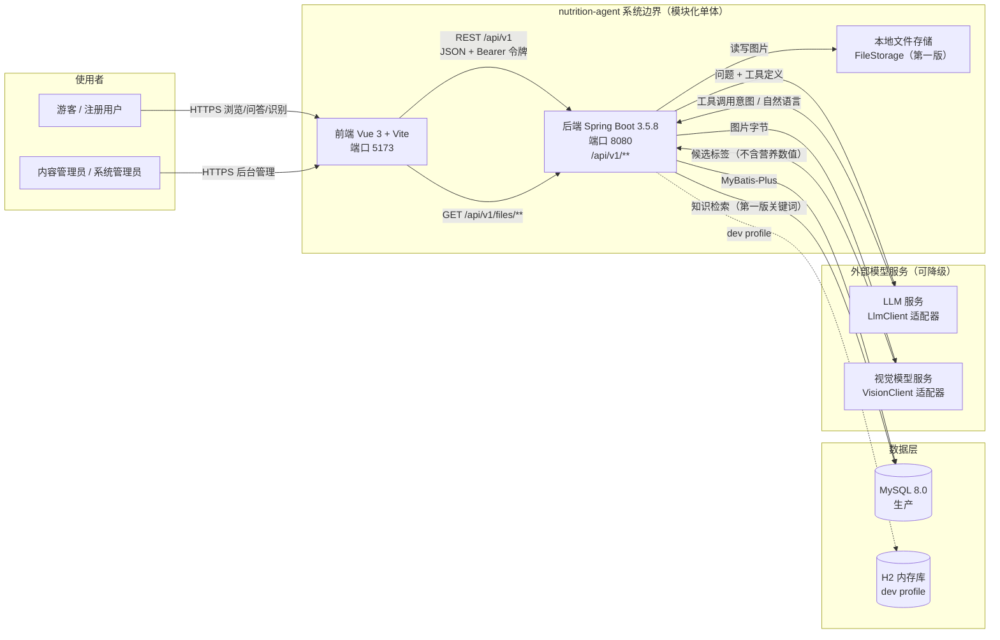
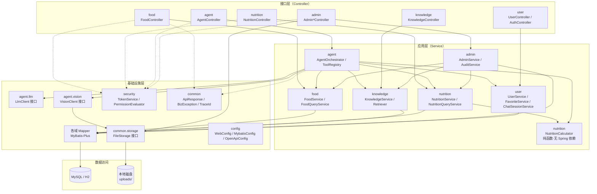
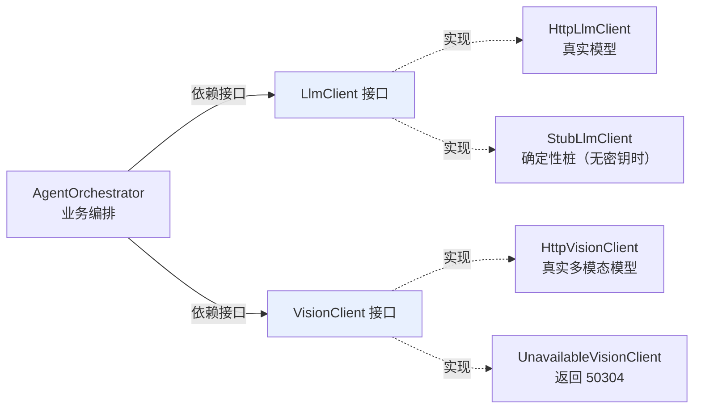
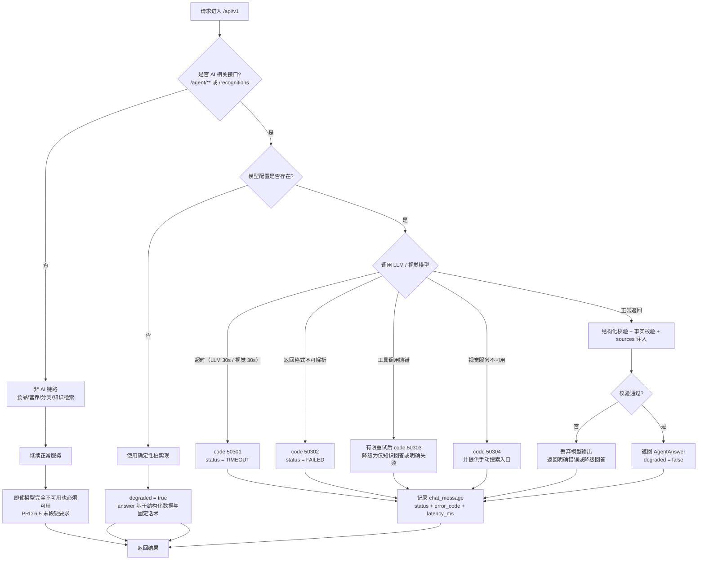
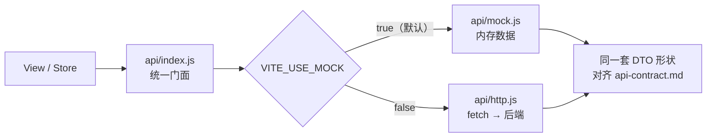

# 系统功能模块图与架构设计 V1.0

> 交付物：对应 **PRD 第十四章第 3 项「系统功能模块图」与第 4 项「系统架构设计文档」**，里程碑标签 **`v0.1.0`**（阶段一：需求分析与设计）。
>
> 契约依据：`nutrition_agent/docs/PRD.md`（第五章功能需求、第六章 Agent、第八章合规、第九章非功能）、
> `docs/db/schema.sql` V1.0（含 `[D1]`~`[D8]`）、`docs/api-contract.md` V1.0、`docs/use-cases.md` V1.0、`README.md`。
> 本文件不引入任何 schema 与 API 契约之外的新表、新字段或新接口。

---

## 一、系统上下文图



### 1.1 边界与数据流说明

| 边界 | 内容 | 规则 |
| --- | --- | --- |
| 前端 ↔ 后端 | 仅通过 `/api/v1/**` 通信 | 契约唯一依据为 `docs/api-contract.md`；前端不直连数据库 |
| 后端 ↔ 数据库 | 仅 MyBatis-Plus Mapper 访问 | 业务层不得拼接 SQL；DDL 唯一来源 `docs/db/schema.sql` |
| 后端 ↔ 模型服务 | 仅通过 `LlmClient` / `VisionClient` 接口 | **业务代码不出现任何厂商 SDK 类型**，模型可替换（见 ADR-09） |
| 后端 ↔ 文件存储 | 仅通过 `FileStorage` 接口 | 第一版 `LocalFileStorage`；对象存储为第二实现，`/files/**` 路径形态不变（见「⚠️ 待确认」T-08） |
| 模型服务不可用 | 只影响 `/agent/**` 与 `/recognitions` | `/foods/**`、`/nutrition/**`、`/categories`、`/knowledge/**` **必须继续可用**（PRD 6.5 末段） |

> **关键观察**：图中把 LLM 与视觉模型放在「可降级的外部依赖」框内，而不是核心链路。
> 这是刻意的架构表达——PRD 6.5 要求模型服务挂掉时非 AI 功能不受影响，
> 因此模型调用**不允许**出现在食品查询或营养计算的事务路径上。

---

## 二、功能模块图

### 2.1 后端包结构与模块职责



### 2.2 模块职责边界与对外能力

| 包路径 | 职责边界（负责什么） | 不负责（明确排除） | 对外暴露能力 | 对应 FR |
| --- | --- | --- | --- | --- |
| `com.nutritionagent.common` | 统一响应 `ApiResponse`、业务异常 `BizException`、错误码常量、`TraceId` 生成、`FileStorage` 接口、通用校验 | 任何业务语义 | `ApiResponse.ok/fail`、`BizException`、`FileStorage` | 9.4 |
| `com.nutritionagent.config` | `WebConfig`（拦截器注册）、`MybatisConfig`、`OpenApiConfig`、`JacksonConfig`、异步与线程池 | 业务规则 | Spring 配置类 | 9.4 |
| `com.nutritionagent.security` | 令牌签发与校验、`PermissionEvaluator`、`@RequirePermission` 注解与拦截器、登录态解析 | 用户资料业务、角色分配业务 | `TokenService.issue/verify`、`PermissionEvaluator.has(perm)` | FR-007、9.2 |
| `com.nutritionagent.food` | 分类树、食品主数据、别名、图片元数据、公开搜索与详情查询、默认可食形态选择 | **不持有任何营养数值**；不做营养计算 | `FoodQueryService.search()`、`detail()`、`featured()`、`related()` | FR-001/002/003 |
| `com.nutritionagent.nutrition` | 营养素字典、营养三态读写、参考重量口径、确定性计算、单位归一 | 不生成自然语言、不调用模型 | `NutritionQueryService.table()`、`NutritionCalculator.compute()` | FR-004 |
| `com.nutritionagent.agent` | 意图识别、工具注册与编排、知识检索调用、`sources` 注入、事实校验、LLM/视觉适配、降级决策 | **不直接写 SQL**、**不自行计算营养数值**、不决定发布状态 | `AgentOrchestrator.chat()`、`ToolRegistry`、`LlmClient`、`VisionClient` | FR-005/006/011、第六章 |
| `com.nutritionagent.knowledge` | 知识文档与分块管理、关键词检索、来源与适用范围携带、索引重建 | 不生成回答文本、不做安全判断 | `KnowledgeSearchService.search()`、`KnowledgeAdminService.reindex()` | FR-010 |
| `com.nutritionagent.user` | 注册登录、资料与偏好、收藏、会话与消息、个人数据删除 | 不管理角色权限定义（属 admin） | `AuthService`、`UserService`、`FavoriteService`、`ChatSessionService` | FR-007/008 |
| `com.nutritionagent.admin` | 食品/形态/营养/图片/知识的后台读写、审核、发布、用户角色管理、审计日志查询 | 不做前台查询优化、不绕过权限 | `AdminFoodService`、`AdminNutritionService`、`ReviewService`、`AuditService` | FR-009 |

> **依赖方向铁律**：`admin → food/nutrition/knowledge` 允许；反向**禁止**。
> 即 `food` 包内不得出现 `AdminFoodService` 的引用，否则前台查询会被后台逻辑污染，
> 「草稿不对普通用户开放」将失去结构性保障。

---

## 三、分层架构说明

### 3.1 三层职责

| 层 | 典型类 | 职责 | 禁止事项 |
| --- | --- | --- | --- |
| **Controller** | `FoodController`、`AgentController` | 参数绑定与 Bean Validation、调用 Service、组装 `ApiResponse`、读取登录态 | 禁止写业务分支；禁止直接调 Mapper；禁止捕获异常后自行编造响应 |
| **Service** | `FoodService`、`AgentOrchestrator` | 业务规则、事务边界、多域协调、权限语义判断 | 禁止出现 HTTP 类型（`HttpServletRequest`）；禁止返回 `ResponseEntity` |
| **Mapper / Repository** | `FoodMapper`、`NutritionValueMapper` | 单表与受控联表查询、乐观并发、逻辑删除条件 | 禁止包含业务判断；禁止在 SQL 中做单位换算（换算在 `NutritionCalculator`） |

**统一异常出口**：Service 抛 `BizException(errorCode, message)`，由 `common` 的 `@RestControllerAdvice`
统一转换为 `ApiResponse`（`code != 0`），并按 `docs/api-contract.md:36-37` 同时设置 HTTP 语义状态码。
Controller 不写 `try/catch`。

### 3.2 落地一：AI 模型调用与业务逻辑解耦



| 解耦手段 | 具体做法 | 收益 |
| --- | --- | --- |
| 接口隔离 | `AgentOrchestrator` 只依赖 `LlmClient` / `VisionClient` 接口 | 更换厂商不动业务代码 |
| 实现可切换 | Spring 条件装配：有密钥 → `HttpLlmClient`；无密钥 → `StubLlmClient` | `dev` 环境零外部依赖即可跑通全链路 |
| 输出结构化 | 适配器内部完成"厂商响应 → `AgentAnswer` DTO"的转换，向上只暴露契约 DTO | 模型返回格式变化被隔离在适配器内（对应异常 `50302`） |
| 超时与重试 | 超时、有限重试配置在适配器内部，业务层只见最终结果或异常 | 避免业务层散落重试逻辑（PRD 9.3） |
| 可观测 | 适配器记录 `model_name`、`latency_ms`、`token_usage` 到 `chat_message` | 支撑 PRD 2.2「工具调用成功率」统计 |

> **硬规则**：`docs/api-contract.md:300` 要求 `sources` 由工具层注入、模型自述来源一律丢弃。
> 因此 `LlmClient` 的返回类型**不包含** `sources` 字段——不是靠代码检查，而是**类型上就没有这个位置**。

### 3.3 落地二：营养计算是可独立测试的确定性逻辑

```java
// backend/src/main/java/com/nutritionagent/nutrition/NutritionCalculator.java
// 纯函数：无 Spring 注解、无静态可变状态、无 IO、无时间依赖；相同输入必得相同输出
public final class NutritionCalculator {

    private NutritionCalculator() {}   // 工具类，禁止实例化

    /**
     * 某营养素摄入量 = 每 referenceAmount 营养素含量 × 实际食用重量 ÷ referenceAmount
     * 再按 nutrient.unit_factor 归一到 base_unit。
     *
     * @param rows    该形态的营养行（已按 nutrient 分组，含三态标记）
     * @param weight  实际食用重量（已归一到 g/ml），由调用方校验 > 0
     * @return 结果项 + 缺失营养素清单；MISSING 行绝不进入结果项
     */
    public static CalculationResult compute(List<NutritionRow> rows, BigDecimal weight) { ... }
}
```

| 设计要点 | 说明 |
| --- | --- |
| 无 Spring 依赖 | 不注入任何 Bean，可被 JUnit 直接 `new` 或静态调用，测试启动成本为零 |
| 无 IO | 数据由调用方查好后传入，函数只做算术，因此不需要 mock 数据库 |
| 输入输出均为不可变 DTO | 避免测试间互相污染 |
| **`MISSING` 语义在此收口** | `value_status = MISSING` 的行不参与任何求和，只进 `missingNutrients`（对应 `docs/api-contract.md:253`） |
| 单位换算单点 | `amount × referenceFactor × unitFactor` 只在这一处实现，Service 与 Agent 均不得自行换算 |
| 边界值 | `weight` 的上限校验在 Controller/Service 完成（`> 0` 且 `<= 100000` → 否则 `40002`），纯函数只处理已校验输入 |

**必测用例**（对齐 PRD FR-004 验收标准）：`PRESENT` 正常折算、`ZERO` 参与但结果为 0、
`MISSING` 被排除且出现在 `missingNutrients`、`kg`/`l` 单位换算、可食部比例处理、`weight` 边界。

---

## 四、关键设计决策记录（ADR）

### 4.1 来自 schema 的 `[D1]`~`[D8]`

#### ADR-01 `[D1]` 食品形态独立成表，营养数据挂在形态上

| 项 | 内容 |
| --- | --- |
| **背景** | 西红柿（生）与西红柿（炒）的热量差异极大。若营养数据直接挂 `food`，两者共用一个营养集合。 |
| **决策** | 建立 `food_state_variant` 表（`docs/db/schema.sql:234-254`），营养数据的 `variant_id` **NOT NULL**（`docs/db/schema.sql:308`），`food` 表**不含任何营养数值**（`docs/db/schema.sql:187`）。 |
| **理由** | PRD 5.3 要求「生食、熟食、去皮食品及加工食品应在数据允许的情况下分别建档」。数据混用是本项目**最严重的事实性错误来源**——一旦混用，Agent 会把熟食热量当生食热量输出，且不可察觉。 |
| **代价** | 数据录入成本上升（一个食品要建多个形态）；查询必须先确定形态，需要 `is_default` 兜底（`docs/db/schema.sql:243`）。 |
| **强制点** | 外键 + NOT NULL 使「营养数据脱离形态存在」在数据库层面不可能。 |

#### ADR-02 `[D2]` 用三列表达「缺失 / 零 / 有值」

| 项 | 内容 |
| --- | --- |
| **背景** | 仅用 `amount IS NULL` 表达缺失，无法区分「已知该食品脂肪为 0」与「尚未录入脂肪数据」。 |
| **决策** | `value_status VARCHAR(16) NOT NULL DEFAULT 'MISSING'`（取值域 `PRESENT` / `ZERO` / `MISSING`）+ `amount DECIMAL NULL`，并以 CHECK 约束锁定两者一致性（`docs/db/schema.sql` 的 `ck_nv_status_amount`）。 |
| **理由** | PRD 5.4 第 8 条与 FR-004 验收标准明确要求「不会把未知营养成分自动当作零」。这是**可验证的产品承诺**，必须由数据库兜底而非应用层自觉。 |
| **代价** | 写入路径略复杂（必须同时维护两列）；备份/导入工具需理解三态语义。 |
| **强制点** | `ck_nv_status_amount` CHECK：`MISSING→amount IS NULL`、`ZERO→amount = 0`、`PRESENT→amount IS NOT NULL`。任何破坏三态一致性的写入被数据库直接拒绝。 |
| **取值域类型说明** | 用 `VARCHAR(16)` 而**不是** `ENUM`：H2 2.x 的 `MODE=MySQL` 不支持 `ENUM`，而 dev/test profile 必须能在 H2 上建出同一套表（见 `SchemaParityTest`），两者只能取交集。取值域因此有两道强制：DB 层 `ck_nv_status_amount` 兜语义，应用层 Java 枚举兜取值。若要改回 `ENUM`，需先放弃 H2 上的 schema parity，属需单独决策的变更。 |

#### ADR-03 `[D3]` 单位集中在 `nutrient` 字典，数据行不写死单位

| 项 | 内容 |
| --- | --- |
| **背景** | 同一营养素在不同来源中可能以 g / mg / μg 出现。 |
| **决策** | `nutrient` 持有 `unit`、`base_unit`、`unit_factor`（`docs/db/schema.sql:266-274`），`nutrition_value` 只存数值。 |
| **理由** | PRD 5.4 第 6 条要求「对单位换算进行统一处理」。单位若写死在数据行，汇总时必然出现 g 与 mg 相加的错误。 |
| **代价** | 新增营养素须同时确认换算系数，不能随手插数据。 |
| **强制点** | 换算系数的唯一来源是字典，`NutritionCalculator` 单点使用。 |

#### ADR-04 `[D4]` 来源独立成表且 `nutrition_value.source_id` NOT NULL

| 项 | 内容 |
| --- | --- |
| **背景** | PRD 2.2 设定「营养数据来源可追溯率 100%」为验收指标。 |
| **决策** | `data_source` 独立表 + `source_id` NOT NULL 外键（`docs/db/schema.sql:316`）；后台接口缺 `sourceId` 直接 `40001`（`docs/api-contract.md:465-466`）。 |
| **理由** | 若允许 `source_id` 为 NULL，"可追溯率 100%" 立即退化为"可追溯率未知"。演示数据也必须挂一个 `source_type='DEMO'` 的来源（`docs/db/schema.sql:291`），使"演示"本身成为可追溯信息。 |
| **代价** | 录入前必须先建来源记录；演示数据也要维护来源。 |
| **强制点** | NOT NULL + 外键 + 接口校验三重；这是全项目**唯一一条被明确写进契约的硬拒绝**。 |

#### ADR-05 `[D5]` 别名带类型与权重，唯一约束防劫持

| 项 | 内容 |
| --- | --- |
| **背景** | 若把别名混入 `food.name`，「番茄」可能覆盖名为「番茄」的其他食品。 |
| **决策** | `food_alias` 独立表，带 `alias_type` 与 `weight`（`docs/db/schema.sql:189-205`）。 |
| **理由** | PRD 5.2 业务规则「别名不能随意覆盖其他食品的标准名称」；`weight` 同时服务搜索排序（标准名精确 > 前缀 > 别名精确 > 别名包含，`docs/api-contract.md:352`）。 |
| **代价** | 跨食品同名别名需服务层校验（表内唯一约束管不到跨食品），见「⚠️ 待确认」T-04。 |
| **强制点** | `uk_alias_food` 保证同食品内别名不重复；跨食品冲突由服务层返回 `40901`。 |

#### ADR-06 `[D6]` 审核状态与发布状态分离

| 项 | 内容 |
| --- | --- |
| **背景** | PRD 7.4 的发布流程为「创建 → 填来源 → 保存草稿 → 审核 → 发布」。 |
| **决策** | `review_status`（DRAFT/PENDING/APPROVED/REJECTED）与 `publish_status`（UNPUBLISHED/PUBLISHED/OFFLINE）两列独立（`docs/db/schema.sql:170-171`）。 |
| **理由** | 「审核通过」与「对外可见」是两件事：审核通过的内容可能还需要等待统一上线；已发布的内容也可能因数据问题被撤回审核。若合成一个状态，"审核≠发布"无法表达。 |
| **代价** | 状态组合变多（4×3），需要明确合法的状态迁移路径。 |
| **强制点** | 前台查询条件同时包含两个状态（`docs/api-contract.md:350`），因此任何单一状态的误改都不会导致草稿泄漏。 |

#### ADR-07 `[D7]` 内容表统一带审计字段

| 项 | 内容 |
| --- | --- |
| **背景** | PRD 9.3「后台内容修改需要有审计记录」，PRD 2.2 要求营养数据可追溯修改前后。 |
| **决策** | 内容表统一带 `created_by`/`updated_by`/`reviewed_by` + `reviewed_at`；关键变更另写 `admin_audit_log.before_json`/`after_json`（`docs/db/schema.sql:43-44`、`495-511`）。 |
| **理由** | 行内字段回答"当前是谁的版本"，审计表回答"历次改了什么"，两者职责不同。 |
| **代价** | 每次写操作多一次审计写入（建议与业务写在同一事务内）。 |

#### ADR-08 `[D8]` 逻辑删除统一用 `deleted_at`

| 项 | 内容 |
| --- | --- |
| **背景** | 需要支持误删恢复、审计，以及"软删后可重建同名记录"。 |
| **决策** | 统一 `deleted_at DATETIME NULL`（NULL = 未删除）。唯一键写成 `(业务列…, deleted_at, gd_deleted_key)`，其中 `gd_deleted_key` 是生成列：`DATETIME GENERATED ALWAYS AS (IFNULL(deleted_at, '1970-01-01 00:00:00'))`。 |
| **理由** | `is_deleted` 布尔只能回答"是否删了"，不能回答"谁在何时删的"。~~而唯一约束若不带上 `deleted_at`，软删后同名记录将无法重建（MySQL 中 NULL 不参与唯一性比较，正好使未删除行保持互斥）~~ —— **原文这半句是错的**：MySQL 与 H2 中 NULL 都不参与唯一性比较，`(code, deleted_at)` 这种键在未删除行上**根本不生效**，可以插入任意多条重复记录（含 `nutrition_value` 的 `(variant_id, nutrient_id)` 重复，会造成汇总重复计算）。故必须额外用生成列把 NULL 归一为哨兵值：未删除行由此互相冲突（真正的唯一性），软删后哨兵值不同、同名可重建。该不变量由 `SchemaParityTest.logicDeleteUniqueKeysAreNullSafe` 卡住。 |
| **代价** | ① 所有查询必须显式带 `deleted_at IS NULL`，容易漏写 → 由 MyBatis-Plus 逻辑删除全局配置兜底；② 8 张表各多一个生成列（VIRTUAL，不占存储）；③ 同一逻辑身份在同**秒**内被软删两次会被拒绝，属可接受的宁严勿松。 |

### 4.2 架构补充决策

#### ADR-09 为什么用模块化单体而非微服务

| 项 | 内容 |
| --- | --- |
| **背景** | 团队规模小、MVP 要尽快打通闭环；PRD 4.3 把「复杂的多 Agent 协作系统」与「一开始就拆分为微服务」明确列为**暂不纳入第一版**。 |
| **决策** | 单个 Spring Boot 应用，**用包边界代替服务边界**（`food`/`nutrition`/`agent`/`knowledge`/`user`/`admin`），模块间只通过 Service 接口调用。 |
| **理由** | ① 微服务的分布式事务、链路追踪、服务发现成本对一个 MVP 是纯负担；② 本项目的核心风险是**事实准确性**而非吞吐量；③ 包边界已经能防止"营养数据挂到食品上"这类结构性错误。 |
| **代价** | 无法按模块独立扩缩容；模块间是方法调用而非网络调用，边界靠纪律与评审维持。 |
| **迁移路径** | 若未来需要拆分，`agent` 与 `admin` 是最先可独立出去的两个模块（前者依赖外部模型、后者是低频写操作），因为它们的依赖方向已经是单向的。 |

#### ADR-10 为什么自研轻量令牌鉴权而非引入 Spring Security

| 项 | 内容 |
| --- | --- |
| **背景** | 需要登录、登出、角色与权限点判定、令牌失效。 |
| **决策** | 自研 `TokenService`（HMAC-SHA256 签名令牌）+ `PermissionEvaluator` + `@RequirePermission` 拦截器；密码用 BCrypt 散列（`docs/db/schema.sql:63`）。 |
| **理由** | ① README 明确「自研轻量鉴权（HMAC-SHA256 签名令牌），不引入重量级依赖」；② 本项目权限模型极简（4 角色 + 少量权限点），Spring Security 的过滤链、`SecurityContext`、配置 DSL 带来的心智成本大于收益；③ 依赖最少化直接缩小供应链攻击面（PRD 9.2 要求密钥与敏感信息管控）。 |
| **代价** | 需要自行保证：令牌过期、时钟偏移、签名比较使用**常量时间比较**、登出撤销。**这些必须写单元测试**，不能靠"应该没问题"。 |
| **与 schema 的关系** | `sys_auth_token` 支持"可撤销令牌"，与"无状态签名令牌"是两条路线，**必须二选一**——见「⚠️ 待确认」T-09。 |

#### ADR-11 为什么 Agent 结构化输出用 JSON 列而非拆表

| 项 | 内容 |
| --- | --- |
| **背景** | PRD 6.4 规定回答可含 `answer`/`foodReferences`/`nutritionFacts`/`recommendations`/`warnings`/`sources`/`uncertainty`，并明确「字段应根据问题类型选择性返回，而不是强制填充所有字段」。 |
| **决策** | `chat_message.structured_output` 用 JSON 列整体存储（`docs/db/schema.sql:426`），同表另有 `tool_calls` JSON 与 `intent` 标量列用于统计。 |
| **理由** | 若按字段拆表，一次"食品介绍类"回答会产生 5~6 张表的空插入；且字段集合会随产品演进（PRD 9.5 要求可扩展），拆表意味着每次加字段都要改 schema。JSON 列让"按需返回"成为自然表达。 |
| **代价** | 无法对 `nutritionFacts` 内部字段建索引做复杂查询；JSON 内容无数据库级 schema 校验 → 需在应用层用 DTO + 序列化校验保证结构（对应异常 `50302`）。 |
| **边界** | `intent`、`model_name`、`latency_ms`、`token_usage`、`status`、`error_code` **刻意保持为标量列**，因为它们是统计与验收（PRD 2.2 工具调用成功率）的查询维度，不能被埋进 JSON。 |

#### ADR-12 为什么 RAG 第一版只做关键词检索

| 项 | 内容 |
| --- | --- |
| **背景** | PRD FR-010 要求「支持关键词检索，后续支持语义向量检索」。 |
| **决策** | 第一版基于 `knowledge_chunk.keywords` 做关键词检索（`docs/db/schema.sql:386`）；`knowledge_doc.embedding_model` 预留为 NULL（`docs/db/schema.sql:359`）。 |
| **理由** | ① 第一版知识库规模小（PRD 11.4 要求"先整理少量高质量知识文档"），关键词检索足以验证"检索能否帮助 Agent 正确回答"；② 语义检索引入向量库、嵌入模型、索引同步三类新依赖，会推迟 MVP 闭环；③ 先用小规模验证**检索质量是否真的是瓶颈**，避免过早优化。 |
| **代价** | 同义词与语义相近问题召回差。 |
| **扩展点** | `KnowledgeRetriever` 定义为接口，关键词实现为第一实现；升级时新增 `HybridRetriever`（关键词 + 向量混合召回），`knowledge_chunk.keywords` 转为混合检索的一路召回，**检索与引用的最小粒度始终是 chunk**，接口契约不变。 |

---

## 五、横切关注点

| 关注点 | 落点 | 具体做法 | 依据 |
| --- | --- | --- | --- |
| **统一响应** | `common/ApiResponse.java` | `{code, message, data, traceId}`；`code=0` 表示成功，非 0 一律失败 | `docs/api-contract.md:12-37` |
| **统一异常** | `common/GlobalExceptionHandler`（`@RestControllerAdvice`） | `BizException → 契约错误码`；参数校验 → `40001`；未捕获 → `50001`；HTTP 状态码同步设置 | `docs/api-contract.md:61-82` |
| **链路追踪** | `common/TraceIdFilter` | 每请求生成 `traceId`，写入 MDC 与响应体，并落到 `operation_log.trace_id` | `docs/db/schema.sql:520` |
| **日志** | `common/SensitiveDataMasker` + logback 配置 | **禁止**记录：对话正文、个人资料、图片路径、令牌、密码；仅记录 `module`/`action`/`duration_ms`/`error_code` | `docs/db/schema.sql:527`、PRD 8.4 |
| **限流** | `security/RateLimiter`（拦截器） | 问答：登录 30/分钟、游客 5/天；识别：登录 20/小时、游客 3/天；其他读接口 120/分钟；超限 `42901` 且不暴露配额实现 | `docs/api-contract.md:476-484` |
| **审计** | `admin/AuditService` | 后台写操作同事务写 `admin_audit_log`（含 `before_json`/`after_json`），同时更新行内 `updated_by` | PRD 9.3、`docs/db/schema.sql:495-511` |
| **配置管理** | `config` + `application.yml` / `application-dev.yml` | 外部模型地址、超时、重试次数、限额、上传大小均走配置，不硬编码 | PRD 9.5、9.4「核心业务规则应可通过配置维护」 |
| **密钥管理** | 环境变量 / `application-local.yml`（**已 gitignore**） | 密钥**不入仓库**；`.gitignore` 已排除本地配置；仓库内仅保留 `*.example` 占位 | `README.md`、PRD 9.2 |
| **权限** | `security/PermissionEvaluator` + `@RequirePermission` | `/admin/**` 需 `CONTENT_ADMIN` 或 `SYS_ADMIN`，否则 `40301`；权限点粒度可区分两种管理员 | PRD 3.1、`docs/api-contract.md:441-443` |
| **越权防护** | Service 层以令牌 `userId` 为准 | 禁止从路径/请求体接收 `userId`；会话与收藏一律校验归属 | `docs/api-contract.md:438-439` |
| **文件安全** | `common/FileValidator` | MIME 白名单 + **文件头魔数校验** + 大小 ≤10MB；只信扩展名会直接导致安全验收失败 | `docs/api-contract.md:421-422`、PRD 12.4 |

---

## 六、降级设计

### 6.1 降级决策流程图



### 6.2 降级矩阵

| 故障 | 受影响功能 | 必须仍可用 | 错误码 | 用户可见行为 |
| --- | --- | --- | --- | --- |
| LLM 未配置 | 问答 | 食品/营养/分类/知识 | — | `degraded: true`，回答基于结构化数据 |
| LLM 超时 | 问答 | 同上 | `50301` | 明确超时提示，可重试 |
| LLM 格式错误 | 问答 | 同上 | `50302` | 明确"服务暂时异常"，**不透传原始输出** |
| 工具调用失败 | 相关问答 | 同上 | `50303` | 说明哪部分数据未能获取 |
| 视觉服务不可用 | 图片识别 | 食品/营养/分类/知识/问答 | `50304` | 提示可改用**手动搜索**完成流程 |
| 模型完全不可用 | 问答 + 识别 | 食品/营养/分类/知识 | 上述之一 | 非 AI 界面**无感知**继续工作 |

> **架构保障**：模型调用只出现在 `agent` 包内，`food`/`nutrition`/`knowledge` 包的依赖图中
> **不存在** `LlmClient` 或 `VisionClient`（见 2.1 模块图）。因此"模型挂了不影响非 AI 功能"
> 不是靠代码判断实现的，而是**依赖图结构保证**的。

---

## 七、前端架构

### 7.1 目录结构

```
frontend/
├─ index.html
├─ package.json                 Vue 3.5 / Vite 5 / Vue Router 4 / Pinia 2
├─ vite.config.js               dev 代理 /api → http://localhost:8080
├─ .env.development             VITE_USE_MOCK=true
└─ src/
   ├─ main.js                   应用入口，挂载 Pinia 与 Router
   ├─ App.vue
   ├─ api/                      接口层：mock / http 双实现，可开关
   │  ├─ index.js               按 VITE_USE_MOCK 选择实现并导出统一门面
   │  ├─ http.js                fetch 封装：注入 Bearer 令牌、解析 ApiResponse、按 code 抛错
   │  ├─ mock.js                mock 实现（对齐 docs/api-contract.md 的示例响应）
   │  └─ dto.md                 字段来源说明，指向 docs/api-contract.md
   ├─ design/                   设计令牌与基础样式
   │  ├─ tokens.css             原型板块 9：主色 #3B82F6，辅色 #10B981 / #F59E0B / #EF4444 / #6B7280
   │  └─ base.css               排版、间距、通用类
   ├─ components/               通用组件
   │  ├─ FoodCard.vue           energyAvailable=false 时渲染"暂无数据"（严禁 0 兜底）
   │  ├─ NutritionTable.vue     三态渲染：PRESENT / ZERO / MISSING
   │  ├─ ValueStatusText.vue    三态文案与样式统一出口
   │  ├─ SourceTag.vue          来源展示（sources 由后端注入）
   │  ├─ VariantSwitcher.vue    形态切换（生/熟/去皮/加工）
   │  ├─ UncertaintyNotice.vue  uncertainty 非空时必须可见
   │  └─ CandidateList.vue      识别候选 + confidence + 手动搜索入口
   ├─ views/                    页面（对齐 ROADMAP 路由表）
   │  ├─ HomeView.vue                    /
   │  ├─ SearchView.vue                  /search
   │  ├─ CategoryView.vue                /category/:slug
   │  ├─ FoodDetailView.vue              /food/:id
   │  ├─ ChatView.vue                    /chat
   │  ├─ RecognizeView.vue               /recognize
   │  ├─ ReportView.vue                  /report/:foodId
   │  ├─ LoginView.vue                   /login
   │  ├─ MeView.vue                      /me
   │  └─ admin/
   │     ├─ AdminLayout.vue              /admin
   │     ├─ FoodAdminView.vue            /admin/foods
   │     ├─ NutritionAdminView.vue       /admin/nutrition
   │     ├─ KnowledgeAdminView.vue       /admin/knowledge
   │     └─ UserAdminView.vue            /admin/users
   ├─ stores/                   Pinia
   │  ├─ auth.js                令牌与当前用户
   │  ├─ chat.js                会话与消息
   │  └─ food.js                搜索与详情缓存
   └─ router/
      └─ index.js               路由表 + 权限守卫（/admin/** 校验角色）
```

### 7.2 API 层 mock / http 双实现切换机制



| 要点 | 说明 |
| --- | --- |
| 切换开关 | `VITE_USE_MOCK`；默认 `true`，实现"接口先行、前后端并行"（`README.md:115-116`） |
| 同一门面 | View/Store **只 import `api/index.js`**，不感知实现，切换零改动 |
| DTO 一致性 | `mock.js` 的字段名、类型、三态语义必须与 `docs/api-contract.md` 完全一致；**mock 里也要能造出 `MISSING` 与 `energyAvailable=false`**，否则三态渲染无法在前端验证 |
| 错误路径 | mock 同样按 `code` 抛错（如 `40002`、`40401`），使前端的错误分支在无后端时也可测 |
| 切换后验证 | 切到 `http` 后必须回归 `/`、`/search`、`/food/:id`、`/chat`、`/recognize`、`/report/:foodId` 六条主链路 |

### 7.3 路由表（对齐 `docs/ROADMAP.md` 的「原型界面 → 页面实现对照」）

| 路由 | 页面 | 对应原型板块 | 对应 FR | 鉴权 |
| --- | --- | --- | --- | --- |
| `/` | 首页 | 1. 首页（整体布局） | FR-001 | 公开 |
| `/search` | 搜索结果页 | 2. 食品搜索 / 分类浏览页 | FR-002 | 公开 |
| `/category/:slug` | 分类浏览页 | 2. 食品搜索 / 分类浏览页 | FR-002 | 公开 |
| `/food/:id` | 食品详情页 | 3. 食品详情页 | FR-003、FR-004 | 公开 |
| `/chat` | AI 营养师问答页 | 4. AI 营养师问答页 | FR-005、FR-011 | 公开（游客限次） |
| `/recognize` | 图片识别页 | 5. 图片识别页 | FR-006 | 公开（游客限次） |
| `/report/:foodId` | 营养分析报告页 | 6. 营养分析报告页 | FR-004、FR-012 | 公开 |
| `/login` | 登录与注册（单页双态） | 侧边栏「我的健康」 | FR-007 | 公开 |
| `/me` | 个人中心（含收藏与历史） | 侧边栏「我的健康」 | FR-007、FR-008 | 登录 |
| `/admin` | 后台管理首页 | 7. 管理后台（示例） | FR-009 | `CONTENT_ADMIN` / `SYS_ADMIN` |
| `/admin/foods` | 食品管理页 | 7. 管理后台（示例） | FR-009 | 同上 |
| `/admin/nutrition` | 营养数据管理页 | 7. 管理后台（示例） | FR-009 | 同上 |
| `/admin/knowledge` | 知识库管理页 | 7. 管理后台（示例） | FR-010 | 同上 |
| `/admin/users` | 用户与权限管理页 | 7. 管理后台（示例） | 角色 D | `SYS_ADMIN` |
| `/docs` | 说明页（承载流程图等说明性内容） | 8. 主要功能流程图 | — | 公开 |

> 原型板块 9（设计风格参考）不产生路由，落在 `frontend/src/design/tokens.css`。
> `docs/ROADMAP.md:30` 要求实现侧边栏的「我的健康」入口，落在 `/me`。
> 路由守卫只做**体验层**拦截（无权限时跳转），真正的权限判定必须在后端（`40301`）。

### 7.4 前端必须遵守的三态渲染规则

| 后端字段 | 前端渲染 | 禁止 |
| --- | --- | --- |
| `valueStatus = PRESENT` | 按 `displayText` 展示数值 + 单位 | — |
| `valueStatus = ZERO` | 展示 `0` + 单位，样式与 PRESENT 一致 | **不得**显示"暂无数据" |
| `valueStatus = MISSING` | 显示"暂无数据"，`amount` 为 `null` | **严禁用 0 兜底** |
| `energyAvailable = false` | 卡片不展示热量数值 | **严禁**展示 `0 kcal` |
| `incomplete = true` | 显示"数据不完整"提示与 `missingCount` | 不得静默忽略 |
| `uncertainty` 非空 | 可见地展示不确定性说明 | 不得静默丢弃（`docs/api-contract.md:301`） |
| `degraded = true` | 提示当前为降级回答 | 不得伪装成完整回答 |

---

## 八、可扩展性落地（PRD 9.5）

| 扩展需求 | 具体做法 | 需要改动的文件 | 不需要改动 |
| --- | --- | --- | --- |
| **新增食品分类** | 在 `food_category` 插入一行（支持 `parent_id` 多级） | 无需改代码；仅需运营数据 | 前后端代码、schema |
| **新增营养素指标** | 在 `nutrient` 插入一行（含 `unit`/`base_unit`/`unit_factor`/`display_order`），再录 `nutrition_value` | 无需改代码；仅需运营数据 | schema、计算逻辑（换算已数据驱动） |
| **新增视觉模型** | 新增 `VisionClient` 实现类，配置层切换 Bean | `backend/src/main/java/com/nutritionagent/agent/vision/<NewVisionClient>.java`、`backend/src/main/java/com/nutritionagent/config/ModelConfig.java` | `AgentOrchestrator`、契约 DTO、前端 |
| **新增 LLM 服务** | 新增 `LlmClient` 实现类，配置层切换 Bean | `backend/src/main/java/com/nutritionagent/agent/llm/<NewLlmClient>.java`、`backend/src/main/java/com/nutritionagent/config/ModelConfig.java` | `AgentOrchestrator`、`AgentAnswer` 结构、前端 |
| **新增知识检索方案** | 实现 `KnowledgeRetriever` 接口（关键词 → 混合召回）；`knowledge_doc.embedding_model` 记录模型标识；`knowledge_chunk` 仍是索引最小粒度 | `backend/src/main/java/com/nutritionagent/knowledge/retriever/<NewRetriever>.java`、`config/KnowledgeConfig.java` | `knowledge_chunk`/`knowledge_doc` 表结构、`GET /knowledge/search` 契约 |
| **新增食品图片与食谱** | 复用 `food_image`（`image_type` 已含 `RECIPE`） | 无需改代码 | schema、接口 |
| **切换对象存储** | 实现 `FileStorage` 的第二实现（如 `S3FileStorage`），`/files/**` 路径形态不变 | `backend/src/main/java/com/nutritionagent/common/storage/S3FileStorage.java`、`config/StorageConfig.java` | 业务代码、契约、前端 |
| **饮食记录与每日汇总（FR-012）** | 新增表（`diet_record` 等）与 `nutrition.summary` 服务；**复用 `NutritionCalculator`** | 新增 schema 段、新增 `backend/.../nutrition/DailySummaryService.java`、新增接口段 | 既有表与既有接口 |

> **可扩展性的真实判据**：上表右列"不需要改动"的内容越多，扩展成本越低。
> 其中"新增营养素指标不改代码"与"新增 LLM 不改业务代码"是本架构**刻意保留的两个最重要的扩展点**——
> 前者靠单位换算数据驱动，后者靠适配器接口隔离。

---

## ⚠️ 待确认

> 本节与 `docs/use-cases.md` 的「⚠️ 待确认」互补，聚焦**架构层面**的待定项。
> **本文件不擅自修改** `docs/db/schema.sql`、`docs/api-contract.md`、`README.md`、`docs/ROADMAP.md`。

| 编号 | 问题 | 位置 | 架构影响 | 建议 |
| --- | --- | --- | --- | --- |
| **A-01** | 令牌方案未最终确定：`sys_auth_token` 表支持"可撤销的有状态令牌"，而 `README.md` 描述为 HMAC-SHA256 签名令牌（通常无状态）。 | `docs/db/schema.sql:98-110`；`README.md:39`；ADR-10 | 决定 `TokenService` 是否需要每次请求查库；影响登出语义、性能与限流实现位置 | 二选一并写入契约：① 有状态（令牌散列入库，登出即撤销）；② 无状态签名 + 撤销黑名单（`sys_auth_token` 语义改为黑名单）。**推荐 ①**，因为已有表结构且语义直白，MVP 流量下查库成本可接受 |
| **A-02** | 游客配额的存储位置未定（内存 vs 落库）。 | `docs/api-contract.md:480-481`；`docs/use-cases.md` T-05 | 若纯内存，重启清零，PRD 3.1「有限次数」可被绕过；若落库，需要一个按天计数的载体 | 建议落库：复用 `operation_log` 统计（`module='AGENT'`/`'RECOGNITION'` 按 `user_id`/`guest_key` + 日期计数），避免新增表；或明确接受"重启即重置"并写入契约 |
| **A-03** | 图片审核（`food_image.review_status`）与营养审核（`nutrition_value.review_status`）缺少驱动接口，且不清楚是否与食品审核联动。 | `docs/db/schema.sql:222`、`318`；`docs/api-contract.md:451-457`；`docs/use-cases.md` T-02、T-03 | 影响 `admin` 包的审核服务设计：是"一物一审"还是"随父审核级联" | 建议明确为**级联审核**：审核食品时，其 `PENDING` 的图片与营养数据一并进入审核结果，`reviewed_by`/`reviewed_at` 同步写入；如需独立审核，则须补契约接口 |
| **A-04** | 知识文档缺少发布/下架/删除接口，导致 `knowledge_doc.publish_status` 无法被驱动。 | `docs/api-contract.md:458-461`；`docs/use-cases.md` T-01 | `knowledge` 模块的后台能力不完整，UC-25/UC-28 无法实现 | 补 `POST /admin/knowledge/{id}/review`、`POST /admin/knowledge/{id}/publish`、`DELETE /admin/knowledge/{id}` |
| **A-05** | `image_recognition.session_id` 无外键约束。 | `docs/db/schema.sql:449` | 会话删除后留下悬空引用；与其他表的一致性策略不一致 | 补外键或注明"有意不约束"（例如为支持游客会话清理后保留识别审计） |
| **A-06** | `FoodImage`/`variant` 与 `food` 的"默认可食形态"唯一性没有数据库约束。 | `docs/db/schema.sql:243` | 同一食品可能出现多个 `is_default=1`，详情页默认形态不确定 | 服务层保证唯一（设置新默认时清除旧的），并补测试；或引入生成列 + 唯一索引 |
| **A-07** | `GET /foods/search` 的 `sort` 参数含 `energyAsc`/`energyDesc`，但能量值可能为 `MISSING`。 | `docs/api-contract.md:348` | 排序语义未定义：缺失能量的食品应排在最前、最后还是排除？ | 建议明确：`MISSING` 一律排在末尾（不与 `ZERO` 混同），并在契约中写明 |
| **A-08** | 前端 `tokens.css` 的色值与原型图板块 9 一致，但原型未给出字体、圆角、阴影规范。 | `frontend/src/design/tokens.css`（待建） | 视觉一致性的判据不完整 | 在 `tokens.css` 建立完整令牌时同步回写一份规范到 `docs/`，作为验收依据 |

---

## 附：交付物与用例追溯

| 本文档章节 | 对应 PRD 交付物 | 对应里程碑 | 覆盖的用例（`docs/use-cases.md`） |
| --- | --- | --- | --- |
| 一、系统上下文图 | 第十四章第 3、4 项 | `v0.1.0` | 全部（边界定义） |
| 二、功能模块图 | 第十四章第 3 项 | `v0.1.0` | UC-01~UC-29（模块归属） |
| 三、分层架构说明 | 第十四章第 4 项 | `v0.1.0` | UC-06（计算纯函数）、UC-08~UC-10（模型解耦） |
| 四、ADR | 第十四章第 4 项 | `v0.1.0` | UC-05、UC-23（`[D1]`~`[D4]`）、UC-24/25（`[D6]`） |
| 五、横切关注点 | 第十四章第 4 项 | `v0.1.0` | UC-16、UC-18、UC-29、UC-37、UC-38 |
| 六、降级设计 | 第十四章第 4 项 | `v0.1.0` | UC-33~UC-36 |
| 七、前端架构 | 第十四章第 9 项 | `v0.4.0` | UC-01~UC-18（界面承载） |
| 八、可扩展性落地 | 第十四章第 4 项 | `v0.1.0` | UC-21~UC-28（运营扩展） |
