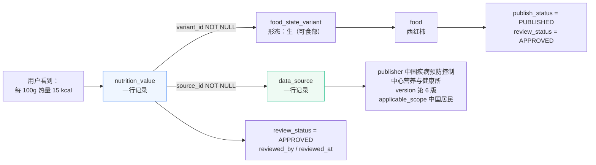
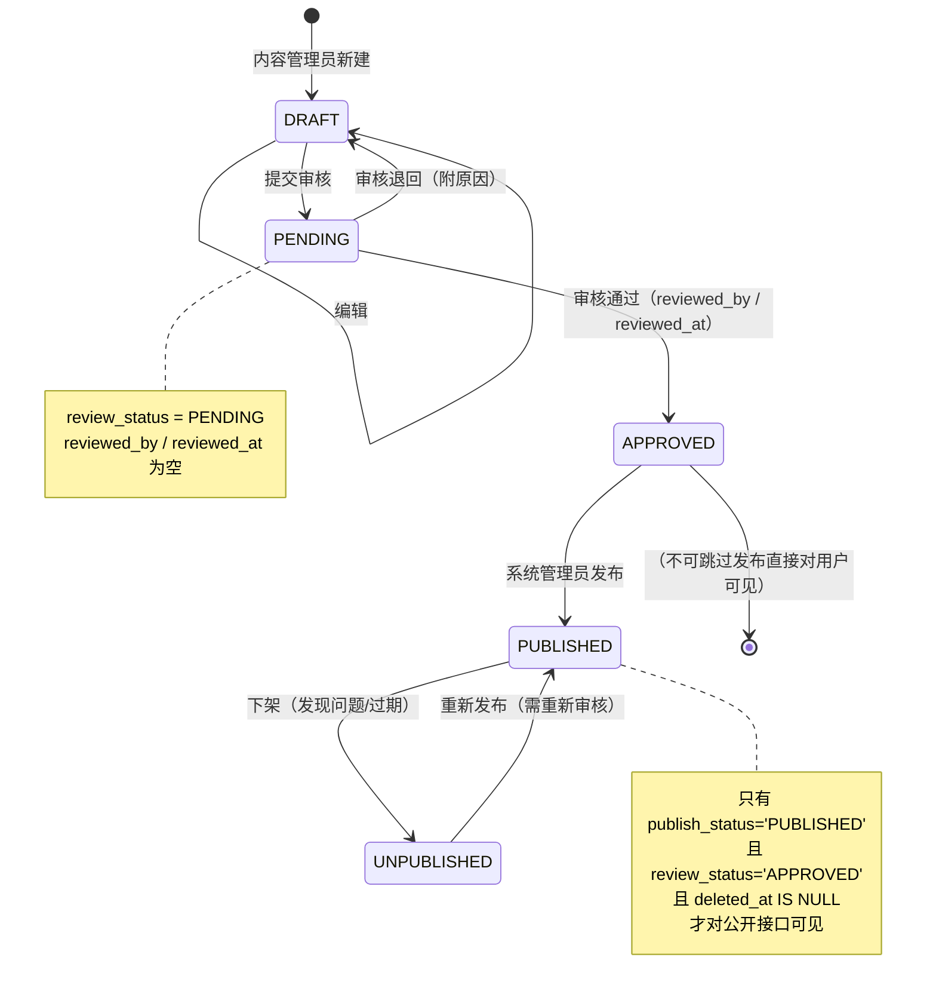

# 营养知识库与数据来源规范 V1.0

> 交付物：对应 **PRD 第十四章第 8 项「营养知识库与数据来源规范文档」**，里程碑标签 **`v0.1.0`**（阶段一：需求分析与设计）。
>
> 契约依据：`nutrition_agent/docs/PRD.md`（5.4、5.8、5.9、7.3、8.1、10.3、11.1、12.1、12.3）、
> `docs/db/schema.sql` V1.0、`docs/api-contract.md` V1.0、`docs/use-cases.md` V1.0、`README.md`（数据来源规范条目）、
> `docs/ROADMAP.md`（阶段一交付物 8、已知技术债务）。
>
> **本文件不引入任何 schema、API 契约、PRD 之外的新表、新字段、新接口。**
> 表名、字段名、枚举值、错误码全部取自 `docs/db/schema.sql` 与 `docs/api-contract.md`。
>
> **本文的核心命题也只有一句**：让"来源可追溯率 100%"（PRD 2.2 验收指标）成为**一条可执行的 SQL 校验**，
> 而不是一句口号。

---

## 一、数据来源模型与分级

### 1.1 来源的四个维度

PRD 10.3 要求数据来源可追溯，PRD 11.1 要求"营养数据必须标注来源"。一份合格的来源必须能回答四个问题：

| 维度 | 字段落点（`data_source` 表） | 回答的问题 | 缺失后果 |
| --- | --- | --- | --- |
| **谁发布的** | `publisher` | 这是个机构还是一条网帖？ | 无法判断权威性 |
| **什么版本** | `version` + `publish_date` | 用的是哪年版？ | 数值无法复现，新旧版本混淆 |
| **适用于谁** | `applicable_scope` | 中国人还是美国人？成人还是儿童？ | 拿别国数据回答中国用户，结论不可用 |
| **从哪能看到** | `url` | 普通用户如何自行核对？ | 来源不可独立验证，等于没有来源 |

> `applicable_scope` 不是装饰字段。PRD 8.1 要求"不同人群用不同参考值"，而 `applicable_scope` 是知识 chunk 与
> 结构化数据在**适用人群**上的唯一落点。Agent 在引用时必须尊重它（见 `docs/agent-design.md` FV-11/FV-12）。

### 1.2 可追溯链路（必须闭合成环）



**链路上任何一个 `→` 断开，该条数值就不得对用户展示。** 第 6 节把这个原则写成可执行的校验规则。

### 1.3 来源分级（A / B / C 三级 + 专用级）

⚠️ **本文档的分级不是 schema 中的新列**，而是**对 `data_source.source_type` 已有取值的业务解释与准入约束**。
本节不新增字段（该限制已记入 `⚠️ 待确认` T-25）。**下表的取值域与 `docs/db/schema.sql` 的 `data_source.source_type`
逐字一致**，并由 schema 的 `ck_source_type` CHECK 强制（T-27 已因此关闭，见第十节）。

| 级别 | 名称 | 对应 `source_type` 取值 | 典型示例 | 可用于营养数值 | 可用于知识引用 | 可用于对外发布 |
| --- | --- | --- | --- | :---: | :---: | :---: |
| **A** | 国家级权威数据 | `OFFICIAL`、`DATABASE` | 《中国食物成分表（标准版）》 | ✅ 首选 | ✅ | ✅ |
| **A** | 国家级指南与标准 | `GUIDELINE` | 《中国居民膳食指南（2022）》、GB 28050 | ✅（限其明确的参考值） | ✅ 首选 | ✅ |
| **B** | 学术文献与综述 | `LITERATURE` | 同行评议期刊的系统综述、Meta 分析 | ⚠️ 仅作**补充与说明**，不得作为某食品主营养数值的唯一来源 | ✅（须带 `valid_until`） | ✅（须标注文献信息） |
| **B** | 行业标准与权威机构 | `STANDARD` | 学会/协会发布的行业标准、技术规范 | ⚠️ 同上 | ✅ | ✅ |
| **C** | 科普与商业资料 | `COMMERCIAL`、`OTHER` | 企业官网、品牌手册、科普网站 | ❌ **禁止** | ⚠️ 仅可作背景说明，**不得**作为健康建议依据 | ⚠️ 须逐条审批 |
| **专用** | 演示数据 | `DEMO` | 仓库内 `dev`/`demo` 种子数据 | ✅ 仅限开发与自动化测试 | ❌ | ❌ **绝对禁止** |
| **专用** | 用户自建 | `CUSTOM` | 内容管理员录入的临时条目 | ⚠️ 须先"转正"为 A/B 级才可发布 | ❌ | ❌（未转正前） |

> **为什么 B 级不能作为主营养数值来源**：学术文献报告的是**研究条件下的测量值**，其样本、地区、品种、检测方法
> 与"食物成分表"的**代表性均值**不是同一概念。用单篇文献的数值充当某食品的通用营养值，会引入不可控偏差。
> 因此 B 级数值的定位是"**补充说明**"（如说明某成分的变异范围），而非"**事实基线**"。
>
> **取值域的唯一权威是 `docs/db/schema.sql` 的 `data_source.source_type`**（`VARCHAR(24) NOT NULL DEFAULT 'DATABASE'`
> + `ck_source_type` CHECK）。上表与它逐字对应，**没有"表里有、库里没有"的取值**；
> 若将来 schema 新增取值而本表未同步，**默认按 C 级处理**（保守原则：未分类的一律不给最高权限）。

### 1.4 A 级来源的准入判据（五条全过才算 A 级）

| # | 判据 | 反例（不算 A 级） |
| --- | --- | --- |
| 1 | 由**国家级机构**发布或经其审定 | 某健康门户整理的数据表 |
| 2 | 有**明确的版本号与发布日期** | "最新数据"（无版本） |
| 3 | 有**明确的方法学说明**（取样、检测、统计口径） | 只给一个数字，无口径 |
| 4 | 有**可核验的正式出处**（`url` 或 ISBN/标准号） | 只有二手转述 |
| 5 | 有**明确的适用人群与地域**（`applicable_scope`） | "通用值" |

> 五条中任一条不满足 → 降为 B 级；再缺两条以上 → 降为 C 级。
> 内容管理员在录入 `data_source` 时，**必须在 `note` 中逐条说明五条判据的满足情况**（见 2.2）。

---

## 二、`data_source` 主数据表规范

### 2.1 字段使用规范

| 字段 | 是否必填 | 填写规范 | 常见错误 |
| --- | :---: | --- | --- |
| `code` | ✅ | **稳定、唯一、大写下划线**的业务编码。一经使用**不得改名**（改名会断开历史数据的追溯链），需变更时新增一条记录并停用旧记录 | 用中文名当 code；随版本改 code |
| `name` | ✅ | 标准名称，**不得使用简称或宣传性表述** | 写"权威数据" |
| `source_type` | ✅ | 严格取自 schema 枚举；不确定时**从低**（C 级） | 把企业资料标成 `OFFICIAL` |
| `publisher` | ✅ | **发布机构全称**，不用简称 | 写"疾控中心"而非全称 |
| `version` | ✅ | 版本号 + 年份，如 `第 6 版 / 2022` | 写"最新版" |
| `publish_date` | ✅ | 精确到日 | 只写年份 |
| `url` | ❌（A 级建议必填） | 官方可访问地址；无公开 URL 时填 ISBN / 标准号 | 填二手转载页 |
| `applicable_scope` | ✅ | 人群 + 地域 + 状态，如"中国居民一般人群，成人" | 留空；写"全体" |
| `note` | ✅（A 级） | A 级来源须写明 1.4 节五条判据的满足情况；其他写明限制条件 | 写"来源可靠" |

### 2.2 录入示例（可直接作为种子数据的参照格式）

```sql
-- 示例 1：A 级 — 国家级食物成分数据（正式对外数据必须来自此类来源）
INSERT INTO data_source (code, name, source_type, publisher, version, publish_date,
                         url, applicable_scope, note)
VALUES ('CN_FOOD_COMPOSITION_6', '中国食物成分表（标准版 第6版）', 'OFFICIAL',
        '中国疾病预防控制中心营养与健康所', '第6版 / 2018', '2018-09-01',
        NULL, '中国居民一般人群，成人',
        'A级判据：①国家级机构发布②有明确版本与日期③含取样与检测方法学说明④以正式出版物（ISBN）核验⑤明确适用人群与地域。仅可使用其中"可食部/生"相关条目；熟制条目须核对烹饪方式是否与本平台 variant.cooking_method 一致。');

-- 示例 2：A 级 — 膳食指南（用于摄入参考与知识库）
INSERT INTO data_source (code, name, source_type, publisher, version, publish_date,
                         url, applicable_scope, note)
VALUES ('CN_DIETARY_GUIDELINE_2022', '《中国居民膳食指南（2022）》', 'GUIDELINE',
        '中国营养学会', '2022版', '2022-04-26',
        NULL, '中国居民一般人群',
        'A级判据：①国家级学会发布②明确版本日期③含制定方法学④以正式出版物核验⑤明确适用人群。用于摄入量参考与营养知识条目；引用时必须带份量口径，不得脱离原文条件概括。');

-- 示例 3：B 级 — 学术文献（仅作补充说明，须设复核期限）
INSERT INTO data_source (code, name, source_type, publisher, version, publish_date,
                         url, applicable_scope, note)
VALUES ('LIT_FIBER_META_2019', '膳食纤维摄入与代谢指标的系统综述', 'LITERATURE',
        '某营养学期刊', 'Vol.XX No.X', '2019-06-15',
        NULL, '成人一般人群（研究纳入人群）',
        'B级：仅作为某营养素作用机制的补充说明，不得作为任何食品主营养数值的唯一来源。引用时必须保留原文限定条件（如"部分研究显示"），禁止概括为普遍结论。');

-- 示例 4：演示数据（严禁对外发布）
INSERT INTO data_source (code, name, source_type, publisher, version, publish_date,
                         url, applicable_scope, note)
VALUES ('DEMO_DATASET', '演示数据集（不可用于对外发布）', 'DEMO',
        '项目自建', 'v1', '2026-10-01',
        NULL, '仅用于开发与自动化测试，无适用人群',
        '本数据集数值仅用于打通流程与自动化测试，不具备任何营养学依据，不得在任何对外可见的食品或知识条目中被引用。');
```

> 示例 4 与 `README.md` 数据来源规范条目的要求逐字一致：
> *"仓库内 `dev`/`demo` 种子数据仅用于打通流程与自动化测试，数值标注为（演示数据），不得直接作为对外发布的权威营养数据。"*

---

## 三、各类数据的来源规范

### 3.1 营养数据（`nutrition_value` 表）

**这是全项目来源要求最严格的数据类别。**

| # | 规范 | 落点 | 依据 |
| --- | --- | --- | --- |
| N1 | `source_id` **必须非空** | `nutrition_value.source_id` NOT NULL + 外键 | schema.sql:316；`README.md` 工程约束 5 |
| N2 | 每个来源必须能区分 **`unit` / `reference_amount` / `reference_unit`** | 单位落 `nutrient.unit`（NOT NULL，[D3]）；参考重量落 `nutrition_value.reference_amount` / `reference_unit`（均 NOT NULL） | PRD 11.1（单位、参考重量、食品状态、来源四项缺一不可） |
| N3 | 必须绑定**具体食品形态** `variant_id` | `nutrition_value.variant_id` NOT NULL | schema.sql:308-312（`[D1]`：营养数据无法脱离形态存在） |
| N4 | `value_status` 三态语义必须正确 | `value_status` + `ck_nv_status_amount` CHECK | schema.sql:314-337 |
| N5 | 审核后方可发布 | `review_status`、`reviewed_by`、`reviewed_at` | schema.sql:318-322 |
| N6 | 仅 A 级来源可用于**正式对外发布** | 服务层 + 发布门禁（本文档第 5 节 LG-02） | PRD 12.3 |
| N7 | 原始资料单位与库内标准单位不同时，必须**记录换算过程** | `nutrition_value.source_detail`（口径/页码定位）+ `admin_audit_log.before_json/after_json` | 本规范（防"数值被谁改过说不清"） |

#### `value_status` 三态的录入判定标准（必须严格执行）

| `value_status` | 含义 | 允许的 `amount` | 什么情况下用 | **禁止的用法** |
| --- | --- | --- | --- | --- |
| `PRESENT` | 有可靠来源的实测/权威数值 | 数值（可含小数） | 来源资料中明确给出了该营养素的含量 | — |
| `ZERO` | **权威来源明确记载为 0 或"未检出"** | `0` | 来源资料明确写"0"或"未检出（ND）"且**检测方法有检出限说明** | 资料里**没有这一项**就填 0 |
| `MISSING` | 未录入 / 来源未提供 | **必须 `NULL`** | 来源资料没有提供该营养素；或提供的单位/口径无法换算 | 用 0 占位；用估算值占位 |

> **三态是防幻觉的地基**（`README.md` 工程约束 3/4）。判定顺序固定为：
> **来源明确写了数值 → `PRESENT`；来源明确写 0/未检出 → `ZERO`；来源没提 → `MISSING`。**
> "未检出（ND）"归入 `ZERO` 的前提是来源**同时说明了检出限**；若只说"未检出"而无检出限，
> 应归入 `MISSING` 并在 `source_detail` 中说明原因（`nutrition_value` 没有独立的备注列）
> ——因为"低于检出限"不等于"含量为零"。

#### 单位规范（配合 `nutrient` 字典表）

`docs/db/schema.sql` 的 `nutrient` 表集中定义了 `unit`、`base_unit`、`unit_factor`，**数据行不写死单位**。录入时必须：

| 规范 | 说明 |
| --- | --- |
| N8 | 录入的 `unit` 必须与 `nutrient.unit`（该营养素的标准单位）一致，**不得**在同一条记录中自定义单位（如把 `kcal` 写成 `千卡`） |
| N9 | 来源资料单位与库内 `unit` 不一致时，**换算后录入**，并在 `source_detail` 写明原始值与换算系数（如"原始资料以 kJ 给出，数值 = 原值 ÷ 4.184"） |
| N10 | 能量（`nutrient.is_energy = true`）的换算**必须**记录，因为 kJ↔kcal 混淆会让数值相差 4.184 倍，是最危险的录入错误 |
| N11 | `unit` 写法统一为字典标准形式（如 `ug` 而非 `μg`，见 schema 的单位字典注释），避免同一单位多种写法导致分组统计错乱 |

#### 参考重量的口径规范

| 规范 | 说明 |
| --- | --- |
| N12 | `reference_amount` + `reference_unit` 必须**显式写入**，不允许依赖"默认 100g"的隐含约定 |
| N13 | 若来源给的是"每 100g 可食部"，则 `reference_amount = 100`、`reference_unit = 'g'`，并在 `reference_note` 注明"可食部"；**是否可食部必须能从 `variant` 判定**（`food_state_variant.state` / `edible_ratio`） |
| N14 | 若来源给出的是"每份""每个"等非重量口径，**必须**换算为可食部重量后录入，并在 `source_detail` + `reference_note` 保留原始口径与换算依据；**无法可靠换算的，不得录入**（`MISSING` 优先于猜测） |

### 3.2 食品基础信息（`food` 表）

食品的名称、别名、简介、食用方式、产地、储存方式、适宜人群、注意事项，来自 PRD 5.8 的多个字段。

**这些字段在 schema 中挂在 `food` 表上，没有逐字段的 `source_id`。** 因此这类数据的来源保障机制是：

| 机制 | 落点 | 说明 |
| --- | --- | --- |
| 录入人员实名 | `food.created_by` / `food.updated_by` | 每一行都能回答"谁录的" |
| 变更留痕 | `admin_audit_log.before_json` / `after_json` | 每次修改都能回答"改前改后是什么" |
| 审核与发布分离 | `food.review_status` → `publish_status` | 审核人 `reviewed_by` / `reviewed_at` 与录入人**应为不同人**（见第 5 节 LG-08） |
| 内容约束 | 本规范要求的撰写规则（下表） | 保证内容本身不越界 |

**食品基础信息的撰写规范**

| 字段 | 撰写规范 | 禁止 |
| --- | --- | --- |
| `intro` | 客观描述食品特征与主要营养成分**类别**（如"富含维生素 C 和矿物质"） | 出现具体数值（数值属于 `nutrition_value`，不得在简介里再写一遍）；出现功效承诺 |
| `common_usage` | 常见食用方式 | 推荐食谱式的定量指导 |
| `origin` | 产地/来源的客观描述 | — |
| `storage_method` | 储存方式 | — |
| `suitable_for` | 一般性人群描述 | 出现疾病治疗相关表述（如"适合糖尿病人降血糖"） |
| `cautions` | 注意事项、可能的禁忌提示 | 出现医疗建议；出现"本品可治疗…" |

> **设计取舍说明**：`suitable_for` / `cautions` 是**风险最高的两个字段**——它们最容易被写成医学建议。
> 这两个字段的内容必须经过**知识库同源审核**：若某条注意事项是引用知识库得出的，
> 应在 `admin_audit_log` 中记录引用的 `knowledge_doc.id`，以便追溯。
> 该"逐字段来源"需求在当前 schema 下**无字段落点**，已记入 `⚠️ 待确认` T-23。

### 3.3 食品图片（`food_image` 表）

PRD 12.3 与 `README.md` 明确要求：**每食品 2~5 张授权图片**，且"图片必须有明确授权来源"。`food_image` 表已提供 `source_id` 与 `license_note` 两个字段。

#### 图片授权的"安全港"清单（只有下列来源可直接使用）

| # | 可用来源 | 需要的凭证 |
| --- | --- | --- |
| I1 | **CC0 / 公有领域（Public Domain）** | 记录原始页面 URL 与许可标识到 `license_note` |
| I2 | **政府或机构公开发布的资料**（在许可范围内） | 记录发布机构、页面 URL 与使用条款摘要 |
| I3 | **自建 SVG 插画**（`README.md` 已声明前端自绘） | `license_note` 写明"项目自建，版权归项目所有" |
| I4 | **已取得书面授权的图片** | 授权方、授权范围、期限记入 `license_note` |

#### 图片的禁止来源（一律不得进入 `food_image`）

| # | 禁止来源 | 原因 |
| --- | --- | --- |
| X1 | 搜索引擎图片结果 | 原始权利人无法确定 |
| X2 | 电商平台商品图、宣传图 | 通常含品牌与商业版权 |
| X3 | 社交媒体图片 | 授权状态不可验证 |
| X4 | 新闻/媒体图片 | 有明确版权方 |
| X5 | **AI 生成的食品图片用于正式环境** | ⚠️ 与项目核心约束冲突：AI 生成的图**不是该食品的真实样貌**，用它作为"食品实物图"会误导用户对食品形态的判断（而形态正是本平台营养数据的关键维度）。仅可用于**明确的占位/示意图**，且必须标注"示意图" |

#### 图片状态与发布规则

| 规范 | 落点 | 依据 |
| --- | --- | --- |
| I5 | 新上传图片 `review_status` 默认 `PENDING`，审核通过后方可用于前台 | `food_image.review_status` 默认值 `PENDING` |
| I6 | 必须绑定 `source_id`（或用 `license_note` 完整说明授权） | `food_image.source_id` 字段 |
| I7 | 文件本身必须通过**魔数校验**（不只是扩展名） | PRD 8.4、`docs/api-contract.md` 图片上传条款 |
| I8 | 单文件 ≤ 10MB，格式限 JPG / PNG / WebP | `application.yml` multipart 限制 10MB / 12MB |
| I9 | `license_note` 不得留空；正式发布前逐张确认 | PRD 12.3 |

> **演示数据的图片同样受约束**：种子数据可用自建 SVG 插画，但**不得**引入来源不明的网络图片"先跑起来"。
> 一旦引入，后续清理成本极高，且极易漏掉进生产。

### 3.4 营养知识文档（`knowledge_doc` / `knowledge_chunk`）

PRD 5.9 要求知识库可管理、检索、引用来源。`knowledge_doc` 提供 `source_id`、`category`、`publish_status`、`review_status`、`valid_until`。

| # | 规范 | 落点 | 说明 |
| --- | --- | --- | --- |
| K1 | `source_id` 必须为 **A 级或 B 级**来源 | `knowledge_doc.source_id` | C 级与 `DEMO` 来源的知识文档**不得发布**（门禁 LG-04） |
| K2 | `category` 必须准确归类 | `knowledge_doc.category` | 取值 `NUTRIENT` / `FOOD` / `GUIDELINE` / `COOKING` / `FAQ` / `SAFETY`；安全类（`SAFETY`）内容须最严格审核 |
| K3 | **指南与文献类知识必须设置 `valid_until`** | `knowledge_doc.valid_until` | 建议：`GUIDELINE` 类 3 年、`LITERATURE` 类 5 年；到期后**自动退出检索**（依据 `docs/api-contract.md` 知识检索条款：排除已过期文档） |
| K4 | 分块必须保留**适用条件** | `knowledge_chunk.content` | 原文中的限定语（"部分研究显示""在成人中""长期过量摄入时"）**不得**在分块时删除。删除限定语等于制造错误结论 |
| K5 | `applicable_scope` 必须在 chunk 或 doc 层级可判定 | `data_source.applicable_scope` + `knowledge_chunk.content` | Agent 引用时按此过滤（`docs/agent-design.md` FV-12） |
| K6 | 每 chunk 必须可唯一定位 | `uk_chunk_doc_index`（`doc_id` + `chunk_index`）+ `knowledge_chunk.id` | 库内唯一性靠 `(doc_id, chunk_index)`；对外引用标识 `chunkRef` 用的是 `knowledge_chunk.id`，见 3.5 |
| K7 | 知识内容**不得**包含个体化医疗建议 | `knowledge_chunk.content` | 与 `docs/agent-design.md` 第 8 节高风险处理一致 |

### 3.5 `chunkRef` 引用标识规范

知识型 `sources[].refId` 的格式统一定义为：

```
KDOC_<docId，至少 4 位，左补零>#chunk<chunkId>
```

| 项 | 规则 |
| --- | --- |
| 前缀 | 固定 `KDOC_` |
| `docId` | `knowledge_doc.id`，左补零至 4 位（超出 4 位按实际位数，不截断） |
| 分隔符 | `#` |
| 分块 | 固定 `chunk` + `knowledge_chunk.id`（该表**全局自增主键**，**不是** `chunk_index`） |
| 示例 | `KDOC_0001#chunk3` —— 种子库中该 chunk 的 `id=3`、`doc_id=1`、`chunk_index=2`（`h2/data.sql:707`） |

> 该格式与 `docs/api-contract.md` 3.5 节 `sources` 下的示例 `"KDOC_0001#chunk3"` **逐字一致**。
> `docs/agent-design.md` 的 FV-11 规则用它校验"知识型来源必须能定位到本轮真实检索到的 chunk"。
> 构造规则现已由 `docs/api-contract.md` 3.5 的注记写明（"`chunkId` 是 `knowledge_chunk.id`，左补零至 4 位"），
> 不再是"只出现在示例里"的约定（原 T-26 / T-12 因此关闭）。
>
> **2026-10 修订**：本文档 3.5 原先写作 `#chunk<chunkIndex>`，示例为 `KDOC_0007#chunk2`。后者**在种子库中
> 查无此条**——种子库只有 6 篇知识文档、18 个 chunk，不存在 `doc_id=7` 或 `chunk.id=23`。经实现
> `backend/src/main/java/com/nutritionagent/agent/tool/AgentToolkit.java:144` 的
> `"KDOC_" + pad(hit.docId()) + "#chunk" + hit.chunkId()` 与 `AgentToolkit.java:288-290` 的
> `String.format("%04d", id)` 确认，`#` 后接的是 `knowledge_chunk.id`，现按实现更正。

---

## 四、录入与更新流程

### 4.1 状态机（`review_status` × `publish_status` 双态分离）

`docs/db/schema.sql` 的设计决策 `[D6]` 明确：**审核态与发布态分离**。任何内容都必须先过审核，才能发布。



### 4.2 角色职责（对齐 PRD 角色定义）

PRD 要求"内容管理员与系统管理员初期可为同一人，但权限必须可区分"。落地为：

| 环节 | 内容管理员 | 系统管理员 | 依据 |
| --- | :---: | :---: | --- |
| 新建 / 编辑草稿（`DRAFT`） | ✅ | ✅ | PRD 5.10 |
| 提交审核（`DRAFT` → `PENDING`） | ✅ | ✅ | — |
| **审核通过**（`PENDING` → `APPROVED`） | ✅ | ✅ | 但**录入人不得审核自己录入的内容**（LG-08） |
| **发布 / 下架**（`APPROVED` ↔ `PUBLISHED`） | ❌ | ✅ | PRD 权限设计：发布属系统管理职责 |
| 用户与权限管理 | ❌ | ✅ | PRD 5.11 |
| 查看审计日志 | ⚠️ 可看自己的操作 | ✅ 全部 | PRD 5.10 |

### 4.3 变更留痕要求

| 规范 | 落点 | 说明 |
| --- | --- | --- |
| 每次内容变更写审计日志 | `admin_audit_log`（`before_json` / `after_json`） | 必须能回答"这条数值 3 个月前是多少、谁改的、为什么改" |
| 更新人必须记录 | 各表 `updated_by` | 内容表统一使用审计列组（`[D7]`） |
| 修改原因必须记录 | `admin_audit_log` 的备注或 `operation_log` | 尤其是**数值型**修改 |
| **严禁**把内容写入操作日志正文 | `docs/db/schema.sql` 的 `operation_log` 注释 | 日志禁止写入对话正文、个人资料、图片路径 |

---

## 五、发布门禁（硬约束清单）

> 门禁分两类：**数据库约束**（绕过应用层也拦得住）与 **服务层 / 审核门禁**（应用层保证）。
> `DB` 列标 ✅ 表示该条由 schema 的 NOT NULL / CHECK / 外键强制，**即使应用层有 bug 也无法写入**。

### 5.1 营养数据门禁

| 编号 | 门禁 | 强制层 | 依据 |
| --- | --- | --- | --- |
| LG-01 | `nutrition_value.source_id` 非空且指向存在的 `data_source` | ✅ DB（NOT NULL + 外键） | schema.sql |
| LG-02 | 对外发布的数据只能引用 **A 级**来源 | 服务层 + 人审 | PRD 12.3 |
| LG-03 | `value_status` 与 `amount` 必须满足 CHECK 约束（`ZERO`→0，`MISSING`→NULL，`PRESENT`→有值） | ✅ DB（CHECK） | schema.sql:314-337 |
| LG-04 | `reference_amount`、`reference_unit` 非空且为正；数值单位与 `nutrient` 字典一致 | 参考重量口径：✅ DB（NOT NULL）；单位一致性：服务层校验（`nutrition_value` **无 `unit` 列**，单位在 `nutrient.unit`，跨表一致性 DB 无法用 CHECK 表达） | PRD 11.1 / `[D3]` |
| LG-05 | `variant_id` 非空（营养数据不能挂在"食品"这一层） | ✅ DB（NOT NULL） | schema.sql:308-312 |
| LG-06 | 发布前必须 `review_status<>'PENDING'`，且 `reviewed_by` 非空 | 服务层 | schema.sql:318-322 |
| LG-07 | 同一 `(variant_id, nutrient_id)` 不得重复 | ✅ DB（`uk_nv_variant_nutrient`，含 `deleted_at` 归一化生成列，见 `[D8]`） | schema.sql |

### 5.2 通用内容门禁

| 编号 | 门禁 | 强制层 | 依据 |
| --- | --- | --- | --- |
| LG-08 | 审核人不得与录入人相同（`reviewed_by <> created_by`） | 服务层 | 本规范（防自审自发） |
| LG-09 | 发布前所有关联图片 `review_status` 不得为 `PENDING` | 服务层 | 本文档 I5 |
| LG-10 | 知识文档的 `source_id` 必须是 A 级或 B 级 | 服务层 | 本文档 K1 |
| LG-11 | 指南/文献类知识文档必须有 `valid_until` | 服务层 | 本文档 K3 |
| LG-12 | 过期知识（`valid_until` 早于当前时间）不得被公开检索返回 | 服务层查询条件 | `docs/api-contract.md` 知识检索条款 |
| LG-13 | 图片带可核验的 `license_note`（或 `source_id`） | 服务层 + 人审 | PRD 12.3 |
| LG-14 | 逻辑删除（`deleted_at`）的数据对公开接口不可见 | 服务层查询条件（MyBatis-Plus 逻辑删除已全局配置） | `application.yml` |

### 5.3 门禁的失败返回

| 场景 | 错误码 | 用户可见文案方向 |
| --- | --- | --- |
| 保存营养数据缺 `sourceId` | `40001` | 参数校验失败：数据来源必填 |
| 保存营养数据 `unit` / `reference_amount` 缺失 | `40001` | 参数校验失败：单位与参考重量必填 |
| 发布未审核内容 | `40301` | 无权限 / 状态不允许 |
| 引用不存在的 `source_id` | `40001` | 参数校验失败：数据来源不存在 |

> 错误码取自 `docs/api-contract.md` 错误码表，**不得新增错误码**。

---

## 六、来源可追溯率 100% 的校验规则

> PRD 2.2 验收指标原文含"来源可追溯率 100%"。本节把它变成**可执行的 SQL 自检**。
> 这些查询同时是阶段六验收与阶段一自检的直接证据。所有查询的**通过条件均为"返回 0 行"**。

### 6.1 C-01：不可追溯的营养数据（必须 0 行）

```sql
-- 对外可见食品的营养数据中，来源缺失或无效的记录
SELECT nv.id, nv.variant_id, nv.nutrient_id, nv.source_id
FROM nutrition_value nv
JOIN food_state_variant fsv ON fsv.id = nv.variant_id
JOIN food f                   ON f.id = fsv.food_id
LEFT JOIN data_source ds      ON ds.id = nv.source_id
WHERE f.publish_status = 'PUBLISHED'
  AND f.review_status  = 'APPROVED'
  AND f.deleted_at IS NULL
  AND (nv.source_id IS NULL
       OR ds.id IS NULL
       OR ds.source_type = 'DEMO'
       OR ds.source_type = 'CUSTOM');
```

> 覆盖 LG-01 与 LG-02。最后两个条件把"演示数据/自建数据不得对外"变成可查事实。

### 6.2 C-02：关键营养素的单位与参考重量完整性（必须 0 行）

```sql
-- 单位或参考重量口径不完整。
-- 注意：nutrition_value 没有 unit 列，单位由 nutrient 字典提供（[D3]），故必须 JOIN nutrient 才查得到；
-- reference_amount / reference_unit 在 nutrition_value 上是 NOT NULL DEFAULT 100 / 'g'，
-- 因此这里额外卡「非正数」与「能量用了非能量单位」两类语义缺陷。
SELECT nv.id, nv.variant_id, nv.nutrient_id, n.unit
FROM nutrition_value nv
JOIN nutrient n ON n.id = nv.nutrient_id
WHERE n.unit IS NULL
   OR TRIM(n.unit) = ''
   OR nv.reference_amount IS NULL
   OR nv.reference_amount <= 0
   OR nv.reference_unit IS NULL
   OR TRIM(nv.reference_unit) = ''
   OR (n.is_energy = 1 AND n.unit NOT IN ('kcal', 'kJ'));
```

### 6.3 C-03：三态一致性（必须 0 行）

```sql
-- value_status 与 amount 语义冲突
SELECT nv.id, nv.value_status, nv.amount
FROM nutrition_value nv
WHERE (nv.value_status = 'MISSING' AND nv.amount IS NOT NULL)
   OR (nv.value_status = 'ZERO'    AND (nv.amount IS NULL OR nv.amount <> 0))
   OR (nv.value_status = 'PRESENT' AND nv.amount IS NULL);
```

> 该查询与 `ck_nv_status_amount` CHECK 约束互为验证：**若 DB 约束生效，此查询永不返回行**；
> 若查出结果，说明环境上的 schema 版本落后或约束被绕过——这本身就是有价值的告警。

### 6.4 C-04：知识来源合规性（必须 0 行）

```sql
-- 已发布知识文档引用了不合规来源或缺少复核期限
-- 注意：knowledge_doc 没有 code 列，文档标识即 id + title（引用标识 KDOC_<docId 左补零至 4 位>#chunk<chunkId>）
SELECT kd.id, kd.title, kd.category, ds.source_type, kd.valid_until
FROM knowledge_doc kd
LEFT JOIN data_source ds ON ds.id = kd.source_id
WHERE kd.publish_status = 'PUBLISHED'
  AND kd.review_status  = 'APPROVED'
  AND kd.deleted_at IS NULL
  AND (kd.source_id IS NULL
       OR ds.id IS NULL
       OR ds.source_type IN ('DEMO', 'CUSTOM', 'COMMERCIAL', 'OTHER')
       OR (kd.category IN ('GUIDELINE', 'NUTRIENT') AND kd.valid_until IS NULL));
```

> 覆盖 LG-10 与 LG-11。

### 6.5 C-05：过期知识未被下架（必须 0 行）

```sql
-- 已过期但仍处于发布状态的知识文档（检索时会过滤，但状态未同步属流程缺陷）
SELECT kd.id, kd.title, kd.valid_until
FROM knowledge_doc kd
WHERE kd.publish_status = 'PUBLISHED'
  AND kd.deleted_at IS NULL
  AND kd.valid_until IS NOT NULL
  AND kd.valid_until < NOW();
```

### 6.6 C-06：图片许可完整性（必须 0 行）

```sql
-- 对外可见食品的图片缺少授权说明
SELECT fi.id, fi.food_id, fi.image_url, fi.license_note, fi.source_id
FROM food_image fi
JOIN food f ON f.id = fi.food_id
WHERE f.publish_status = 'PUBLISHED'
  AND f.review_status  = 'APPROVED'
  AND f.deleted_at IS NULL
  AND fi.deleted_at IS NULL
  AND fi.review_status = 'PENDING'
  AND (fi.license_note IS NULL OR fi.license_note = '')
  AND fi.source_id IS NULL;
```

> 覆盖 LG-09 与 LG-13。

### 6.7 C-07：发布食品的营养覆盖度体检（**不要求 0 行**，用于进度跟踪）

```sql
-- 已发布食品中，有多少形态至少有 1 条 PRESENT/ZERO 营养数据
SELECT f.id, f.code, f.name,
       COUNT(DISTINCT fsv.id) AS variant_count,
       COUNT(DISTINCT CASE WHEN nv.value_status IN ('PRESENT','ZERO')
                           THEN fsv.id END) AS variant_with_data
FROM food f
LEFT JOIN food_state_variant fsv ON fsv.food_id = f.id AND fsv.deleted_at IS NULL
LEFT JOIN nutrition_value nv    ON nv.variant_id = fsv.id AND nv.deleted_at IS NULL
WHERE f.publish_status = 'PUBLISHED'
  AND f.review_status  = 'APPROVED'
  AND f.deleted_at IS NULL
GROUP BY f.id, f.code, f.name
HAVING variant_with_data = 0 OR variant_with_data < variant_count;
```

> **这是本文档唯一允许"不为 0 行"的查询**——它衡量数据建设进度（PRD 12.3 要求 50~100 种食品），
> 不是缺陷。用于阶段二维度看板。

### 6.8 追溯链路自检清单（人工 + SQL 双轨）

| # | 问题 | 验证方式 |
| --- | --- | --- |
| 1 | 用户看到的每条营养数值，能否查到 `source_id`？ | C-01 |
| 2 | 该 `data_source` 的 `publisher` / `version` / `applicable_scope` 是否齐全？ | 人工抽查 + 2.1 必填表 |
| 3 | 该数值属于哪个食品的哪个形态？ | `nutrition_value.variant_id` → `food_state_variant` → `food` |
| 4 | 该条数值是谁录入、谁审核、何时？ | `created_by` / `reviewed_by` / `reviewed_at` |
| 5 | 若来源资料口径与库内不同，换算过程在哪？ | `nutrition_value.source_detail` / `reference_note` 或 `admin_audit_log.before_json/after_json` |
| 6 | AI 回答引用的来源，是否真实存在？ | `docs/agent-design.md` FV-05S / FV-11 校验 + `chunkRef` 规则（3.5） |
| 7 | 知识结论能否定位到具体 chunk？ | `KDOC_<docId 左补零至 4 位>#chunk<chunkId>`（`chunkId` = `knowledge_chunk.id`） |
| 8 | 图片能否说明授权来源？ | C-06 + `license_note` |
| 9 | 已过期的指南/文献是否已退出检索？ | C-05 + LG-12 |
| 10 | 演示数据是否被误当正式数据发布？ | C-01 的 `source_type IN ('DEMO','CUSTOM')` 条件 |

---

## 七、演示数据与正式数据的隔离

### 7.1 隔离要求

| # | 要求 | 说明 |
| --- | --- | --- |
| D1 | 演示数据的 `data_source.code` 统一使用 **`DEMO_DATASET`** | 与 `README.md` 声明一致。**当前种子库未达标**：实际 code 是 `DEMO-SEED`（T-29 已把它登记为稳定引用键）。改名会打断已生效的稳定引用，故本项按"**目标形态**"保留、不追溯既存数据 |
| D2 | 演示数据来源的 `name` 必须含**醒目标识** | 让人在后台一眼看出。当前种子库满足：`AI 食品营养师演示数据集（非真实来源）` |
| D3 | 演示数据的 `source_type = 'DEMO'` | 可被 C-01 自动识别。当前种子库满足（`data_source.id=1`） |
| D4 | 演示数据的 `applicable_scope` 必须写明"仅用于开发与自动化测试" | 防止被当作适用人群依据 |
| D5 | 演示食品的 `code` 建议带前缀（如 `DEMO_`） | 便于批量清理与识别。**当前种子库未采用**（food code 用 `veg-`/`fruit-`/`aquatic-` 等分类前缀），属建议项而非要求，暂不迁移 |
| D6 | 演示数据**不得**进入 `knowledge_doc`（知识库） | 知识库内容会被 AI 引用，风险更高。**当前种子库存在一处自相矛盾**：6 篇知识文档的 `source_id` 全部指向 `data_source.id=1`（`DEMO-SEED`），见 3.4 |
| D7 | 演示数据**不得**进入任何标注为"正式"的发布流程 | C-01 已将此变成硬校验。**当前种子库不满足**（见 7.2 与 D9） |
| D8 | 上线前必须执行一次 C-01，确认 0 行 | 阶段六验收的必过项。**注意：在开发期本项必然不通过**，这是 7.2 的过渡期状态，不是缺陷 |
| D9 | **开发期种子数据的整体豁免（2026-10 决策）** | 种子库的 23 个食品**全部**为演示数据（营养行 100% 引用 `DEMO-SEED`），且全部 `publish_status='PUBLISHED'`。这是**有意为之**：后端接口需要"已发布且数据完整"的对象才能联通与演示（`publish_status` 过滤是公开接口的第一道门，若全部下架则后端无任何可见数据）。因此**开发期整体豁免 D7**，种子数据状态不改。豁免的**边界**：①只适用于 `h2/data.sql` 这份开发/测试种子；②上线前 D8 仍然必须过（做法是逐条把演示行**替换**为 A 级来源数据，而非新增并存，见 7.2 表）；③任何**新增**的演示数据仍受 D7 约束 |
| D10 | 种子数据的"已发布"不等于"可对外发布" | 见 `README.md` 第六节「种子数据声明」：种子数值**不得**直接作为对外发布的权威营养数据。`publish_status='PUBLISHED'` 在开发期只承担"让后端有可见数据"的作用，**不构成产品级发布承诺** |

### 7.2 隔离机制的现实限制（必须知晓）

⚠️ **`publish_status` / `review_status` 是"食品级"状态，不是"营养数据级"状态。**
`nutrition_value` 表本身**没有** `publish_status` 字段。这意味着：

> 如果某个已发布食品的某个形态，其**部分营养素来自 A 级来源、另一部分来自演示数据**，
> 系统在**表级**无法单独隐藏那条演示数据——要么整条形态可见，要么整条形态不可见。

因此**过渡期的强制做法**是：

| 阶段 | 做法 |
| --- | --- |
| 开发期 | 允许演示数据与真实数据共存，但必须能通过 C-01 查出所有"已发布食品引用了 DEMO 来源"的记录 |
| 数据建设期 | 每录入一条真实 A 级数据，就在同一个 `(variant_id, nutrient_id)` 上**替换**演示数据（而非新增一条并存） |
| 上线前 | C-01 必须 0 行：所有对外可见食品的营养数据 100% 来自 A 级来源 |
| 上线后 | 新增演示数据一律**不得**挂在 `PUBLISHED` 食品上 |

> 这项颗粒度限制已记入 `⚠️ 待确认` T-24（该条已按本节 D9 决策关闭，见下）。
>
> ⚠️ **2026-10 决策：开发期整批豁免。** 原文写的是「**在它被解决前，禁止把演示数据挂在已发布食品上**」（`~~删除线~~` 标注为已被 D9 取代）。该禁令在**当前种子库上是必然违反的**——23 个食品全部 `PUBLISHED`、其营养行 100% 来自 `DEMO-SEED`。经确认为**有意选择**并记入 D9：种子数据的状态不改，改为由本文档显式声明豁免范围与边界。**"C-01 非 0 行"在开发期是预期状态，不是待修缺陷**；上线前（D8）仍必须归零，做法见下表的「数据建设期」行——**替换**而非并存。
>
> **为什么选择豁免而不是整批下架**：把 23 个食品改为未发布虽然能让 C-01 立即归零，但会让后端公开接口在开发期没有任何可见数据（`publish_status='PUBLISHED' + review_status='APPROVED' + deleted_at IS NULL` 是公开查询的第一道过滤），后续接口联通与端到端演示都会失去真实对象。而"换一个非 DEMO 的权威来源标签"等于**伪造来源**，被 PRD 2.2 与本文档全文禁止。因此唯一既真实又能推进开发的做法是：保留数据形态，把豁免写成文档的一部分。

### 7.3 后台的区分展示

后台食品管理页面（原型图第 7 板块）应能一眼区分数据来源级别。建议在营养数据编辑界面对每条记录展示：

| 展示项 | 目的 |
| --- | --- |
| 来源名称 + `source_type` + 级别（A/B/C/演示） | 一眼看出数据可信度 |
| `version` + `publish_date` | 判断是否过期 |
| `review_status` 与审核人 | 判断是否已过审 |
| ⚠️ 演示数据红色标签 | 防止误发布 |

> ⚠️ 前端是否展示 `source_type` 未在 API 契约中约定。若后台接口不返回该字段，需要补充——已记入 `⚠️ 待确认` T-28。

---

## 八、版权与合规

| # | 事项 | 要求 | 落点 |
| --- | --- | --- | --- |
| L1 | 营养数据的引用 | 引用《中国食物成分表》等出版物数据时，**不得**整表复制原书内容；只录入本平台运营所需的**单条数值**，并以 `data_source` 标明出处 | `data_source` + `README.md` |
| L2 | 图片版权 | 仅用安全港清单（3.3）内的来源；每张图有 `license_note` | `food_image.license_note` |
| L3 | 知识文档版权 | 引用指南/标准时，**摘要与改写**而非全文转载；保留原文出处与版本 | `knowledge_doc.source_id` |
| L4 | 个人信息保护 | 用户健康信息仅在授权后用于回答，禁止写入日志、禁止用于画像 | `user_profile.consent_at`、`operation_log` 注释、PRD 8.4 |
| L5 | 数据删除权 | 支持删除用户个人数据 | `docs/api-contract.md` 用户数据删除接口 |
| L6 | 医学边界 | 平台不提供诊断与治疗建议；知识库内容同样受此约束 | PRD 8.3、`docs/agent-design.md` 第 8 节 |
| L7 | 免责声明 | 前端必须展示"本平台提供一般性营养信息，不构成医疗建议" | PRD 8.3 |
| L8 | 许可范围标注 | 若来源许可仅限非商业用途，必须记录其限制 | `data_source.note` |

---

## 九、审计与持续维护

### 9.1 审计要求

| # | 要求 | 落点 |
| --- | --- | --- |
| A1 | 所有内容写操作记审计（含变更前后） | `admin_audit_log.before_json` / `after_json` |
| A2 | 审计日志只增不改不删 | 表设计（无逻辑删除语义的写入型表） |
| A3 | **禁止**把内容正文写入 `operation_log` | `operation_log` 注释 |
| A4 | 审计日志可按操作人 / 时间 / 对象检索 | `docs/api-contract.md` 审计日志查询接口 |
| A5 | 审核留痕（谁审的、何时、结论） | `reviewed_by` / `reviewed_at` / `review_status` |

### 9.2 维护节奏

| 周期 | 动作 | 责任角色 |
| --- | --- | --- |
| 每次内容变更 | 自动审计 + 必要时人工复核 | 内容管理员 |
| 每月 | 执行 C-01 ~ C-06，处置非 0 行结果 | 系统管理员 |
| 每季度 | 抽查 10% 已发布食品的来源链完整性（6.8 清单） | 内容管理员 |
| 每年 | 复审 `data_source` 有效性；官方数据表出新版时新增版本记录并迁移引用的数值 | 内容管理员 |
| 指南/文献到期前 1 个月 | 复核并更新 `valid_until` 或下架 | 内容管理员 |
| 每次 schema/契约变更后 | 重跑 C-01 ~ C-06 并更新本文档 | 系统管理员 |

### 9.3 版本升级的处理原则

| 场景 | 处理方式 |
| --- | --- |
| 《中国食物成分表》出新版 | **新增**一条 `data_source`（新 `code` 或新 `version`），**不修改**旧记录；逐个 `nutrition_value` 迁移并留审计。旧记录保留，保证历史回答可追溯 |
| 某来源被发现有系统性错误 | 新增纠错来源记录 → 逐条修正 → 审计留痕；**不删除**旧记录，标注其失效原因 |
| 某食品数据整体替换 | 通过后台营养数据更新接口逐条替换，每次替换产生一条审计记录 |

> **核心原则：来源记录只增不删。** 删除来源会让引用它的历史数据变成"孤儿"，
> 直接破坏"来源可追溯率 100%"——这是不可逆的合规损失。

---

## 十、验收自检项

> 阶段一交付物 11「自动化测试及验收记录」的输入。这些是**可执行的检查项**，不是原则表述。

| # | 自检项 | 验证方式 | 通过标准 |
| --- | --- | --- | --- |
| S1 | 不可追溯的营养数据 | C-01 | 0 行 |
| S2 | 三态一致性 | C-03 | 0 行（且 DB CHECK 约束存在） |
| S3 | 知识来源合规 | C-04 | 0 行 |
| S4 | 过期知识下架 | C-05 | 0 行 |
| S5 | 图片许可完整 | C-06 | 0 行 |
| S6 | 演示数据未混入公开数据 | C-01 的 `DEMO`/`CUSTOM` 条件 | 0 行 |
| S7 | 保存营养数据缺 `sourceId` 被拒 | 接口测试（期望 `40001`） | 稳定返回 `40001` |
| S8 | 缺 `unit` / `reference_amount` 被拒 | 接口测试（期望 `40001`） | 稳定返回 `40001` |
| S9 | `MISSING` + 非空 `amount` 被库拒绝 | 直接 SQL 插入测试 | 数据库抛 CHECK 约束错误 |
| S10 | 审核人与录入人相同的发布被拒 | 接口测试 | 稳定拒绝（LG-08） |
| S11 | 知识引用可定位 | 取一条 AI 回答，按其 `sources[].refId` 反查 `knowledge_chunk` | 必能命中 `knowledge_chunk.id`（该行的 `doc_id` 与 refId 中的 `docId` 一致） |
| S12 | 种子数据可识别 | 查 `data_source` 中 `source_type='DEMO'` | 存在且 `name` 含醒目标识 |

---

## ⚠️ 待确认

> 撰写本文档时发现的 **PRD ↔ schema ↔ API 契约 ↔ README ↔ 前端** 之间的不一致与缺口。
> **本文档不擅自修改上述任何文件**，仅列出供决策。编号续接 `docs/agent-design.md` 的 T-11~T-22。

| 编号 | 问题 | 位置 | 影响 | 建议 |
| --- | --- | --- | --- | --- |
| **T-23** | **`food` 表缺少逐字段的来源落点。** 食品的 `intro` / `common_usage` / `origin` / `storage_method` / `suitable_for` / `cautions`（PRD 5.8）在 schema 中只有 `created_by` / `updated_by` 作为溯源手段，**没有 `source_id`**。而 `nutrition_value`、`food_image`、`knowledge_doc` **都有** `source_id`。 | `docs/db/schema.sql` 的 `food` 表定义 | PRD 12.1「来源可追溯率 100%」在食品文案类字段上**无法自动校验**。`suitable_for` 与 `cautions` 是风险最高的字段（最易写成医学建议），却恰恰没有结构化来源 | 建议为 `food` 增加 `source_id`（或对 `suitable_for` / `cautions` 单独增加来源字段）；在补字段前，本文档要求这两个字段的内容若引用知识库，须在审计日志中记录引用的 `knowledge_doc.id` |
| ~~**T-24**~~ | ~~**来源分级的颗粒度与发布门禁冲突。**~~ | ✅ **已关闭（2026-10 决策，落点 D9）** | 原影响：过渡期存在"演示数值随已发布食品一起对外可见"的风险，直接违反 `README.md` 的演示数据禁令。C-01 只能**发现**，不能**阻止** | **已在 7.1 新增 D9/D10 与 7.2 写明**：开发期种子数据（23 个食品全部 PUBLISHED、营养行 100% 来自 `DEMO-SEED`）**整批豁免** D7，状态不改；"C-01 非 0 行"在开发期是预期状态。豁免边界：只适用 `h2/data.sql` 这份开发种子、上线前 D8 仍须归零（**替换**而非并存）、新增演示数据仍受 D7 约束。技术层面的颗粒度限制**依然存在**（`nutrition_value` 没有行级发布状态），中长期建议不变：为行级可见性引入 `is_publishable` 或在发布时物化快照 |
| **T-25** | **来源分级（A/B/C）不是 schema 中的列。** `data_source` 只有 `source_type`，没有 `source_tier`。 | `docs/db/schema.sql` 的 `data_source` 表 | 本文档第 1.3 节的分级是**对 `source_type` 的业务解释**，不是可直接查询的事实。LG-02（只能引用 A 级）无法用一条简单 SQL 表达，必须硬编码 `source_type` 白名单，未来扩展 `source_type` 时容易漏改 | 建议增加 `source_tier`（`A`/`B`/`C`）列，或把白名单集中到一个可配置常量类中并加单测。**本文档按"白名单硬编码 + C-01 校验"设计**，不改 schema |
| ~~**T-26**~~ | ~~**`chunkRef` 格式未作为正式约定写明。** 只在 `docs/api-contract.md` 的 `sources[].refId` 示例中出现过 `"KDOC_0007#chunk2"` 一个字符串。~~ | ✅ **已关闭（2026-10 修订）** | 原影响：若非正式约定，S11 自检与 `docs/agent-design.md` FV-11 都会失效；且原示例 `KDOC_0007#chunk2` 在种子库中**查无此条** | **已解决**：`docs/api-contract.md` 3.5 已用注记写明 `refId` 的构造规则（`KDOC_<docId 左补零至 4 位>#chunk<chunkId>`，`chunkId` = `knowledge_chunk.id`），示例换成种子库真实存在的 `KDOC_0001#chunk3`；本文档 3.5 同步更正为同一格式。两者现**逐字一致**（与 T-12 为同一问题的两面，一并关闭） |
| ~~**T-27**~~ | ~~**`data_source.source_type` 的完整取值域未在契约中列出。**~~ | ✅ **已关闭（2026-10 修订）** | 原影响：若实际枚举少于本文档所列，1.3 的映射需收敛 | **已解决**：`source_type` 的取值域现已由 `ck_source_type` CHECK 在 **MySQL 与 H2 两份 schema 上同时强制**，取值为 `OFFICIAL`/`DATABASE`/`GUIDELINE`/`LITERATURE`/`STANDARD`/`COMMERCIAL`/`OTHER`/`DEMO`/`CUSTOM`，与本文档 1.3 分级表**逐字一致**；该不变量由 `SchemaParityTest.sourceTypeDomainMatchesPolicy` 卡住（任一处漂移即红）。**遗留**：把该枚举同步到 `docs/api-contract.md` 的后台数据源管理接口，仍未做 |
| **T-28** | **后台营养数据接口是否返回 `source_type` / 来源级别未约定。** | `docs/api-contract.md` 后台营养数据更新接口 | 本文档 7.3 要求后台界面能一眼区分"演示数据"，但若接口不返回 `source_type`，前端无法展示红色警示标签 | 建议后台查询接口返回 `source` 对象（含 `code`、`name`、`source_type`、`version`）；前台公开接口是否返回来源由 PRD 11.1 决定 |
| **T-29** | ~~**`data_source.code` 的唯一性约束需确认。**~~ | ✅ **已核实（2026-10 修订）** | 本文档 2.1 要求"`code` 稳定唯一、一经使用不得改名"，并以 `DEMO-SEED`、`CN-DIETARY-GUIDE-2022` 等作为稳定引用键 | **已确认存在**：两份 schema 都有 `uk_source_code (code)`，`code` 另有 `NOT NULL`。该键**不含** `deleted_at`，因为 `data_source` 没有逻辑删除列（来源不允许被删除，只能停用），故此表不受 `[D8]` 影响 |
| **T-30** | **`admin_audit_log` 的 `before_json`/`after_json` 是否覆盖数值型字段的完整快照未约定。** 本文档 N7 / 9.3 依赖它记录单位换算与数值迁移过程。 | `docs/db/schema.sql` 的 `admin_audit_log` 表 | 若审计只记"哪个对象被改"而不记字段级前后值，9.3 的"版本升级留痕"与 N7 的"换算过程可追溯"都落不了地 | 明确审计的中粒度（对象级 vs 字段级），并在验收中抽查一条真实的数值修改记录 |
| **T-31** | **`knowledge_doc.valid_until` 是否有默认值与强制规则未约定。** 本文档 K3 / LG-11 要求指南类知识必须有复核期限。 | `docs/db/schema.sql` 的 `knowledge_doc` 表 | 若字段可空且无服务层强制，"过期知识自动退出检索"（LG-12）只对设置了期限的文档有效，未设置期限的会长久存活 | 建议：`GUIDELINE` / `LITERATURE` 类在提交审核时强制要求 `valid_until`（服务层校验 + 单测） |
| **T-32** | **图片魔数校验规则未在契约中明确。** PRD 8.4 与契约均要求"校验文件头魔数"，但未约定允许的魔数清单与拒绝行为。 | `docs/api-contract.md` 图片上传条款 | 本文档 I7 依赖该校验作为图片合规的第一道关口 | 明确允许的魔数（JPEG `FF D8 FF`、PNG `89 50 4E 47`、WebP `RIFF....WEBP`）与失败错误码（`41501`） |
| **T-33** | **`food_image` 与 `food` 的图片冗余关系需确认。** 原型图详情页展示主图 + 多张附图（含"+N"折叠），本文档 I5 依赖 `review_status` 逐张管控。 | `docs/db/schema.sql` 的 `food_image` 表（`is_cover`、`sort_order`） | 需确认"封面唯一性"由谁保证（`is_cover` 是否有唯一约束），否则可能出现多张封面或被全部取消封面 | 确认封面唯一性约束；若无，由服务层保证并在验收中检查 |

---

## 附：本文档交付物追溯

| 本文档章节 | 覆盖 PRD 条款 | 关联 schema 表 | 关联 API / 文档 |
| --- | --- | --- | --- |
| 一、数据来源模型与分级 | 10.3、11.1、8.1 | `data_source`、`nutrition_value`、`food_state_variant`、`food` | — |
| 二、`data_source` 主数据规范 | 11.1、10.3 | `data_source` | 后台数据源相关接口 |
| 三、各类数据来源规范 | 5.4、5.8、5.9、12.3 | `nutrition_value`、`nutrient`、`food`、`food_image`、`knowledge_doc`、`knowledge_chunk` | 后台食品/图片/知识接口 |
| 四、录入与更新流程 | 5.10、5.11 | `admin_audit_log`、各内容表的 `review_status`/`publish_status` | 审核 / 发布接口 |
| 五、发布门禁 | 8.1、11.1、12.3 | 全部内容表 | 错误码表 |
| 六、可追溯率 100% 校验 | 2.2、12.1、12.3 | 同 C-01~C-07 各查询 | 验收记录（阶段一交付物 11） |
| 七、演示数据隔离 | `README.md` 数据来源规范；ROADMAP 已知技术债务 | `data_source`、`nutrition_value` | — |
| 八、版权与合规 | 8.4、12.3、10.3 | `food_image`、`knowledge_doc`、`user_profile` | 用户数据删除接口 |
| 九、审计与维护 | 5.10、9.3 | `admin_audit_log`、`operation_log` | 审计日志查询接口 |
| 十、验收自检项 | 2.2、12.1、12.2 | 同 S1~S12 | — |
