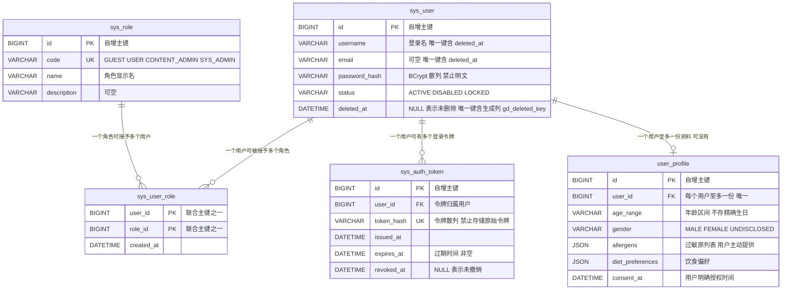
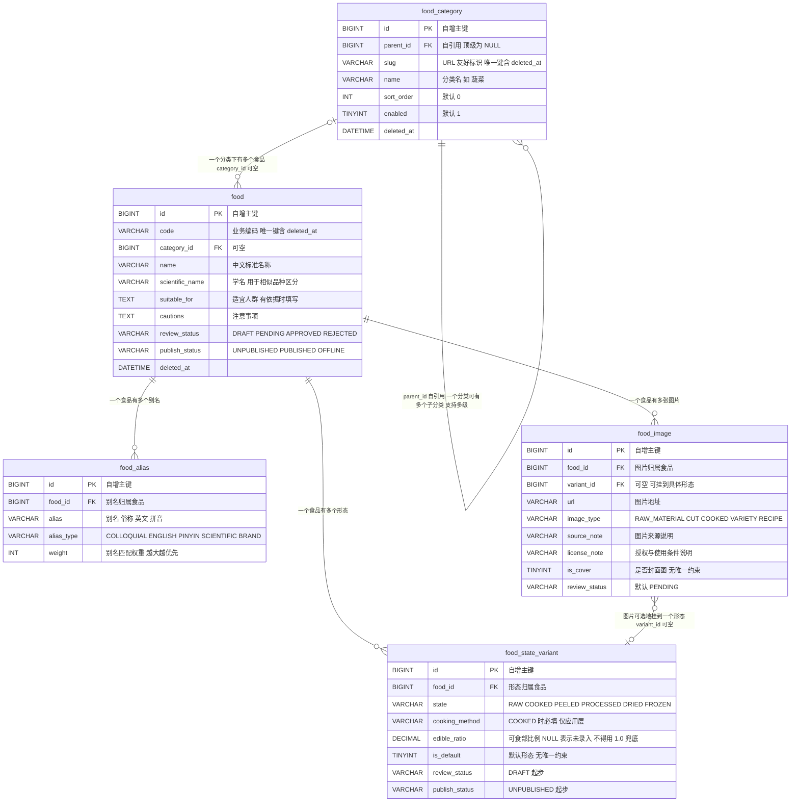
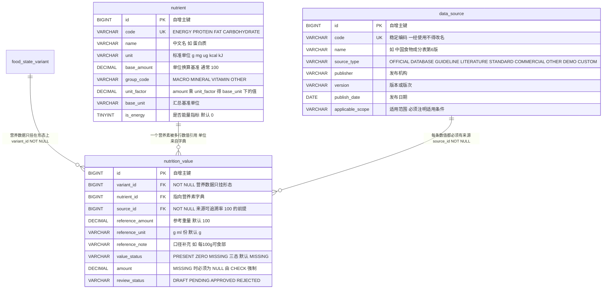
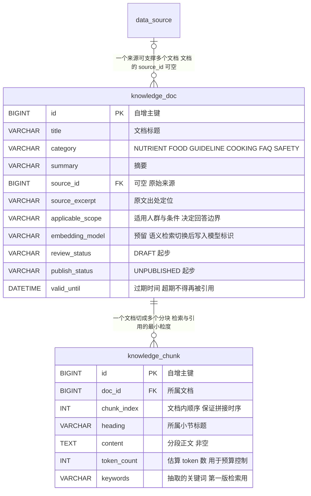
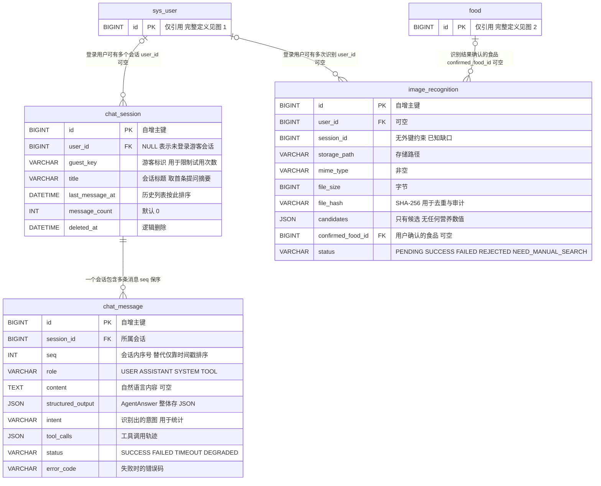
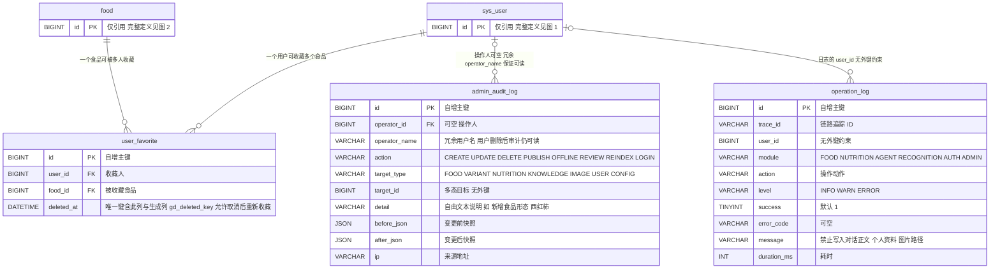
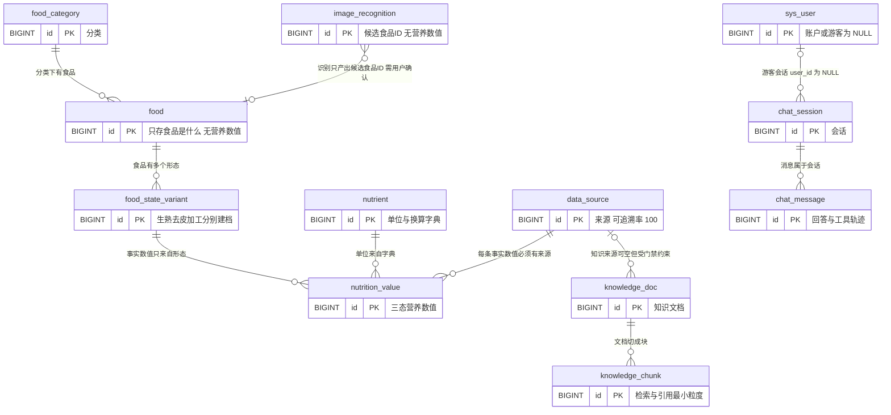
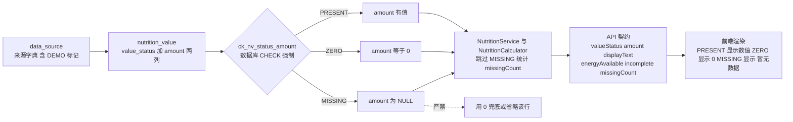

# 数据库 ER 图与实体关系 V1.0

> AI 食品营养师平台（nutrition-agent）—— 21 张表的实体关系、字段清单、约束与不变量。
> 本文是 [ROADMAP.md](ROADMAP.md) 阶段一交付物第 5 项（`docs/er-diagram.md` + `docs/db/schema.sql`）的 ER 图部分。

---

## 一、文档说明

### 1.1 依据文件与版本

| 依据文件 | 版本 | 本文使用的部分 |
| --- | --- | --- |
| [`docs/db/schema.sql`](db/schema.sql) | V1.0（603 行，21 张表） | **唯一权威 schema 定义**：表、列、类型、可空、默认值、注释、索引、UNIQUE、CHECK、外键 |
| [`docs/api-contract.md`](api-contract.md) | V1.0（560 行） | 三态响应字段语义（`valueStatus` / `amount` / `displayText` / `energyAvailable` / `incomplete`）、错误码 `40901` / `40001` |
| [`docs/use-cases.md`](use-cases.md) | V1.0（442 行） | 业务规则 R01~R22 的强制点、UC-01~UC-38 与表的对应关系、待确认 T-01~T-10 |
| [`docs/DESIGN.md`](DESIGN.md) | V1.0（596 行） | ADR-01~ADR-12、前端三态渲染规则、待确认 A-01~A-08 |
| [`docs/data-source-policy.md`](data-source-policy.md) | V1.0（704 行） | 可追溯链路、发布门禁 LG-01~LG-14、自检 SQL C-01~C-07 |
| PRD | V1.0（1090 行） | 5.3 食品详情、5.4 营养成分与计算、5.9 后台内容管理、6.x Agent 设计、11.x 初始化要求 |

> **行数与行号（2026-10 复核）**：上表行数为 2026-10 实测值（`[IO.File]::ReadAllLines().Count`），成稿时的旧值依次为 560 / 490 / 442 / 595 / 680 / 1090 行。本文正文中的 `docs/db/schema.sql:NNN` 行号引用、第 2.1 节的「schema.sql 行」区间、第 9 节校验输出与文件属性表均写于成稿时；`schema.sql` 此后增长到 603 行（新增 `admin_audit_log.detail`、`operation_log.client_key` 等）。
>
> **行号引用已按内容重新对齐（2026-10）**：全文 68 处 `schema.sql` 引用不再靠人工维护。`scripts/fix_erd_links.py` 以成稿时的 schema 修订 `dfbf480` 为旧坐标（560 行，当前 603 行），用 `difflib` 求两版逐行的**逐字对应关系**（595/596 行可一一对上，9 处新增行不参与），把每个旧行号映到内容相同的那个新行号；§4 各表的「定义位置」另按 `CREATE TABLE …) ENGINE=` 实测区间回填。因此：
>
> - **判据仍是 schema 原文**：脚本只保证「指到同一行内容」，不保证被引用的那行仍然说明了当初想说的意思。若某个对象被改写（而不只是位置变动），行号依旧有效但语义可能已变，必须回读原文。
> - **脚本怎么判一行行号对不对**：单看「内容是否改变」会把每一行都判成错的——给 7 张表补 `gd_deleted_key` 生成列后，这些表的每一行都换了行号，内容也确实变了，但引用一处处都没错。所以判据是**内容指纹 + 表归属**：把该行号指着的那行内容（去空白后取 MD5）拿到旧坐标里找落点，看它当时属于哪张表，再与该号现在落在哪张表比对；两者不是同一张表才判为「已指到别的表上去了」。此外 `§4.N` 小节的「定义位置 A-B」被当作该段正文引用的表归属声明（只在本节内生效，`§6`/`§8` 的跨表引用不受它约束）。
> - **4 处引用成稿时就指错了对象**（`er-diagram.md:212` 的 `food_image.variant_id` 可空 + `fk_image_variant`、`:501` 的 `sys_role` 定义位置、`:786` 的 `knowledge_doc` 定义位置、`:1079` 的 `admin_audit_log.before_json`/`after_json`），现已逐处回读 `schema.sql` 原文裁定并改对。这类错误不能靠行号映射修好——映射只会把一个错误搬成另一个看起来正常的错误。
> - 改动 schema 后重跑 `python scripts/fix_erd_links.py`（`--check` 只报告、有漂移时 exit=1；`--write` 就地改写）即可回填，不要手工改行号。

### 1.2 权威性与变更规则

1. **本文的所有字段、类型、约束均逐字取自 `docs/db/schema.sql`。**
2. **schema 变更时以 [`docs/db/schema.sql`](db/schema.sql) 为准**：本文与 schema 冲突时，视为本文过期，应先改 schema 再回写本文。
3. 本文**不修改** `docs/db/schema.sql`、`docs/api-contract.md`、`docs/PRD.md`、`README.md`、`docs/ROADMAP.md` 中的任何内容；发现的冲突集中记录在第 6.3 节（文档一致性冲突）与第 8 节（已知缺口），供决策。
4. 数据库环境：MySQL 8.0+（`utf8mb4` / `utf8mb4_0900_ai_ci`），亦可在 H2 2.x（`MODE=MySQL`）下执行供 `dev` profile 使用（[`docs/db/schema.sql:5-6`](db/schema.sql)）。
5. 建表脚本开头执行 `SET FOREIGN_KEY_CHECKS = 0;`（[`docs/db/schema.sql:71`](db/schema.sql)），因此**表定义顺序不等于依赖顺序**：`food_image` 在 `food_state_variant` 之前创建却引用后者（[`docs/db/schema.sql:235-258`](db/schema.sql)）。这是脚本的执行细节，不是表关系问题。

### 1.3 两处“引用路径与实际不符”（本次校验发现）

| 引用处 | 引用写法 | 实际情况 |
| --- | --- | --- |
| 交付物清单 [`docs/ROADMAP.md:36`](ROADMAP.md)、[`README.md:7`](README.md) | `nutrition_agent/docs/PRD.md` | 该文件确实存在，但位于**工作区另一目录** `D:\ds_harness_work\nutrition_agent\docs\PRD.md`（目录名是下划线 `nutrition_agent`）。**`D:\ds_harness_work\nutrition-agent\docs\` 下没有 `PRD.md`。** |
| 本文任务约定 | `node .mmdval/esmcheck.mjs`（相对项目根） | `nutrition-agent` 下**没有** `.mmdval`；校验器实际位于工作区根 `D:\ds_harness_work\.mmdval\esmcheck.mjs`（附真实 mermaid ESM 构建）。详见第 9 节「校验记录」。 |

> 上表只描述路径事实，不修改任何被引用的文件。

### 1.4 Mermaid 书写约定（本文的 ER 图）

- `erDiagram` 的属性行写作 `类型 属性名 [键] "注释"`；**类型一律不带括号**（写 `DECIMAL`、`TINYINT`、`VARCHAR`，不写 `DECIMAL(18,6)`、`TINYINT(1)`、`VARCHAR(64)`），**属性名不含空格**，否则 mermaid 解析失败。
- 关系标签一律用**双引号**包裹；图内不使用中文全角括号 `（）`，避免解析歧义。
- 为了让每张图可读，**图内只列关系键与区分性字段**（`id`、外键、状态列）；**完整字段清单见第 4 节**（21 张表逐张列全）。
- 图内把 `TINYINT(1)` 记为 `TINYINT`，把 `DECIMAL(5,4)` 等记为 `DECIMAL`。

---

## 二、实体分组总览

schema 文件本身用 9 个注释分区组织（一~九）；本文按**业务域**归并为 6 个域 + 1 张跨域主干图（第 3 节共 7 个 `erDiagram` 块）。

| 域 | 图 | 表 | 职责 | 主要依据 |
| --- | --- | --- | --- | --- |
| **A. 用户与权限** | 图 1 | `sys_user`、`sys_role`、`sys_user_role`、`sys_auth_token`、`user_profile` | 账户、四类角色、可撤销令牌、用户资料与偏好（全部业务字段可空，支持“不填”） | FR-007、PRD 3.1、5.7 |
| **B. 食品与形态** | 图 2 | `food_category`、`food`、`food_alias`、`food_state_variant`、`food_image` | “食品是什么”与“以什么形态存在”：分类树、主数据、别名、生/熟/去皮/加工形态、图片 | FR-001/002/003、PRD 5.2/5.3 |
| **C. 营养与来源** | 图 3 | `nutrient`、`data_source`、`nutrition_value` | 营养素字典（单位与换算）、数据来源、**三态营养数值**——本项目事实准确性的核心 | FR-004、PRD 5.4 / 8.1 / 11.3 |
| **D. 知识库（RAG）** | 图 4 | `knowledge_doc`、`knowledge_chunk` | 知识文档与分块；检索与引用的最小粒度是 chunk | FR-010、PRD 5.10 / 11.4 |
| **E. 会话与识别** | 图 5 | `chat_session`、`chat_message`、`image_recognition` | 问答会话（含游客）、消息与工具轨迹、图片识别记录（只存候选，不存营养数值） | FR-005/006/008、PRD 5.6 / 6.4 / 6.5 |
| **F. 用户行为与审计** | 图 6 | `user_favorite`、`admin_audit_log`、`operation_log` | 收藏、后台变更前后快照、运行与调用日志（禁写敏感信息） | FR-008、PRD 9.3 / 8.4 |
| **（跨域主干）** | 图 7 | 跨 A~E 的关系摘要 | 一张图回答“事实数据与 AI 生成内容在哪里分离” | README 六条约束、ADR-01~ADR-04 |

### 2.1 21 张表清单（与 `schema.sql` 顺序一致）

| # | 表 | 域 | schema.sql 行 |
| --- | --- | --- | --- |
| 1 | `sys_user` | A | 59-74 |
| 2 | `sys_role` | A | 77-85 |
| 3 | `sys_user_role` | A | 88-96 |
| 4 | `sys_auth_token` | A | 99-110 |
| 5 | `user_profile` | A | 113-130 |
| 6 | `food_category` | B | 137-153 |
| 7 | `food` | B | 156-187 |
| 8 | `food_alias` | B | 190-205 |
| 9 | `food_image` | B | 208-231 |
| 10 | `food_state_variant` | B | 235-254 |
| 11 | `nutrient` | C | 261-283 |
| 12 | `data_source` | C | 286-302 |
| 13 | `nutrition_value` | C | 306-341 |
| 14 | `knowledge_doc` | D | 348-375 |
| 15 | `knowledge_chunk` | D | 378-393 |
| 16 | `chat_session` | E | 400-414 |
| 17 | `chat_message` | E | 417-439 |
| 18 | `image_recognition` | E | 446-470 |
| 19 | `user_favorite` | F | 477-489 |
| 20 | `admin_audit_log` | F | 496-511 |
| 21 | `operation_log` | F | 518-534 |

---

## 三、Mermaid ER 图（7 个 `erDiagram` 块）

### 3.1 图 1 — 用户与权限（域 A）



**关键关系说明**

- `sys_user_role` 是纯关联表：**无代理主键**，以 `(user_id, role_id)` 为联合主键（[`docs/db/schema.sql:114`](db/schema.sql)），天然防重复授权；两条外键均无 `ON DELETE`，删除用户或角色会被数据库拒绝（RESTRICT），符合“审计优先”的取舍。
- `user_profile` 与 `sys_user` 是**严格的一对零或一**：`user_id` 非空 + `uk_profile_user` 唯一（[`docs/db/schema.sql:149`](db/schema.sql)）。
- `user_profile` 的**全部业务字段可空**（`age_range` / `gender` / `height_cm` / `weight_kg` / `activity_level` / `diet_goal` / `allergens` / `diet_preferences`），并单独记录 `consent_at`：这是 R22「个人资料必须由用户主动提供或授权」在结构层的表达——“不填”是合法状态（[`docs/use-cases.md:409`](use-cases.md)）。
- `sys_auth_token` 同时具备 `token_hash` 唯一、`expires_at` 非空、`revoked_at` 可空三件套，支持“可撤销 + 可过期”令牌。它与 `README.md:38` 的“有状态令牌”一致，但与 [`docs/DESIGN.md:338`](DESIGN.md) ADR-10 的“HMAC-SHA256 签名令牌（通常无状态）”仍不一致（见 8.2 节 G-19）。

### 3.2 图 2 — 食品与形态（域 B）



**关键关系说明**

- `food` 表的注释明确写着“**只存‘食品是什么’，不存任何营养数值**”（[`docs/db/schema.sql:188`](db/schema.sql)）；`food` 上不存在指向 `nutrition_value` 的任何列，这是 ADR-01 的结构落点。
- `food_state_variant` 是**营养数据的最小承载单元**：`state` 区分生/熟/去皮/加工，`cooking_method` 区分煮/蒸/炒/炸/烤。
- `edible_ratio` 可空且注释写明“**缺失时 NULL，不填 1.0**”（[`docs/db/schema.sql:268`](db/schema.sql)）：可食部比例是**事实数据**，用 `1.0` 兜底等于把“未录入”伪装成“100% 可食”。
- `food_image.variant_id` 可空：`NULL` 的语义是“该图片只展示食品本身，不代表某一形态的营养数据”（[`docs/db/schema.sql:239-257`](db/schema.sql)）。这与“菜品图与原材料图必须可区分”直接相关。
- `food_category` 支持多级分类（`parent_id` 自引用，顶级为 `NULL`）；图上的 `|o--o{` 表达的就是“分类可空归属父分类、父分类可有多个子分类”。

### 3.3 图 3 — 营养与来源（域 C，核心图）



**关键关系说明（本项目的核心）**

- **营养数据无法脱离形态存在**：`nutrition_value.variant_id` 是 `NOT NULL` 外键（[`docs/db/schema.sql:340`](db/schema.sql)、[`docs/db/schema.sql:374`](db/schema.sql)）。想“给食品直接挂热量”在数据库层写不进去。
- **来源不可为空**：`nutrition_value.source_id` 是 `NOT NULL` 外键（[`docs/db/schema.sql:348`](db/schema.sql)、[`docs/db/schema.sql:340`](db/schema.sql)）。这是“来源可追溯率 100%”（PRD 2.2）的唯一结构前提；若允许 `NULL`，该指标立刻退化为“不可测”。演示数据也必须挂一条 `source_type='DEMO'` 的来源，使“演示”本身成为可追溯信息。
- **单位不落在数据行上**：`nutrition_value` 没有任何 `unit` 列，单位来自 `nutrient.unit` / `base_unit` / `unit_factor`（ADR-03，[`docs/DESIGN.md:263-271`](DESIGN.md)）。汇总时先换算到 `base_unit`，避免 g 与 mg 直接相加。
- **三态由约束锁定**：`ck_nv_status_amount` CHECK 要求 `MISSING → amount IS NULL`、`ZERO → amount = 0`、`PRESENT → amount IS NOT NULL`（[`docs/db/schema.sql:368-372`](db/schema.sql)）。
- **同一形态同一营养素同一口径只允许一条有效记录**：`uk_nv_variant_nutrient(variant_id, nutrient_id, reference_amount, reference_unit, deleted_at, gd_deleted_key)`（[`docs/db/schema.sql:362`](db/schema.sql)），防止汇总时重复计算。末列的 `gd_deleted_key` 是把未删除行的 NULL 归一为哨兵值的生成列，没有它这条唯一键对未删除行不生效（见 4.1 / 4.13 节与 8.1 节 G-01）。

### 3.4 图 4 — 知识库（域 D）



**关键关系说明**

- `knowledge_doc.source_id` **可空**，与 `nutrition_value.source_id` 的 NOT NULL 形成对比：知识文档允许“先入库、后补来源”，但发布时由服务层门禁拦截（`LG-10`：知识来源必须是 A 级或 B 级；[`docs/data-source-policy.md:370`](data-source-policy.md)）。**注意：营养数值没有这个宽容度，两者不可混为一谈。**
- `knowledge_chunk` 是**检索与引用的最小粒度**（[`docs/db/schema.sql:427`](db/schema.sql)），`uk_chunk_doc_index(doc_id, chunk_index)` 保证文档内序号唯一、上下文拼接不乱序。
- `knowledge_chunk` 上**没有** `review_status` / `publish_status` / `deleted_at`：分块的可见性完全继承文档，因此“分块级审核”在结构上不可行（见 8.2 节 G-13，对应 T-01/T-02/T-03）。
- `embedding_model` 是第一版预留的扩展点：关键词检索升级为混合检索时不改表结构（ADR-12，[`docs/DESIGN.md:353-361`](DESIGN.md)）。

### 3.5 图 5 — 会话与识别（域 E）



**关键关系说明**

- `chat_session.user_id` **可空**：`NULL = 未登录游客会话`，配合 `guest_key` 实现 PRD 角色 A 的“有限次试用”（R12，[`docs/use-cases.md:399`](use-cases.md)）。
- `chat_message` 用 `seq` 而非仅靠时间戳排序：同秒并发会乱序，`uk_msg_session_seq(session_id, seq)` 保证会话内序号唯一（[`docs/db/schema.sql:455`](db/schema.sql)、[`docs/db/schema.sql:468`](db/schema.sql)）。
- `structured_output` 与 `tool_calls` 是 JSON 列，而 `intent` / `model_name` / `latency_ms` / `token_usage` / `status` / `error_code` **刻意保持标量列**，因为它们是统计与验收维度（ADR-11，[`docs/DESIGN.md:351`](DESIGN.md)）。
- `image_recognition.candidates` 的注释写明候选结构为 `[{foodId, foodName, confidence, reason}]`，**不含任何营养数值字段**（[`docs/db/schema.sql:489`](db/schema.sql)、[`docs/api-contract.md:321`](api-contract.md)）。因此视觉模型与营养事实之间**在结构上就没有通道**（R20）。
- `image_recognition.session_id` 在 schema 中存在但**没有外键约束**（[`docs/db/schema.sql:483`](db/schema.sql)），这是与全表一致性策略的唯一例外之一，见 8.2 节 G-06（对应 T-07 / A-05）。

### 3.6 图 6 — 用户行为与审计（域 F）



**关键关系说明**

- `user_favorite` 的唯一键是 `(user_id, food_id, deleted_at, gd_deleted_key)`（[`docs/db/schema.sql`](db/schema.sql)），注释写明“**含 deleted_at：允许取消收藏后重新收藏**”。**该键对未删除行是真正生效的**：末列的生成列 `gd_deleted_key` 把 NULL 归一为 `'1970-01-01 00:00:00'`（见 8.1 节 G-01，已修复）。
- `admin_audit_log.target_id` 是**多态指针**（配合 `target_type`），因此没有外键——它可能指向 `food` / `nutrition_value` / `knowledge_doc` 等不同表，这是有意的设计，不是遗漏。
- `admin_audit_log.operator_name` 是**冗余用户名**：“用户删除后审计仍可读”（[`docs/db/schema.sql:535`](db/schema.sql)）。这是审计表在“引用完整性”与“可读性”之间的取舍。
- `operation_log.message` 的注释是硬性限制：“注意：敏感信息（对话正文、个人资料、图片路径）禁止写入此处（PRD 8.4 限制日志记录）”（[`docs/db/schema.sql:569`](db/schema.sql)）。**数据库无法强制这一点**，只能靠应用层过滤（R18）。
- `operation_log.user_id` 与 `admin_audit_log.operator_id` 不同：前者**没有外键**（[`docs/db/schema.sql:558`](db/schema.sql)），因此日志可以记录已被物理删除的用户 id（见 8.2 节 G-07）。

### 3.7 图 7 — 跨域主干：事实数据与 AI 生成内容在哪里分离



**这张图要说明的唯一一件事**

- 从 `image_recognition`（候选食品 ID）出发，**没有任何一条关系指向 `nutrition_value`**。视觉模型的输出只能经 `confirmed_food_id` 落到 `food`，再由前端/Agent 另行调用 `/foods/{id}/nutrition` 取事实数值。**“AI 生成的候选”与“数据库事实”之间不存在结构通路**，这正是 README 六条约束中第 2 条的落地方式。
- 同理，`chat_message.structured_output` 里的 `nutritionFacts` 只是**快照**，其数值必须来自 `nutrition_value`（经工具层），并由 `FactValidator` 比对；`sources` 由工具层注入，模型自述来源一律丢弃（R14，[`docs/use-cases.md:401`](use-cases.md)）。
- 因此：**Agent 无法用自己的记忆或推断，在数据模型里创造出营养事实。**

---

## 四、完整字段清单（21 张表逐张列全）

> 全部逐字取自 [`docs/db/schema.sql`](db/schema.sql)。`含义` 列优先采用 schema 中的中文注释；schema 未写注释的列标注为“（schema 无注释）”。
> 记法约定：`可空` 列中 `N` = NOT NULL，`Y` = 允许 NULL；“默认值”为空表示无 `DEFAULT`。

### 4.1 `sys_user` — 用户账户

表注释：`用户账户（FR-007）`；定义位置 [`docs/db/schema.sql:78-95`](db/schema.sql)。

| 列名 | 类型 | 可空 | 默认值 | 含义 |
| --- | --- | :---: | --- | --- |
| `id` | BIGINT | N | AUTO_INCREMENT | 自增主键 |
| `username` | VARCHAR(64) | N | — | 登录名 |
| `email` | VARCHAR(128) | Y | — | 邮箱，可空 |
| `password_hash` | VARCHAR(255) | N | — | BCrypt 散列，禁止明文 |
| `nickname` | VARCHAR(64) | Y | — | 昵称 |
| `avatar_url` | VARCHAR(512) | Y | — | 头像地址 |
| `status` | VARCHAR(16) | N | `'ACTIVE'` | ACTIVE / DISABLED / LOCKED |
| `last_login_at` | DATETIME | Y | — | 最后登录时间（schema 无注释） |
| `created_at` | DATETIME | N | CURRENT_TIMESTAMP | 创建时间（schema 无注释） |
| `updated_at` | DATETIME | N | CURRENT_TIMESTAMP ON UPDATE CURRENT_TIMESTAMP | 更新时间（schema 无注释） |
| `deleted_at` | DATETIME | Y | — | 逻辑删除时间，NULL = 未删除 |
| `gd_deleted_key` | DATETIME | N | — | **生成列**（不落盘）：`` GENERATED ALWAYS AS (IFNULL(`deleted_at`, '1970-01-01 00:00:00')) VIRTUAL ``（H2 侧写作 `` TIMESTAMP AS (IFNULL(`deleted_at`, TIMESTAMP '1970-01-01 00:00:00')) ``）。**为什么需要它**：MySQL 与 H2 的唯一索引里 **NULL 与 NULL 互不相等**，若唯一键只写到 `deleted_at` 为止，未删除行（`deleted_at IS NULL`）之间**根本不受唯一性约束**，可以插入任意多条重名、重邮箱的记录；本列把未删除行的 NULL 归一为哨兵值 `1970-01-01 00:00:00` 再追加到唯一键末尾，未删除行之间才会真正互相冲突（唯一性生效），而软删之后哨兵值不同，仍可重建同名记录（G-01 的守护点）。**代价**：同一逻辑身份在同一**秒**内被软删两次会被唯一键拒绝——正常业务流程下不可能发生，宁严勿松。**可空列为何写 N**：schema 未显式写 `NOT NULL`，但 `IFNULL(...)` 的结果不可能为 NULL |

键与索引：`PRIMARY KEY (id)`；`uk_user_username UNIQUE (username, deleted_at, gd_deleted_key)`；`uk_user_email UNIQUE (email, deleted_at, gd_deleted_key)`。两个键末列的 `gd_deleted_key` 是上表所述的归一化生成列，没有它这两条唯一键对未删除行形同虚设（见下方说明与 8.1 节 G-01）。

### 4.2 `sys_role` — 角色

表注释：`角色（PRD 3.1，四类角色权限必须在设计上可区分）`；定义位置 [`docs/db/schema.sql:98-106`](db/schema.sql)。

| 列名 | 类型 | 可空 | 默认值 | 含义 |
| --- | --- | :---: | --- | --- |
| `id` | BIGINT | N | AUTO_INCREMENT | 自增主键 |
| `code` | VARCHAR(32) | N | — | GUEST / USER / CONTENT_ADMIN / SYS_ADMIN |
| `name` | VARCHAR(64) | N | — | 角色显示名 |
| `description` | VARCHAR(255) | Y | — | 角色说明（schema 无注释） |
| `created_at` | DATETIME | N | CURRENT_TIMESTAMP | 创建时间（schema 无注释） |

键与索引：`PRIMARY KEY (id)`；`uk_role_code UNIQUE (code)`。

> 注意：`sys_role` **没有** `deleted_at`（角色是受控字典，不做逻辑删除），这与 4.1 的 `sys_user` 不同。

### 4.3 `sys_user_role` — 用户角色关联

表注释：`用户角色关联`；定义位置 [`docs/db/schema.sql:109-117`](db/schema.sql)。

| 列名 | 类型 | 可空 | 默认值 | 含义 |
| --- | --- | :---: | --- | --- |
| `user_id` | BIGINT | N | — | 用户 id（联合主键之一） |
| `role_id` | BIGINT | N | — | 角色 id（联合主键之一） |
| `created_at` | DATETIME | N | CURRENT_TIMESTAMP | 授权时间（schema 无注释） |

键与索引：`PRIMARY KEY (user_id, role_id)`；`KEY idx_ur_role (role_id)`。
外键：`fk_ur_user (user_id) → sys_user(id)`；`fk_ur_role (role_id) → sys_role(id)`。

### 4.4 `sys_auth_token` — 登录令牌

表注释：`登录令牌（可撤销、可过期）`；定义位置 [`docs/db/schema.sql:120-131`](db/schema.sql)。

| 列名 | 类型 | 可空 | 默认值 | 含义 |
| --- | --- | :---: | --- | --- |
| `id` | BIGINT | N | AUTO_INCREMENT | 自增主键 |
| `user_id` | BIGINT | N | — | 令牌归属用户 |
| `token_hash` | VARCHAR(128) | N | — | 令牌散列，禁止存储原始令牌 |
| `issued_at` | DATETIME | N | CURRENT_TIMESTAMP | 签发时间（schema 无注释） |
| `expires_at` | DATETIME | N | — | 过期时间（schema 无注释） |
| `revoked_at` | DATETIME | Y | — | 撤销时间，NULL = 未撤销（schema 无注释） |

键与索引：`PRIMARY KEY (id)`；`uk_token_hash UNIQUE (token_hash)`；`KEY idx_token_user (user_id)`。
外键：`fk_token_user (user_id) → sys_user(id)`。

### 4.5 `user_profile` — 用户资料与饮食偏好

表注释：`用户资料与饮食偏好（FR-007，全部字段可空=用户可不填）`；定义位置 [`docs/db/schema.sql:134-151`](db/schema.sql)。

| 列名 | 类型 | 可空 | 默认值 | 含义 |
| --- | --- | :---: | --- | --- |
| `id` | BIGINT | N | AUTO_INCREMENT | 自增主键 |
| `user_id` | BIGINT | N | — | 归属用户，一对一 |
| `age_range` | VARCHAR(16) | Y | — | 年龄区间，不存精确生日（最小化收集） |
| `gender` | VARCHAR(16) | Y | — | MALE / FEMALE / UNDISCLOSED |
| `height_cm` | DECIMAL(5,1) | Y | — | 身高，用户主动提供 |
| `weight_kg` | DECIMAL(5,1) | Y | — | 体重，用户主动提供 |
| `activity_level` | VARCHAR(24) | Y | — | SEDENTARY / LIGHT / MODERATE / ACTIVE / VERY_ACTIVE |
| `diet_goal` | VARCHAR(32) | Y | — | WEIGHT_LOSS / MAINTAIN / MUSCLE_GAIN / ... |
| `allergens` | JSON | Y | — | 过敏原列表，用户主动提供 |
| `diet_preferences` | JSON | Y | — | 饮食偏好（素食等） |
| `consent_at` | DATETIME | Y | — | 用户明确授权时间（PRD 5.7 要求主动提供或明确授权） |
| `created_at` | DATETIME | N | CURRENT_TIMESTAMP | 创建时间（schema 无注释） |
| `updated_at` | DATETIME | N | CURRENT_TIMESTAMP ON UPDATE CURRENT_TIMESTAMP | 更新时间（schema 无注释） |

键与索引：`PRIMARY KEY (id)`；`uk_profile_user UNIQUE (user_id)`。
外键：`fk_profile_user (user_id) → sys_user(id)`。

> `user_profile` **没有** `deleted_at`：用户删除走 `sys_user` 的逻辑删除（UC-18），资料随用户失效；这也是 8.2 节 G-14 的例子之一。

### 4.6 `food_category` — 食品分类

表注释：`食品分类（FR-001/FR-002）`；定义位置 [`docs/db/schema.sql:158-176`](db/schema.sql)。

| 列名 | 类型 | 可空 | 默认值 | 含义 |
| --- | --- | :---: | --- | --- |
| `id` | BIGINT | N | AUTO_INCREMENT | 自增主键 |
| `parent_id` | BIGINT | Y | — | 支持多级分类，顶级为 NULL |
| `slug` | VARCHAR(64) | N | — | URL 友好标识 |
| `name` | VARCHAR(64) | N | — | 分类名，如 蔬菜 |
| `icon` | VARCHAR(64) | Y | — | 前端图标标识 |
| `intro` | VARCHAR(512) | Y | — | 分类介绍 |
| `sort_order` | INT | N | `0` | 排序（schema 无注释） |
| `enabled` | TINYINT(1) | N | `1` | 是否启用（schema 无注释） |
| `created_at` | DATETIME | N | CURRENT_TIMESTAMP | 创建时间（schema 无注释） |
| `updated_at` | DATETIME | N | CURRENT_TIMESTAMP ON UPDATE CURRENT_TIMESTAMP | 更新时间（schema 无注释） |
| `deleted_at` | DATETIME | Y | — | 逻辑删除，NULL = 未删除 |
| `gd_deleted_key` | DATETIME | N | — | **生成列**（不落盘）：`` GENERATED ALWAYS AS (IFNULL(`deleted_at`, '1970-01-01 00:00:00')) VIRTUAL ``。把未删除行的 `deleted_at` NULL 归一为哨兵值 `1970-01-01 00:00:00`，让 `uk_category_slug (slug, deleted_at, gd_deleted_key)` 对未删除行**真正生效**——唯一索引里 NULL 互不相等，只写 `deleted_at` 时重复 slug 不会被拒绝；软删后哨兵值不同，故仍可重建同名分类。完整机理与代价（同秒两次软删被拒）见 4.1 节；守护 `SchemaParityTest.logicDeleteUniqueKeysAreNullSafe` |

键与索引：`PRIMARY KEY (id)`；`uk_category_slug UNIQUE (slug, deleted_at, gd_deleted_key)`；`KEY idx_category_parent (parent_id)`。
外键：`fk_category_parent (parent_id) → food_category(id)`（**自引用**）。

### 4.7 `food` — 食品主表

表注释：`食品主表（FR-003）— 只存"食品是什么"，不存任何营养数值`；定义位置 [`docs/db/schema.sql:179-212`](db/schema.sql)。

| 列名 | 类型 | 可空 | 默认值 | 含义 |
| --- | --- | :---: | --- | --- |
| `id` | BIGINT | N | AUTO_INCREMENT | 自增主键 |
| `code` | VARCHAR(64) | N | — | 业务编码，种子数据与导入用 |
| `category_id` | BIGINT | Y | — | 所属分类（schema 无注释） |
| `name` | VARCHAR(128) | N | — | 中文标准名称 |
| `en_name` | VARCHAR(128) | Y | — | 英文名称 |
| `scientific_name` | VARCHAR(128) | Y | — | 学名，用于相似品种区分 |
| `intro` | TEXT | Y | — | 食品介绍 |
| `common_usage` | TEXT | Y | — | 常见食用方式 |
| `origin` | VARCHAR(255) | Y | — | 产地/来源描述 |
| `storage_method` | VARCHAR(255) | Y | — | 储存方式 |
| `suitable_for` | TEXT | Y | — | 适宜人群（有依据时填写） |
| `cautions` | TEXT | Y | — | 注意事项 |
| `search_keywords` | VARCHAR(512) | Y | — | 搜索加权词（去空格分隔） |
| `review_status` | VARCHAR(16) | N | `'DRAFT'` | DRAFT / PENDING / APPROVED / REJECTED |
| `publish_status` | VARCHAR(16) | N | `'UNPUBLISHED'` | UNPUBLISHED / PUBLISHED / OFFLINE |
| `published_at` | DATETIME | Y | — | 发布时间（schema 无注释） |
| `created_by` | BIGINT | Y | — | 创建人（schema 无注释） |
| `updated_by` | BIGINT | Y | — | 更新人（schema 无注释） |
| `reviewed_by` | BIGINT | Y | — | 审核人（schema 无注释） |
| `reviewed_at` | DATETIME | Y | — | 审核时间（schema 无注释） |
| `created_at` | DATETIME | N | CURRENT_TIMESTAMP | 创建时间（schema 无注释） |
| `updated_at` | DATETIME | N | CURRENT_TIMESTAMP ON UPDATE CURRENT_TIMESTAMP | 更新时间（schema 无注释） |
| `deleted_at` | DATETIME | Y | — | 逻辑删除，NULL = 未删除 |
| `gd_deleted_key` | DATETIME | N | — | **生成列**（不落盘）：`` GENERATED ALWAYS AS (IFNULL(`deleted_at`, '1970-01-01 00:00:00')) VIRTUAL ``。把未删除行的 `deleted_at` NULL 归一为哨兵值 `1970-01-01 00:00:00`，让 `uk_food_code (code, deleted_at, gd_deleted_key)` 对未删除行**真正生效**——唯一索引里 NULL 互不相等，只写 `deleted_at` 时同一 `code` 可插入多条未删除记录；软删后哨兵值不同，故仍可重建同一编码。完整机理与代价（同秒两次软删被拒）见 4.1 节；守护 `SchemaParityTest.logicDeleteUniqueKeysAreNullSafe` |

键与索引：`PRIMARY KEY (id)`；`uk_food_code UNIQUE (code, deleted_at, gd_deleted_key)`；`KEY idx_food_name (name)`；`KEY idx_food_category (category_id)`；`KEY idx_food_publish (publish_status, review_status, deleted_at)`（schema 注释：**前台查询几乎恒带此条件，独立索引避免回表后再过滤**）。
外键：`fk_food_category (category_id) → food_category(id)`。

> **`food` 表没有任何 `source_id` 列**，但 `suitable_for` / `cautions` / `common_usage` 这些最需要出处的字段都在这里 —— 见 8.2 节 G-03。

### 4.8 `food_alias` — 食品别名

表注释：`食品别名（FR-002 搜索范围：中文别名、英文名称）`；定义位置 [`docs/db/schema.sql:215-232`](db/schema.sql)。

| 列名 | 类型 | 可空 | 默认值 | 含义 |
| --- | --- | :---: | --- | --- |
| `id` | BIGINT | N | AUTO_INCREMENT | 自增主键 |
| `food_id` | BIGINT | N | — | 别名归属食品 |
| `alias` | VARCHAR(128) | N | — | 别名/俗称/英文别名/拼音 |
| `alias_type` | VARCHAR(24) | N | `'COLLOQUIAL'` | COLLOQUIAL 俗称 / ENGLISH 英文 / PINYIN 拼音 / SCIENTIFIC 学名 / BRAND 品牌 |
| `weight` | INT | N | `0` | 别名匹配权重，越大越优先 |
| `created_at` | DATETIME | N | CURRENT_TIMESTAMP | 创建时间（schema 无注释） |
| `deleted_at` | DATETIME | Y | — | 逻辑删除，NULL = 未删除 |
| `gd_deleted_key` | DATETIME | N | — | **生成列**（不落盘）：`` GENERATED ALWAYS AS (IFNULL(`deleted_at`, '1970-01-01 00:00:00')) VIRTUAL ``。把未删除行的 `deleted_at` NULL 归一为哨兵值 `1970-01-01 00:00:00`，让 `uk_alias_food (food_id, alias, deleted_at, gd_deleted_key)` 对未删除行**真正生效**——唯一索引里 NULL 互不相等，只写 `deleted_at` 时同一食品下重复别名不会被拒绝；软删后哨兵值不同，故仍可重建同名别名。完整机理与代价（同秒两次软删被拒）见 4.1 节；守护 `SchemaParityTest.logicDeleteUniqueKeysAreNullSafe` |

键与索引：`PRIMARY KEY (id)`；`uk_alias_food UNIQUE (food_id, alias, deleted_at, gd_deleted_key)`；`KEY idx_alias_alias (alias)`。
外键：`fk_alias_food (food_id) → food(id)`。
schema 行内注释（[`docs/db/schema.sql:229`](db/schema.sql)）：**同一食品下同一别名不重复；跨食品同名别名在服务层做冲突校验**。

### 4.9 `food_image` — 食品图片

表注释：`食品图片（FR-003 图片类型；菜品图与原材料图必须可区分）`；定义位置 [`docs/db/schema.sql:235-258`](db/schema.sql)。

| 列名 | 类型 | 可空 | 默认值 | 含义 |
| --- | --- | :---: | --- | --- |
| `id` | BIGINT | N | AUTO_INCREMENT | 自增主键 |
| `food_id` | BIGINT | N | — | 图片归属食品 |
| `variant_id` | BIGINT | Y | — | 可挂到具体形态；为 NULL 表示该图片仅展示食品本身，不代表某一形态的营养数据 |
| `url` | VARCHAR(512) | N | — | 图片地址（本地磁盘或对象存储） |
| `thumb_url` | VARCHAR(512) | Y | — | 缩略图地址 |
| `image_type` | VARCHAR(24) | N | `'RAW_MATERIAL'` | RAW_MATERIAL 新鲜原材料 / CUT 切开处理 / COOKED 烹饪成品 / VARIETY 不同品种 / RECIPE 食谱 |
| `caption` | VARCHAR(255) | Y | — | 图片描述 |
| `source_note` | VARCHAR(255) | Y | — | 图片来源说明（PRD 11.2 必须保存来源） |
| `license_note` | VARCHAR(255) | Y | — | 授权/使用条件说明（PRD 风险表：图片版权） |
| `is_cover` | TINYINT(1) | N | `0` | 是否封面图 |
| `sort_order` | INT | N | `0` | 排序（schema 无注释） |
| `review_status` | VARCHAR(16) | N | `'PENDING'` | 图片同样需要审核 |
| `created_at` | DATETIME | N | CURRENT_TIMESTAMP | 创建时间（schema 无注释） |
| `updated_at` | DATETIME | N | CURRENT_TIMESTAMP ON UPDATE CURRENT_TIMESTAMP | 更新时间（schema 无注释） |
| `deleted_at` | DATETIME | Y | — | 逻辑删除，NULL = 未删除 |

键与索引：`PRIMARY KEY (id)`；`KEY idx_image_food (food_id, sort_order)`；`KEY idx_image_variant (variant_id)`。**无任何 UNIQUE 键。**
外键：`fk_image_food (food_id) → food(id)`；`fk_image_variant (variant_id) → food_state_variant(id)`。

### 4.10 `food_state_variant` — 食品形态（营养数据的最小承载单元）

表注释：`食品形态 [D1]：生/熟/去皮/加工分别建档，营养数据只挂在此表上`；定义位置 [`docs/db/schema.sql:262-283`](db/schema.sql)。

| 列名 | 类型 | 可空 | 默认值 | 含义 |
| --- | --- | :---: | --- | --- |
| `id` | BIGINT | N | AUTO_INCREMENT | 自增主键 |
| `food_id` | BIGINT | N | — | 形态归属食品 |
| `state` | VARCHAR(16) | N | — | RAW / COOKED / PEELED / PROCESSED / DRIED / FROZEN |
| `cooking_method` | VARCHAR(32) | Y | — | 煮/蒸/炒/炸/烤，state=COOKED 时必填 |
| `name_suffix` | VARCHAR(64) | Y | — | 展示用后缀，如"（可食部）""（炒）" |
| `edible_ratio` | DECIMAL(5,4) | Y | — | 可食部比例，如 0.94 表示 94% 可食（缺失时 NULL，不填 1.0） |
| `description` | VARCHAR(512) | Y | — | 形态说明 |
| `is_default` | TINYINT(1) | N | `0` | 详情页默认选中形态 |
| `review_status` | VARCHAR(16) | N | `'DRAFT'` | DRAFT / PENDING / APPROVED / REJECTED（schema 无注释，取值同 `food`） |
| `publish_status` | VARCHAR(16) | N | `'UNPUBLISHED'` | UNPUBLISHED / PUBLISHED / OFFLINE（schema 无注释，取值同 `food`） |
| `created_at` | DATETIME | N | CURRENT_TIMESTAMP | 创建时间（schema 无注释） |
| `updated_at` | DATETIME | N | CURRENT_TIMESTAMP ON UPDATE CURRENT_TIMESTAMP | 更新时间（schema 无注释） |
| `deleted_at` | DATETIME | Y | — | 逻辑删除，NULL = 未删除 |
| `gd_deleted_key` | DATETIME | N | — | **生成列**（不落盘）：`` GENERATED ALWAYS AS (IFNULL(`deleted_at`, '1970-01-01 00:00:00')) VIRTUAL ``。把未删除行的 `deleted_at` NULL 归一为哨兵值 `1970-01-01 00:00:00`，让 `uk_variant_food_state (food_id, state, cooking_method, deleted_at, gd_deleted_key)` 对未删除行**真正生效**——唯一索引里 NULL 互不相等，只写 `deleted_at` 时同一食品的重复形态（含 `cooking_method IS NULL` 的那种）不会被拒绝；软删后哨兵值不同，故仍可重建同形态。完整机理与代价（同秒两次软删被拒）见 4.1 节；守护 `SchemaParityTest.logicDeleteUniqueKeysAreNullSafe` |

键与索引：`PRIMARY KEY (id)`；`uk_variant_food_state UNIQUE (food_id, state, cooking_method, deleted_at, gd_deleted_key)`；`KEY idx_variant_food (food_id)`；`KEY idx_variant_publish (publish_status, review_status, deleted_at)`。
外键：`fk_variant_food (food_id) → food(id)`。

> `cooking_method` 参与唯一键且**可空**，因此“state=COOKED 时必填”这条业务要求既没有 CHECK 也没有触发器兜底（见 8.2 节 G-09）；`is_default` 没有任何唯一约束（见 G-04）。

### 4.11 `nutrient` — 营养素字典

表注释：`营养素字典 [D3]：指标单位在此定义，扩展新指标只需插入数据（PRD 9.5）`；定义位置 [`docs/db/schema.sql:290-312`](db/schema.sql)。

| 列名 | 类型 | 可空 | 默认值 | 含义 |
| --- | --- | :---: | --- | --- |
| `id` | BIGINT | N | AUTO_INCREMENT | 自增主键 |
| `code` | VARCHAR(32) | N | — | ENERGY / PROTEIN / FAT / CARBOHYDRATE / ... |
| `name` | VARCHAR(64) | N | — | 中文名，如 蛋白质 |
| `en_name` | VARCHAR(64) | Y | — | 英文名（schema 无注释） |
| `unit` | VARCHAR(16) | N | — | 标准单位 g / mg / ug / kcal / kJ |
| `base_amount` | DECIMAL(18,6) | N | `100` | 单位换算基准，通常为 100（每 100g） |
| `group_code` | VARCHAR(32) | N | `'MACRO'` | MACRO 宏量 / MINERAL 矿物质 / VITAMIN 维生素 / OTHER 其他 |
| `display_order` | INT | N | `0` | 前端营养表格的固定列顺序，避免每次查询后重排 |
| `base_unit` | VARCHAR(16) | N | — | 汇总基准单位，用于跨单位统一 |
| `unit_factor` | DECIMAL(18,8) | N | `1` | 换算系数：amount × unit_factor = base_unit 下的值 |
| `is_energy` | TINYINT(1) | N | `0` | 是否能量指标（数据库可能以 kJ 提供能量而前端展示 kcal，需显式声明，禁止隐式假设） |
| `description` | VARCHAR(512) | Y | — | 营养素的通俗解释（PRD FR-010 营养素基本知识） |
| `enabled` | TINYINT(1) | N | `1` | 是否启用（schema 无注释） |
| `created_at` | DATETIME | N | CURRENT_TIMESTAMP | 创建时间（schema 无注释） |
| `updated_at` | DATETIME | N | CURRENT_TIMESTAMP ON UPDATE CURRENT_TIMESTAMP | 更新时间（schema 无注释） |

键与索引：`PRIMARY KEY (id)`；`uk_nutrient_code UNIQUE (code)`。无外键。

### 4.12 `data_source` — 数据来源

表注释：`数据来源 [D4]：营养数据可追溯率 100% 的基础`；定义位置 [`docs/db/schema.sql:315-334`](db/schema.sql)。

| 列名 | 类型 | 可空 | 默认值 | 含义 |
| --- | --- | :---: | --- | --- |
| `id` | BIGINT | N | AUTO_INCREMENT | 自增主键 |
| `code` | VARCHAR(64) | N | — | 来源编码（schema 无注释） |
| `name` | VARCHAR(255) | N | — | 如《中国食物成分表》第6版 |
| `source_type` | VARCHAR(24) | N | `'DATABASE'` | 来源类型。取值域由 `ck_source_type` CHECK 强制，共 9 个：`OFFICIAL` 官方文件 / `DATABASE` 成分数据库 / `GUIDELINE` 膳食指南 / `LITERATURE` 文献 / `STANDARD` 标准 / `COMMERCIAL` 商业资料 / `OTHER` 其他 / `DEMO` 演示数据 / `CUSTOM` 自定义 |
| `publisher` | VARCHAR(255) | Y | — | 发布机构 |
| `version` | VARCHAR(64) | Y | — | 版本/版次 |
| `publish_date` | DATE | Y | — | 发布日期（PRD 5.10 要求记录发布日期或版本） |
| `url` | VARCHAR(512) | Y | — | 可核查来源地址 |
| `applicable_scope` | VARCHAR(512) | Y | — | 适用范围（PRD 8.2：必须注明适用条件） |
| `note` | VARCHAR(512) | Y | — | 备注（schema 无注释） |
| `created_at` | DATETIME | N | CURRENT_TIMESTAMP | 创建时间（schema 无注释） |
| `updated_at` | DATETIME | N | CURRENT_TIMESTAMP ON UPDATE CURRENT_TIMESTAMP | 更新时间（schema 无注释） |

键与索引：`PRIMARY KEY (id)`；`uk_source_code UNIQUE (code)`。无外键。

> **`source_type` 的取值域由 `ck_source_type` CHECK 强制**（`VARCHAR(24)`，取值 `OFFICIAL / DATABASE / GUIDELINE / LITERATURE / STANDARD / COMMERCIAL / OTHER / DEMO / CUSTOM`），MySQL 与 H2 两份 schema 同域，且与 [`docs/data-source-policy.md`](data-source-policy.md) §1.3 的分级表**逐字一致**（该不变量由 `SchemaParityTest.sourceTypeDomainMatchesPolicy` 守护）。**注意 `remark` 这个列名不存在**：`data_source` 上的备注列叫 `note`（政策文档原先写错，已修，见 8.2 节 G-18）。

### 4.13 `nutrition_value` — 营养数值（三态）

表注释：`营养数值 [D2][D3][D4]：缺失/零/有值三态，单位归一，来源必填`；定义位置 [`docs/db/schema.sql:338-375`](db/schema.sql)。

| 列名 | 类型 | 可空 | 默认值 | 含义 |
| --- | --- | :---: | --- | --- |
| `id` | BIGINT | N | AUTO_INCREMENT | 自增主键 |
| `variant_id` | BIGINT | N | — | 营养数据永远挂在形态上，不挂食品 [D1] |
| `nutrient_id` | BIGINT | N | — | 指向 `nutrient` 字典（schema 无注释） |
| `reference_amount` | DECIMAL(10,3) | N | `100` | 参考重量口径：每多少克（或毫升）对应下列数值，如 100 表示每 100g |
| `reference_unit` | VARCHAR(16) | N | `'g'` | g / ml / 份 |
| `reference_note` | VARCHAR(128) | Y | — | 口径补充，如"每100g可食部" |
| `value_status` | VARCHAR(16) | N | `'MISSING'` | PRESENT / ZERO / MISSING [D2] |
| `amount` | DECIMAL(18,6) | Y | — | PRESENT/ZERO 时非空；MISSING 时为 NULL |
| `source_id` | BIGINT | N | — | 来源可追溯率达 100% 的前提 [D4] |
| `source_detail` | VARCHAR(255) | Y | — | 来源中的具体表/页码定位 |
| `review_status` | VARCHAR(16) | N | `'DRAFT'` | DRAFT / PENDING / APPROVED / REJECTED（schema 无注释，取值同 `food`） |
| `created_by` | BIGINT | Y | — | 创建人（schema 无注释） |
| `updated_by` | BIGINT | Y | — | 更新人（schema 无注释） |
| `reviewed_by` | BIGINT | Y | — | 审核人（schema 无注释） |
| `reviewed_at` | DATETIME | Y | — | 审核时间（schema 无注释） |
| `created_at` | DATETIME | N | CURRENT_TIMESTAMP | 创建时间（schema 无注释） |
| `updated_at` | DATETIME | N | CURRENT_TIMESTAMP ON UPDATE CURRENT_TIMESTAMP | 更新时间（schema 无注释） |
| `deleted_at` | DATETIME | Y | — | 逻辑删除，NULL = 未删除 |
| `gd_deleted_key` | DATETIME | N | — | **生成列**（不落盘）：`` GENERATED ALWAYS AS (IFNULL(`deleted_at`, '1970-01-01 00:00:00')) VIRTUAL ``。把未删除行的 `deleted_at` NULL 归一为哨兵值 `1970-01-01 00:00:00`，让 `uk_nv_variant_nutrient (variant_id, nutrient_id, reference_amount, reference_unit, deleted_at, gd_deleted_key)` 对未删除行**真正生效**——唯一索引里 NULL 互不相等，只写 `deleted_at` 时同一形态同一指标同一口径可重复录入，**汇总时会重复计算**；软删后哨兵值不同，故仍可重建同一口径的记录。完整机理与代价（同秒两次软删被拒）见 4.1 节；守护 `SchemaParityTest.logicDeleteUniqueKeysAreNullSafe` |

键与索引：`PRIMARY KEY (id)`；`uk_nv_variant_nutrient UNIQUE (variant_id, nutrient_id, reference_amount, reference_unit, deleted_at, gd_deleted_key)`；`KEY idx_nv_variant (variant_id)`；`KEY idx_nv_nutrient (nutrient_id)`；`KEY idx_nv_source (source_id)`。
CHECK：`ck_nv_status_amount`（[`docs/db/schema.sql:368-372`](db/schema.sql)）：
```sql
CONSTRAINT `ck_nv_status_amount` CHECK (
  (`value_status` = 'MISSING' AND `amount` IS NULL)
  OR (`value_status` = 'ZERO'    AND `amount` = 0)
  OR (`value_status` = 'PRESENT' AND `amount` IS NOT NULL)
)
```
外键：`fk_nv_variant (variant_id) → food_state_variant(id)`；`fk_nv_nutrient (nutrient_id) → nutrient(id)`；`fk_nv_source (source_id) → data_source(id)`。

> **本表是全项目事实准确性的枢纽**：`variant_id` NOT NULL 保证“营养不脱离形态”，`source_id` NOT NULL 保证“每条数值都有出处”，`ck_nv_status_amount` 保证“未知 ≠ 0”。
> **注意：本表没有 `unit` 列**（单位在 `nutrient` 字典，[D3]）。[`docs/data-source-policy.md`](data-source-policy.md) §6.2 的 C-02 自检 SQL 原先引用了不存在的 `nv.unit`，**已修为 `JOIN nutrient n ON n.id = nv.nutrient_id` 后校验 `n.unit`**（见 8.2 节 G-18）。

### 4.14 `knowledge_doc` — 营养知识文档

表注释：`营养知识文档（FR-010）`；定义位置 [`docs/db/schema.sql:382-409`](db/schema.sql)。

| 列名 | 类型 | 可空 | 默认值 | 含义 |
| --- | --- | :---: | --- | --- |
| `id` | BIGINT | N | AUTO_INCREMENT | 自增主键 |
| `title` | VARCHAR(255) | N | — | 文档标题（schema 无注释） |
| `category` | VARCHAR(32) | N | `'GENERAL'` | NUTRIENT 营养素 / FOOD 食品营养 / GUIDELINE 膳食指南 / COOKING 加工烹饪 / FAQ 常见问题 / SAFETY 食品安全 |
| `summary` | VARCHAR(512) | Y | — | 摘要（schema 无注释） |
| `source_id` | BIGINT | Y | — | 原始来源 |
| `source_excerpt` | VARCHAR(512) | Y | — | 原文出处定位 |
| `applicable_scope` | VARCHAR(512) | Y | — | 适用人群/条件，如"成人一般人群"（适用范围直接决定回答边界，PRD 8.2） |
| `embedding_model` | VARCHAR(64) | Y | — | 语义检索切换后写入模型标识，便于复现（扩展点，第一版为 NULL） |
| `review_status` | VARCHAR(16) | N | `'DRAFT'` | DRAFT / PENDING / APPROVED / REJECTED（schema 无注释） |
| `publish_status` | VARCHAR(16) | N | `'UNPUBLISHED'` | UNPUBLISHED / PUBLISHED / OFFLINE（schema 无注释） |
| `published_at` | DATETIME | Y | — | 发布时间（schema 无注释） |
| `valid_until` | DATETIME | Y | — | 过期时间，超期内容不应再被引用（PRD 风险表） |
| `created_by` | BIGINT | Y | — | 创建人（schema 无注释） |
| `updated_by` | BIGINT | Y | — | 更新人（schema 无注释） |
| `reviewed_by` | BIGINT | Y | — | 审核人（schema 无注释） |
| `reviewed_at` | DATETIME | Y | — | 审核时间（schema 无注释） |
| `created_at` | DATETIME | N | CURRENT_TIMESTAMP | 创建时间（schema 无注释） |
| `updated_at` | DATETIME | N | CURRENT_TIMESTAMP ON UPDATE CURRENT_TIMESTAMP | 更新时间（schema 无注释） |
| `deleted_at` | DATETIME | Y | — | 逻辑删除，NULL = 未删除 |

键与索引：`PRIMARY KEY (id)`；`KEY idx_kdoc_publish (publish_status, review_status, deleted_at)`；`KEY idx_kdoc_category (category)`。**无 UNIQUE 键。**
外键：`fk_kdoc_source (source_id) → data_source(id)`。

> 本表**没有 `code` 列**；[`docs/data-source-policy.md`](data-source-policy.md) §6.4 / §6.5 的 C-04 / C-05 自检 SQL 原先查询了不存在的 `kd.code`，**已改用 `kd.title`**（知识引用标识是 `KDOC_<docId 四位补零>#chunk<chunkId>`：`chunkId` 是 `knowledge_chunk.id` 全局自增主键，**不是** `chunk_index`；见 8.2 节 G-18）。

### 4.15 `knowledge_chunk` — 知识分块

表注释：`知识分块 [索引单元]：检索与引用均以 chunk 为最小粒度`；定义位置 [`docs/db/schema.sql:412-427`](db/schema.sql)。

| 列名 | 类型 | 可空 | 默认值 | 含义 |
| --- | --- | :---: | --- | --- |
| `id` | BIGINT | N | AUTO_INCREMENT | 自增主键 |
| `doc_id` | BIGINT | N | — | 所属文档 |
| `chunk_index` | INT | N | `0` | 文档内顺序，保证拼接上下文时序正确 |
| `heading` | VARCHAR(255) | Y | — | 所属小节标题，用于引用时展示 |
| `content` | TEXT | N | — | 分段正文 |
| `token_count` | INT | Y | — | 估算 token 数，用于拼装预算控制 |
| `keywords` | VARCHAR(512) | Y | — | 抽取的关键词，去空格分隔（第一版关键词检索用；升级语义检索后作为混合检索的召回一路） |
| `created_at` | DATETIME | N | CURRENT_TIMESTAMP | 创建时间（schema 无注释） |
| `updated_at` | DATETIME | N | CURRENT_TIMESTAMP ON UPDATE CURRENT_TIMESTAMP | 更新时间（schema 无注释） |

键与索引：`PRIMARY KEY (id)`；`uk_chunk_doc_index UNIQUE (doc_id, chunk_index)`；`KEY idx_chunk_doc (doc_id)`。
外键：`fk_chunk_doc (doc_id) → knowledge_doc(id)`。

> 本表**没有 `deleted_at` / `review_status` / `publish_status`**：分块随文档级联，不能单独审核或单独下架（见 8.2 节 G-13）。

### 4.16 `chat_session` — 问答会话

表注释：`问答会话（FR-005 多轮对话 / FR-008 历史记录）`；定义位置 [`docs/db/schema.sql:434-448`](db/schema.sql)。

| 列名 | 类型 | 可空 | 默认值 | 含义 |
| --- | --- | :---: | --- | --- |
| `id` | BIGINT | N | AUTO_INCREMENT | 自增主键 |
| `user_id` | BIGINT | Y | — | NULL = 未登录游客会话（PRD 角色A 有限次试用） |
| `guest_key` | VARCHAR(64) | Y | — | 游客标识，用于限制试用次数 |
| `title` | VARCHAR(128) | Y | — | 会话标题，取首条提问摘要 |
| `last_message_at` | DATETIME | Y | — | 历史对话列表按此排序（FR-008） |
| `message_count` | INT | N | `0` | 消息数（schema 无注释） |
| `created_at` | DATETIME | N | CURRENT_TIMESTAMP | 创建时间（schema 无注释） |
| `updated_at` | DATETIME | N | CURRENT_TIMESTAMP ON UPDATE CURRENT_TIMESTAMP | 更新时间（schema 无注释） |
| `deleted_at` | DATETIME | Y | — | 逻辑删除，NULL = 未删除 |

键与索引：`PRIMARY KEY (id)`；`KEY idx_session_user (user_id, last_message_at)`；`KEY idx_session_guest (guest_key)`。
外键：`fk_session_user (user_id) → sys_user(id)`。

### 4.17 `chat_message` — 对话消息

表注释：`对话消息（PRD 6.4 结构化输出 / 6.5 异常处理记录）`；定义位置 [`docs/db/schema.sql:451-473`](db/schema.sql)。

| 列名 | 类型 | 可空 | 默认值 | 含义 |
| --- | --- | :---: | --- | --- |
| `id` | BIGINT | N | AUTO_INCREMENT | 自增主键 |
| `session_id` | BIGINT | N | — | 所属会话 |
| `seq` | INT | N | — | 会话内序号，替代仅靠时间戳排序（同秒并发会乱序） |
| `role` | VARCHAR(16) | N | — | USER / ASSISTANT / SYSTEM / TOOL |
| `content` | TEXT | Y | — | 自然语言内容（对应 Agent 输出的 answer 字段） |
| `structured_output` | JSON | Y | — | Agent 结构化输出整体存 JSON：answer / foodReferences / nutritionFacts / recommendations / warnings / sources / uncertainty（PRD 6.4）。存 JSON 而非拆表的原因：字段按问题类型选择性返回，强结构化会产生大量 NULL 列 |
| `intent` | VARCHAR(32) | Y | — | 识别出的意图，用于评估与统计（PRD 2.2 工具调用成功率） |
| `tool_calls` | JSON | Y | — | 工具调用轨迹，用于可解释性与回归测试 |
| `model_name` | VARCHAR(64) | Y | — | 实际使用的模型标识 |
| `latency_ms` | INT | Y | — | 调用耗时（schema 无注释） |
| `token_usage` | INT | Y | — | token 用量（schema 无注释） |
| `status` | VARCHAR(16) | N | `'SUCCESS'` | SUCCESS / FAILED / TIMEOUT / DEGRADED |
| `error_code` | VARCHAR(64) | Y | — | 失败时的错误码（9 类异常之一） |
| `created_at` | DATETIME | N | CURRENT_TIMESTAMP | 创建时间（schema 无注释） |

键与索引：`PRIMARY KEY (id)`；`uk_msg_session_seq UNIQUE (session_id, seq)`；`KEY idx_msg_session (session_id, created_at)`。
外键：`fk_msg_session (session_id) → chat_session(id)`。

> 本表**没有 `deleted_at`**：消息不单独逻辑删除，删除会话（`chat_session.deleted_at`）后消息仍物理保留（UC-18 的“逻辑删除”只落在会话上）。

### 4.18 `image_recognition` — 图片识别记录

表注释：`图片识别记录（FR-006，含状态/耗时/错误信息）`；定义位置 [`docs/db/schema.sql:480-504`](db/schema.sql)。

| 列名 | 类型 | 可空 | 默认值 | 含义 |
| --- | --- | :---: | --- | --- |
| `id` | BIGINT | N | AUTO_INCREMENT | 自增主键 |
| `user_id` | BIGINT | Y | — | 上传用户，游客为空（schema 无注释） |
| `session_id` | BIGINT | Y | — | 识别后继续追问时关联会话（**无外键**） |
| `storage_path` | VARCHAR(512) | N | — | 存储路径 |
| `original_name` | VARCHAR(255) | Y | — | 原始文件名（schema 无注释） |
| `mime_type` | VARCHAR(64) | N | — | 媒体类型（schema 无注释） |
| `file_size` | BIGINT | N | — | 字节 |
| `file_hash` | VARCHAR(64) | Y | — | SHA-256，用于去重与审计 |
| `candidates` | JSON | Y | — | 候选列表 `[{foodId, foodName, confidence, reason}]`；**视觉模型只产出候选，不产出任何营养数值**（PRD 5.6 业务规则） |
| `confirmed_food_id` | BIGINT | Y | — | 用户确认的食品（PRD 5.6 流程第 7 步） |
| `status` | VARCHAR(16) | N | `'PENDING'` | PENDING / SUCCESS / FAILED / REJECTED / NEED_MANUAL_SEARCH |
| `failure_reason` | VARCHAR(255) | Y | — | 失败原因，如 格式不支持/超过大小限制 |
| `model_name` | VARCHAR(64) | Y | — | 使用的视觉模型标识（schema 无注释） |
| `latency_ms` | INT | Y | — | 调用耗时（schema 无注释） |
| `created_at` | DATETIME | N | CURRENT_TIMESTAMP | 创建时间（schema 无注释） |
| `updated_at` | DATETIME | N | CURRENT_TIMESTAMP ON UPDATE CURRENT_TIMESTAMP | 更新时间（schema 无注释） |

键与索引：`PRIMARY KEY (id)`；`KEY idx_recog_user (user_id, created_at)`；`KEY idx_recog_status (status)`。
外键：`fk_recog_user (user_id) → sys_user(id)`；`fk_recog_food (confirmed_food_id) → food(id)`。

> 本表**没有 `deleted_at`**（识别记录不逻辑删除），且 `session_id` **没有外键**（见 8.2 节 G-06）。

### 4.19 `user_favorite` — 食品收藏

表注释：`食品收藏（FR-008）`；定义位置 [`docs/db/schema.sql:511-525`](db/schema.sql)。

| 列名 | 类型 | 可空 | 默认值 | 含义 |
| --- | --- | :---: | --- | --- |
| `id` | BIGINT | N | AUTO_INCREMENT | 自增主键 |
| `user_id` | BIGINT | N | — | 收藏人 |
| `food_id` | BIGINT | N | — | 被收藏食品 |
| `created_at` | DATETIME | N | CURRENT_TIMESTAMP | 收藏时间（schema 无注释） |
| `deleted_at` | DATETIME | Y | — | 取消收藏时间，NULL = 有效 |
| `gd_deleted_key` | DATETIME | N | — | **生成列**（不落盘）：`` GENERATED ALWAYS AS (IFNULL(`deleted_at`, '1970-01-01 00:00:00')) VIRTUAL ``。把未删除（`deleted_at IS NULL`，即“仍在收藏中”）的行归一为哨兵值 `1970-01-01 00:00:00`，让 `uk_fav_user_food (user_id, food_id, deleted_at, gd_deleted_key)` 对生效行**真正生效**——唯一索引里 NULL 互不相等，只写 `deleted_at` 时同一用户可以重复收藏同一食品；取消收藏后哨兵值不同，故可以再次收藏。完整机理与代价（同秒两次软删被拒）见 4.1 节；守护 `SchemaParityTest.logicDeleteUniqueKeysAreNullSafe` |

键与索引：`PRIMARY KEY (id)`；`uk_fav_user_food UNIQUE (user_id, food_id, deleted_at, gd_deleted_key)`（schema 注释：**含 deleted_at：允许取消收藏后重新收藏**）；`KEY idx_fav_user (user_id, created_at)`。
外键：`fk_fav_user (user_id) → sys_user(id)`；`fk_fav_food (food_id) → food(id)`。

### 4.20 `admin_audit_log` — 后台操作审计

表注释：`后台操作审计（PRD 9.3）`；定义位置 [`docs/db/schema.sql:532-548`](db/schema.sql)。

| 列名 | 类型 | 可空 | 默认值 | 含义 |
| --- | --- | :---: | --- | --- |
| `id` | BIGINT | N | AUTO_INCREMENT | 自增主键 |
| `operator_id` | BIGINT | Y | — | 操作人 id（schema 无注释） |
| `operator_name` | VARCHAR(64) | Y | — | 冗余用户名，用户删除后审计仍可读 |
| `action` | VARCHAR(32) | N | — | CREATE / UPDATE / DELETE / PUBLISH / OFFLINE / REVIEW / REINDEX / LOGIN |
| `target_type` | VARCHAR(32) | N | — | FOOD / VARIANT / NUTRITION / KNOWLEDGE / IMAGE / USER / CONFIG |
| `target_id` | BIGINT | Y | — | 目标 id（多态，schema 无注释） |
| `detail` | VARCHAR(512) | Y | — | 自由文本说明（schema 注释：如「新增食品形态（西红柿）」；审计列表要给人看，只有 action + target_id 不足以事后判断改了什么） |
| `before_json` | JSON | Y | — | 变更前快照（PRD 2.2 / 9.3 要求可追溯修改前后） |
| `after_json` | JSON | Y | — | 变更后快照 |
| `ip` | VARCHAR(64) | Y | — | 来源 IP（schema 无注释） |
| `created_at` | DATETIME | N | CURRENT_TIMESTAMP | 记录时间（schema 无注释） |

键与索引：`PRIMARY KEY (id)`；`KEY idx_audit_target (target_type, target_id)`；`KEY idx_audit_operator (operator_id, created_at)`。
外键：`fk_audit_operator (operator_id) → sys_user(id)`。无 `deleted_at`（审计记录不可逻辑删除）。

### 4.21 `operation_log` — 操作日志

表注释：`操作日志（限流、错误统计、模型调用统计）`；定义位置 [`docs/db/schema.sql:555-577`](db/schema.sql)。

| 列名 | 类型 | 可空 | 默认值 | 含义 |
| --- | --- | :---: | --- | --- |
| `id` | BIGINT | N | AUTO_INCREMENT | 自增主键 |
| `trace_id` | VARCHAR(64) | Y | — | 链路追踪 ID |
| `user_id` | BIGINT | Y | — | 关联用户（**无外键**） |
| `client_key` | VARCHAR(64) | Y | — | 游客限流键（schema 注释：IP 的单向摘要，不存明文；`SHA-256(token_secret + 客户端 IP)` 十六进制摘要，与 `chat_session.guest_key` 同一口径） |
| `module` | VARCHAR(32) | N | — | FOOD / NUTRITION / AGENT / RECOGNITION / AUTH / ADMIN |
| `action` | VARCHAR(64) | N | — | 操作动作（schema 无注释） |
| `level` | VARCHAR(16) | N | `'INFO'` | INFO / WARN / ERROR |
| `success` | TINYINT(1) | N | `1` | 是否成功（schema 无注释） |
| `error_code` | VARCHAR(64) | Y | — | 错误码（schema 无注释） |
| `message` | VARCHAR(1024) | Y | — | 日志正文。**注意：敏感信息（对话正文、个人资料、图片路径）禁止写入此处（PRD 8.4 限制日志记录）** |
| `duration_ms` | INT | Y | — | 耗时（schema 无注释） |
| `created_at` | DATETIME | N | CURRENT_TIMESTAMP | 记录时间（schema 无注释） |

键与索引：`PRIMARY KEY (id)`；`KEY idx_oplog_module (module, created_at)`；`KEY idx_oplog_client (client_key, action, created_at)`；`KEY idx_oplog_level (level, created_at)`。**无外键、无 `deleted_at`。**

---

## 五、关系总表（全部外键）

### 5.1 外键清单（共 22 条）

> **删除策略统一说明**：`docs/db/schema.sql` 中**没有任何一条外键声明 `ON DELETE` 或 `ON UPDATE`**，因此全部为 MySQL 默认的 `RESTRICT`（等价 `NO ACTION`）。
> 这与 `[D8]` 逻辑删除（`deleted_at`）配套：**物理删除父行会被数据库直接拒绝，删除一律走 `deleted_at`**。这也解释了为什么审计表要用冗余的 `operator_name` 而不是依赖级联。

| # | 子表.列 | 父表.列 | 子列可空 | 删除/更新策略 | 基数 | 业务含义 |
| --- | --- | --- | :---: | --- | --- | --- |
| 1 | `sys_user_role.user_id` | `sys_user.id` | N | RESTRICT（默认） | N:1 | 授权关系必须指向真实用户 |
| 2 | `sys_user_role.role_id` | `sys_role.id` | N | RESTRICT（默认） | N:1 | 授权关系必须指向真实角色 |
| 3 | `sys_auth_token.user_id` | `sys_user.id` | N | RESTRICT（默认） | N:1 | 令牌必须归属用户 |
| 4 | `user_profile.user_id` | `sys_user.id` | N | RESTRICT（默认） | 1:1 | 每个用户至多一份资料（配合 `uk_profile_user`） |
| 5 | `food_category.parent_id` | `food_category.id` | Y | RESTRICT（默认） | N:1（自引用） | 多级分类，顶级为 NULL |
| 6 | `food.category_id` | `food_category.id` | Y | RESTRICT（默认） | N:1 | 食品归属分类，可暂缺 |
| 7 | `food_alias.food_id` | `food.id` | N | RESTRICT（默认） | N:1 | 别名必须挂在真实食品上 |
| 8 | `food_image.food_id` | `food.id` | N | RESTRICT（默认） | N:1 | 图片必须归属食品 |
| 9 | `food_image.variant_id` | `food_state_variant.id` | Y | RESTRICT（默认） | N:1 | 图片可挂到具体形态；NULL = 只展示食品本身 |
| 10 | `food_state_variant.food_id` | `food.id` | N | RESTRICT（默认） | N:1 | 形态必须归属食品 |
| 11 | **`nutrition_value.variant_id`** | `food_state_variant.id` | **N** | RESTRICT（默认） | N:1 | **营养数据只挂形态，绝不挂食品**（ADR-01） |
| 12 | `nutrition_value.nutrient_id` | `nutrient.id` | N | RESTRICT（默认） | N:1 | 指标必须来自字典（单位随之而来） |
| 13 | **`nutrition_value.source_id`** | `data_source.id` | **N** | RESTRICT（默认） | N:1 | **每条数值都必须有来源**（可追溯率 100%，ADR-04） |
| 14 | `knowledge_doc.source_id` | `data_source.id` | Y | RESTRICT（默认） | N:1 | 知识文档的原始来源，可空但受发布门禁约束 |
| 15 | `knowledge_chunk.doc_id` | `knowledge_doc.id` | N | RESTRICT（默认） | N:1 | 分块必须归属文档 |
| 16 | `chat_session.user_id` | `sys_user.id` | Y | RESTRICT（默认） | N:1 | NULL = 游客会话 |
| 17 | `chat_message.session_id` | `chat_session.id` | N | RESTRICT（默认） | N:1 | 消息必须归属会话 |
| 18 | `image_recognition.user_id` | `sys_user.id` | Y | RESTRICT（默认） | N:1 | NULL = 游客识别 |
| 19 | `image_recognition.confirmed_food_id` | `food.id` | Y | RESTRICT（默认） | N:1 | 用户确认的食品（识别与事实数据的唯一接口） |
| 20 | `user_favorite.user_id` | `sys_user.id` | N | RESTRICT（默认） | N:1 | 收藏必须归属用户 |
| 21 | `user_favorite.food_id` | `food.id` | N | RESTRICT（默认） | N:1 | 收藏必须指向真实食品 |
| 22 | `admin_audit_log.operator_id` | `sys_user.id` | Y | RESTRICT（默认） | N:1 | 操作人可空（系统任务无操作人） |

### 5.2 有“引用列”但没有外键的字段（悬空引用风险清单）

| 表.列 | 语义上指向 | 现状 | 影响 |
| --- | --- | --- | --- |
| `image_recognition.session_id` | `chat_session.id` | 无外键 | 会话删除后产生悬空引用（G-06 / T-07 / A-05） |
| `operation_log.user_id` | `sys_user.id` | 无外键 | 用户硬删除后日志仍可保留（可视为**有意**，与日志留存目标一致）；但也不防写错 id（G-07） |
| `food.created_by` / `updated_by` / `reviewed_by` | `sys_user.id` | 无外键 | 审计字段可能指向不存在用户（G-12） |
| `nutrition_value.created_by` / `updated_by` / `reviewed_by` | `sys_user.id` | 无外键 | 同上 |
| `knowledge_doc.created_by` / `updated_by` / `reviewed_by` | `sys_user.id` | 无外键 | 同上 |
| `admin_audit_log.target_id` | `food` / `nutrition_value` / `knowledge_doc` / `sys_user` 等 | 无外键（多态） | **有意设计**：配合 `target_type` 表达多态目标，单列无法建外键 |

### 5.3 关系基数速查

| 关系 | 基数 | 说明 |
| --- | --- | --- |
| `sys_user` → `sys_user_role` → `sys_role` | N:N | 通过关联表实现多对多 |
| `sys_user` → `user_profile` | 1:0..1 | `uk_profile_user` 保证唯一 |
| `sys_user` → `sys_auth_token` | 1:N | 多端登录、多令牌 |
| `food_category` → `food_category` | 1:N | 自引用树，可多级 |
| `food_category` → `food` | 1:N | `category_id` 可空 |
| `food` → `food_alias` / `food_state_variant` / `food_image` | 1:N | 三个从属集合 |
| `food_state_variant` → `food_image` | 1:0..N | `food_image.variant_id` 可空 |
| `food_state_variant` → `nutrition_value` | 1:N | **营养事实的唯一入口** |
| `nutrient` → `nutrition_value` | 1:N | 字典被广泛引用 |
| `data_source` → `nutrition_value` | 1:N | 来源被广泛引用（NOT NULL） |
| `data_source` → `knowledge_doc` | 1:0..N | 可空 |
| `knowledge_doc` → `knowledge_chunk` | 1:N | 检索最小粒度 |
| `sys_user` → `chat_session` | 1:0..N | 游客会话 `user_id` 为 NULL |
| `chat_session` → `chat_message` | 1:N | `seq` 保序 |
| `sys_user` → `image_recognition` | 1:0..N | `user_id` 可空 |
| `food` → `image_recognition` | 1:0..N | 仅经 `confirmed_food_id`，即“用户已确认” |
| `sys_user` / `food` → `user_favorite` | 1:N / 1:N | 联合唯一约束防重复收藏 |

---

## 六、关键约束与不变量

> **本节回答本项目最重要的一个工程问题：哪些规则“即使应用层有 bug 也写不进去”，哪些只是应用层自觉。**
> 分层判据与 [`docs/data-source-policy.md:347-385`](data-source-policy.md) 的发布门禁（LG-01~LG-14）一致：`数据库强制` = NOT NULL / UNIQUE / CHECK / 外键；其余一律为 `应用层`。

### 6.1 UNIQUE 约束清单

| 表 | 唯一键 | 列 | 说明 |
| --- | --- | --- | --- |
| `sys_user` | `uk_user_username` | `(username, deleted_at, gd_deleted_key)` | 登录名唯一（末列 `gd_deleted_key` 把未删除行的 NULL 归一为哨兵值，故对未删除行**真正生效**；见 G-01，已修复） |
| `sys_user` | `uk_user_email` | `(email, deleted_at, gd_deleted_key)` | 邮箱唯一；`email` 本身可空 |
| `sys_role` | `uk_role_code` | `(code)` | 角色码唯一（唯一键中**不含** `deleted_at`） |
| `sys_auth_token` | `uk_token_hash` | `(token_hash)` | 令牌散列唯一，防重放同一令牌 |
| `user_profile` | `uk_profile_user` | `(user_id)` | 一对一 |
| `food_category` | `uk_category_slug` | `(slug, deleted_at, gd_deleted_key)` | slug 唯一 |
| `food` | `uk_food_code` | `(code, deleted_at, gd_deleted_key)` | 业务编码唯一 |
| `food_alias` | `uk_alias_food` | `(food_id, alias, deleted_at, gd_deleted_key)` | 同一食品内别名不重复（**跨食品冲突管不到**） |
| `food_state_variant` | `uk_variant_food_state` | `(food_id, state, cooking_method, deleted_at, gd_deleted_key)` | 同食品同形态同做法不重复（`cooking_method` 可空 → 见 G-09） |
| `nutrient` | `uk_nutrient_code` | `(code)` | 指标编码唯一 |
| `data_source` | `uk_source_code` | `(code)` | 来源编码唯一 |
| `nutrition_value` | `uk_nv_variant_nutrient` | `(variant_id, nutrient_id, reference_amount, reference_unit, deleted_at, gd_deleted_key)` | 同形态同指标同口径只允许一条有效记录，避免汇总重复计算（`gd_deleted_key` 使该约束对未删除行真正生效，见 G-01） |
| `knowledge_chunk` | `uk_chunk_doc_index` | `(doc_id, chunk_index)` | 文档内分块序号唯一 |
| `chat_message` | `uk_msg_session_seq` | `(session_id, seq)` | 会话内消息序号唯一（保序） |
| `user_favorite` | `uk_fav_user_food` | `(user_id, food_id, deleted_at, gd_deleted_key)` | 防重复收藏，且允许取消后重新收藏 |

另：`sys_user_role` 用**联合主键** `(user_id, role_id)` 达到唯一效果（无代理主键）。

### 6.2 不变量与强制层

| 编号 | 不变量 | 强制层 | 落点/依据 | 说明 |
| --- | --- | --- | --- | --- |
| **INV-01** | 「未知 ≠ 零」：`MISSING` 必须 `amount IS NULL`、`ZERO` 必须 `amount = 0`、`PRESENT` 必须 `amount` 非空 | **数据库强制** | `ck_nv_status_amount`（[`docs/db/schema.sql:368-372`](db/schema.sql)） | 应用层漏改会被数据库直接拒绝。**副作用**：该 CHECK 也顺带限制了 `value_status` 的取值域（任何非三态值配 NULL / 0 / 非零都会被拒），所以 `value_status` 虽只是 `VARCHAR(16)`，实际无法写入第四个状态 |
| **INV-02** | 每条营养数值必须有来源 | **数据库强制** | `source_id` NOT NULL + `fk_nv_source`（[`docs/db/schema.sql:348`](db/schema.sql)、[`docs/db/schema.sql:340`](db/schema.sql)）；接口层再兜一道：`PUT /admin/variants/{id}/nutrition` 缺 `sourceId` 必须 `40001`（[`docs/api-contract.md:465-466`](api-contract.md)） | “来源可追溯率 100%”的唯一结构前提 |
| **INV-03** | 营养数据不能脱离食品形态 | **数据库强制** | `variant_id` NOT NULL + `fk_nv_variant`（[`docs/db/schema.sql:340`](db/schema.sql)、[`docs/db/schema.sql:374`](db/schema.sql)） | 防止生食/熟食数据混用 |
| INV-04 | 同一形态同一指标同一参考口径只允许一条有效记录 | **数据库强制** | `uk_nv_variant_nutrient` | 防止汇总重复计算 |
| INV-05 | 删除是逻辑删除，`deleted_at` 一旦写入即对公开接口不可见 | 数据库（列存在）+ 应用层（查询条件） | MyBatis-Plus 逻辑删除全局配置；`LG-14`（[`docs/data-source-policy.md:374`](data-source-policy.md)） | 数据库不会自动过滤已删除行，**漏写条件即泄漏** |
| INV-06 | 单位必须与 `nutrient` 字典一致，跨单位汇总先换算到 `base_unit` | 应用层 | `nutrient.unit` / `base_unit` / `unit_factor`（ADR-03）；`NutritionCalculator` 单点使用 | 结构上 `nutrition_value` 没有 `unit` 列，因此“写错单位”只能由服务层拦 |
| INV-07 | `edible_ratio` 缺失时保持 `NULL`，**不得用 `1.0` 兜底** | 应用层 | schema 注释（[`docs/db/schema.sql:268`](db/schema.sql)）；无 CHECK | 用 `1.0` 兜底等于把“未录入”伪装成“100% 可食”，是可食部计算的事实性错误来源 |
| INV-08 | 别名不得劫持其他食品的标准名，跨食品同名冲突返回 `40901` | 应用层 | schema 行内注释（[`docs/db/schema.sql:229`](db/schema.sql)）；错误码（[`docs/api-contract.md:72`](api-contract.md)）；R08、T-04 | 表内唯一键管不到跨食品 |
| INV-09 | 同一食品的默认形态应唯一 | 应用层（**无数据库约束**） | `food_state_variant.is_default`（[`docs/db/schema.sql:270`](db/schema.sql)）；A-06 | 已知待改进点，见 G-04 |
| INV-10 | `state=COOKED` 时 `cooking_method` 必填 | 应用层（**无 CHECK、无触发器**） | schema 注释（[`docs/db/schema.sql:268`](db/schema.sql)）；UC-22 异常流程 | 见 G-09 |
| INV-11 | 审核 ≠ 发布：两个状态分别可控 | 数据库（两列分离）+ 应用层（两个接口、前台查询同时带两条件） | ADR-06（[`docs/DESIGN.md:293-301`](DESIGN.md)）；`POST /admin/foods/{id}/review` 与 `/publish`（[`docs/api-contract.md:451-452`](api-contract.md)）；R10 | 列分离是结构保证；“未审核不得发布”“草稿不对前台可见”仍靠服务层与查询条件 |
| INV-12 | 未审核 / 未发布 / 已下架 / 已过期的内容对前台不可见 | 应用层（查询条件） | 食品：`publish_status='PUBLISHED' AND review_status='APPROVED' AND deleted_at IS NULL`（[`docs/api-contract.md:350`](api-contract.md)）；知识：额外加 `valid_until`（[`docs/api-contract.md:411`](api-contract.md)）；R09/R15/R16 | 数据库不提供“行级可见性” |
| INV-13 | 后台内容修改必须留痕（改前/改后） | 应用层（同事务写入） | `admin_audit_log.before_json` / `after_json`（[`docs/db/schema.sql:540-541`](db/schema.sql)）；行内 `created_by` / `updated_by` / `reviewed_by`（`[D7]`）；R17 | 表结构提供了载体，不提供“必须写” |
| INV-14 | `operation_log` 禁止写入对话正文、个人资料、图片路径 | 应用层（**数据库无法强制**） | schema 行内注释（[`docs/db/schema.sql:569`](db/schema.sql)）；R18；`SensitiveDataMasker`（[`docs/DESIGN.md:372`](DESIGN.md)） | 只能靠写入前过滤与代码评审 |
| INV-15 | `MISSING` 不参与求和，只进入 `missingNutrients` | 应用层 | [`docs/api-contract.md:253`](api-contract.md)；UC-31 | 计算的正确性依赖纯函数实现 |
| INV-16 | 计算类结果必须标注为估算值 | 应用层（契约恒定值） | `estimated` 恒为 `true` + `estimatedReason`（[`docs/api-contract.md:242-252`](api-contract.md)）；R21 | 字段恒定由后端组装保证 |
| INV-17 | 视觉模型只产出候选食品，不产出营养数值 | 数据库（结构上无字段）+ 应用层（DTO 无字段） | `candidates` 结构（[`docs/db/schema.sql:489`](db/schema.sql)）；`ImageRecognitionResult.candidates`（[`docs/api-contract.md:321`](api-contract.md)）；R20 | 这是**结构级**保证：没有存放营养数值的列 |
| INV-18 | 引用来源不得虚构，`sources` 由工具层注入 | 应用层（架构强制） | `sources` 由工具层注入、模型输出一律丢弃（[`docs/api-contract.md:300`](api-contract.md)）；R14 | 模型无法写入来源字段 |
| INV-19 | 越权防护：一律以令牌中的 `userId` 为准 | 应用层 | [`docs/api-contract.md:438-439`](api-contract.md)；R13；UC-37 | 数据库层面无法表达“只能看自己的行” |
| INV-20 | 上传文件必须校验 MIME + 文件头魔数，不能只信扩展名 | 应用层 | [`docs/api-contract.md:421-422`](api-contract.md)；R19；`FileValidator`（[`docs/DESIGN.md:379`](DESIGN.md)） | `image_recognition.mime_type` 非空只是记录，不是校验 |
| INV-21 | 个人资料必须由用户主动提供或明确授权 | 数据库（字段全可空，结构允许“不填”）+ 应用层（写 `consent_at`） | [`docs/db/schema.sql:117-124`](db/schema.sql)；R22 | 结构只保证“可空”，授权语义靠业务写入 |
| INV-22 | 发布门禁的具体条目（A 级来源才可对外、审核人不得与录入人相同、知识文档必须有 `valid_until` 等） | 应用层 | `LG-02` / `LG-06` / `LG-08`~`LG-13`（[`docs/data-source-policy.md:352-374`](data-source-policy.md)） | 这些规则**数据库只提供一部分支撑**（如 NOT NULL、CHECK），其余全部是服务层门禁 |

### 6.3 文档一致性冲突（以 `docs/db/schema.sql` 为准）

| 编号 | 冲突 | 位置 | 以 schema 为准的结论 |
| --- | --- | --- | --- |
| ~~C-1~~ | ~~`value_status` 被描述为 `ENUM('PRESENT','ZERO','MISSING')`~~ → ✅ 已消除 | schema 头部设计说明、`docs/DESIGN.md` ADR-02 | **已统一**：文档与 schema 都写 `VARCHAR(16) NOT NULL DEFAULT 'MISSING'`，并注明为何不用 ENUM（H2 `MODE=MySQL` 不支持 ENUM，dev/test 必须能建同一套表）；取值域由 `ck_nv_status_amount` + 应用层 Java 枚举双重兜住。见 G-02 |
| ~~C-2~~ | ~~`data_source` 被要求填 `remark` 字段（A 级来源逐条说明五条判据）~~ → ✅ 已消除 | `docs/data-source-policy.md` §1.4 / §2.1 / §2.2 等 14 处 | **已统一为 `note VARCHAR(512)`**；另把原本误指到 `note` 的引用改到真正存在的落点（`nutrition_value.source_detail` / `reference_note`、`admin_audit_log`）。见 G-18 |
| ~~C-3~~ | ~~自检 SQL C-02 查询 `nv.unit`~~ → ✅ 已消除 | `docs/data-source-policy.md` §6.2 | **已改为 `JOIN nutrient n ON n.id = nv.nutrient_id` 后校验 `n.unit`**（单位在字典，[D3]），并补上 `reference_amount > 0` 与“能量必须用 kcal/kJ”两类语义检查。见 G-18 |
| ~~C-4~~ | ~~自检 SQL C-04 / C-05 查询 `kd.code`~~ → ✅ 已消除 | `docs/data-source-policy.md` §6.4 / §6.5 | **已改用 `kd.title`**；`knowledge_doc` 本就没有 `code` 列，其引用标识是 `KDOC_<docId 四位补零>#chunk<chunkId>`（`chunkId` = `knowledge_chunk.id`，非 `chunk_index`）。见 G-18 |
| ~~C-5~~ | ~~来源分级表把级别映射到 `LITERATURE / STANDARD / COMMERCIAL / OTHER / CUSTOM`，schema 注释域只有五个取值~~ → ✅ 已消除 | `docs/data-source-policy.md` §1.3、`docs/db/schema.sql` 的 `data_source` | **已取「政策文档定域」方案**：`source_type` 取值域统一为 `OFFICIAL/DATABASE/GUIDELINE/LITERATURE/STANDARD/COMMERCIAL/OTHER/DEMO/CUSTOM`，由 `ck_source_type` CHECK 在 MySQL 与 H2 两侧强制；`PAPER` 这一旧取值已删除（学术文献统一用 `LITERATURE`）。三处一致性由 `SchemaParityTest.sourceTypeDomainMatchesPolicy` 守护。见 G-18 |
| C-6 | 交付物清单引用 `nutrition_agent/docs/PRD.md` | [`docs/ROADMAP.md:36`](ROADMAP.md)、[`README.md:7`](README.md) | 文件确实在**另一个目录**（下划线 `nutrition_agent`），不在本仓库 `nutrition-agent/docs/` 下；本文 1.3 节已注明 |
| C-7 | 令牌方案：`README.md:38` 说“有状态令牌，令牌哈希落在 `sys_auth_token`，登出即删除该行”；[`docs/DESIGN.md:338`](DESIGN.md) ADR-10 说“自研 `TokenService`（HMAC-SHA256 签名令牌）”，并把 A-01 列为待确认 | README、DESIGN ADR-10 | schema 的结构（`token_hash` UNIQUE + `expires_at` NOT NULL + `revoked_at` 可空）**完全支持有状态可撤销令牌**；本文以 schema 为准记录为“有状态令牌表”，并保留该冲突（G-19） |
| C-8 | `docs/ROADMAP.md` 阶段一交付物状态列 | [`docs/ROADMAP.md:34-47`](ROADMAP.md) | 多个已存在的文档仍标 ⬜（`use-cases.md`、`DESIGN.md`、`api-contract.md`、`agent-design.md`、`data-source-policy.md` 均已落盘）；本文落盘后第 5 项也应更新为 ✅。**状态列滞后于文件事实，属流程记录问题，不影响 schema** |

---

## 七、三态数据流：「未知」如何一路不被塌成 0

这是本项目最核心的设计主线。**「未知」不是 0，也不是空白，而是有名字的第三种状态。**



### 7.1 链路的六个环与各自的强制点

| 环 | 位置 | 「未知」如何被保住 | 强制点与依据 | 该环失效的后果 |
| --- | --- | --- | --- | --- |
| **环 0** | 录入（后台） | 录入者必须在 `PRESENT` / `ZERO` / `MISSING` 中显式选择，并填/不填 `amount` | 缺 `sourceId` → `40001` 硬拒绝（[`docs/api-contract.md:465-466`](api-contract.md)）；`value_status` 与 `amount` 不一致 → 数据库 CHECK 报错（UC-23） | 数值无出处，或三态被随手写成 0 |
| **环 1** | 存储（数据库） | `value_status` 与 `amount` 两列共同表达三态；`MISSING` 行的 `amount` **物理上就是 NULL** | `ck_nv_status_amount`（[`docs/db/schema.sql:368-372`](db/schema.sql)）；`variant_id` / `source_id` NOT NULL + 三条外键 | 数据库层出现“0 与未知混同”，下游无法分辨 |
| **环 2** | 查询与组装（Service） | 按 `display_order` 组装表格，统计 `missingCount`，置 `incomplete` | `[D3]` 单位来自字典；缺失行**不回填 0**（[`docs/DESIGN.md:271`](DESIGN.md)） | 汇总时把缺失当 0 参与求和 |
| **环 3** | 计算（确定性纯函数） | `MISSING` **不进入 `items`**，只列入 `missingNutrients` | `NutritionCalculator` 纯函数（ADR；UC-06）；契约（[`docs/api-contract.md:253`](api-contract.md)） | 摄入量被算低，且用户看不到少算了什么 |
| **环 4** | 契约（API 响应） | `valueStatus` / `amount` / `displayText` 三件套；列表项用 `energyAvailable=false` + `energyKcal=null`；计算接口用 `missingNutrients`；Agent 用 `uncertainty: DATA_MISSING` | [`docs/api-contract.md:107-108`](api-contract.md)、[`docs/api-contract.md:209-217`](api-contract.md)、[`docs/api-contract.md:287`](api-contract.md) | 前端拿不到“这是缺失”的信号，只能显示 0 |
| **环 5** | 渲染（前端） | `MISSING` → “暂无数据”；`ZERO` → “0 单位”；`incomplete=true` → “数据不完整”提示；`uncertainty` 非空必须可见 | [`docs/DESIGN.md:533-543`](DESIGN.md) 三态渲染规则 | 把“暂无数据”显示成 0，或静默丢弃不确定性 |
| **环 6** | 回归与自检 | C-03 自检 SQL 与 CHECK 互为验证（期望 0 行） | [`docs/data-source-policy.md:425-437`](data-source-policy.md)；验收标准“不会把未知营养成分自动当作零”（PRD 12.1） | 约束被绕过而无人发现 |

### 7.2 最容易发生“塌成 0”的五个位置（实现时必须防）

| # | 塌陷位置 | 具体形态 | 防范 |
| --- | --- | --- | --- |
| 1 | Java DTO 字段类型 | 用 `double` / `long` 承载 `amount`，`null` 自动变 `0` | 必须用包装类型 `BigDecimal` / `Long`，并显式判空 |
| 2 | MyBatis 映射 | 结果集 `amount` 为 NULL 时被映射为 0 | 映射层保持 NULL，不在 SQL 里 `COALESCE(amount, 0)` |
| 3 | 汇总/计算累加 | 用 0 初始化累加器后不区分“缺失”与“零” | 只累加 `PRESENT` / `ZERO`，`MISSING` 计数并回传 `missingCount` |
| 4 | JSON 序列化 | 把 `null` 序列化为 `0`（或省略字段） | 契约要求 `amount: null` 与 `energyKcal: null` 明确出现 |
| 5 | 排序 / 前端表达式 | `energyAsc` 排序时把 `MISSING` 当 0（A-07）；前端写 `amount \|\| 0` | 排序把 `MISSING` 排在末尾且不与 `ZERO` 混同；前端按 `valueStatus` 分支渲染，不做算术兜底 |

> **一句话判据**：任何一处代码写出“`amount == null` 时使用 0”，都是对本项目核心承诺的破坏。

---

## 八、已知缺口与后续演进

> 每条都给出**现状 / 风险 / 建议**。`关联` 列指向已有决策记录（`docs/use-cases.md` 的 T-xx、`docs/DESIGN.md` 的 A-xx），便于合并处理。
> 本节只记录问题，**不修改任何 schema 或文档**。

### 8.1 数据库结构层缺口

| 编号 | 项目 | 现状 | 风险 | 建议 | 关联 |
| --- | --- | --- | --- | --- | --- |
| ~~**G-01**~~ | ~~唯一键含 `deleted_at` 后**对未删除行失效**~~ → ✅ **已修复（2026-10 修订）** | **原现状**：7 张表的 8 个唯一键把 `deleted_at` 作为最后一列（`uk_user_username`、`uk_user_email`、`uk_category_slug`、`uk_food_code`、`uk_alias_food`、`uk_variant_food_state`、`uk_nv_variant_nutrient`、`uk_fav_user_food`）。在 MySQL / H2 中 **`NULL` 互不相等**，因此两行 `deleted_at IS NULL` 的记录可以拥有完全相同的键值 —— 唯一性**没有被真正强制** | **原风险**：①同一 `code` 可出现多条未删除食品；②同一用户可出现两条 `username` 相同记录；③同一形态同一营养素可重复录入，`uk_nv_variant_nutrient` 名存实亡，**汇总时重复计算**；④`docs/DESIGN.md` ADR-08 当时写“MySQL 中 NULL 不参与唯一性比较，正好使未删除行保持互斥”，该判断与数据库实际行为**相反** | **已按建议①修复**：7 张表各新增生成列 `gd_deleted_key`（MySQL：`DATETIME GENERATED ALWAYS AS (IFNULL(\`deleted_at\`, '1970-01-01 00:00:00')) VIRTUAL`；H2：`TIMESTAMP AS (IFNULL(\`deleted_at\`, TIMESTAMP '1970-01-01 00:00:00'))`），并把该列追加到上述 8 个唯一键末尾。ADR-08 的相反判断已删除线标注纠正。**遗留**：①`deleted_at` 必须是 NULL 才表示未删除（哨兵值写法未采用）；②同秒两次软删会被唯一键拒绝，属可接受的宁严勿松 | 已由 `SchemaParityTest.logicDeleteUniqueKeysAreNullSafe` 卡住（含 `nullSafeCount == 8` 期望值） |
| ~~**G-02**~~ | ~~`value_status` 实际是 `VARCHAR(16)` 而非 ENUM~~ → ✅ **已修复（2026-10 修订）** | **原现状**：schema 头部设计说明与 ADR-02 都写作 `ENUM('PRESENT','ZERO','MISSING')`，实际列是 `VARCHAR(16)` | **原风险**：取值域仅由 `ck_nv_status_amount` **间接**限制 | **已按建议（改文档）修复**：`docs/db/schema.sql` 头部 `[D2]`、`docs/DESIGN.md` ADR-02 均改为 `VARCHAR(16) NOT NULL DEFAULT 'MISSING'`，并写明**为何不能用 ENUM**（H2 2.x `MODE=MySQL` 不支持 ENUM，而 dev/test 必须能在 H2 建同一套表）。取值域由 `ck_nv_status_amount`（语义）+ 应用层 Java 枚举（取值）双重兜住 | 原关联 C-1；见 `docs/DESIGN.md` ADR-02「取值域类型说明」 |
| **G-03** | `food` 表**没有 `source_id`** | `suitable_for`（适宜人群）、`cautions`（注意事项）、`common_usage`、`origin` 等字段都直接挂在 `food` 上，而这些恰恰是最需要出处的内容；`food` 表没有任何来源列 | 这些字段无法自动校验来源，只能靠内容管理员自觉与 `admin_audit_log` 事后追溯；“有依据时填写”（[`docs/db/schema.sql:190`](db/schema.sql)）中的“有依据”**没有结构载体** | ①为 `food` 增加可空 `source_id`（或单独的 `food_source` 关联表，支持一条食品多来源），并配套发布门禁；②若坚持不加列，则必须在 `data-source-policy.md` 的 §3.2 明确“食品基础信息不建来源、由审计留痕替代”，并在后台 UI 强制填写引用说明 | 政策 §3.2 |
| **G-04** | `food_state_variant.is_default` 无唯一约束 | 同一食品可以有任意多行 `is_default = 1`（[`docs/db/schema.sql:270`](db/schema.sql)） | 详情页“默认形态”不确定，`variantId` 省略时的计算结果随查询顺序变化（同一份数据两次访问可能给出不同形态的营养值） | 服务层设置新默认时清除旧的，并补并发测试；数据库侧可用生成列 `default_flag AS (IF(is_default=1, food_id, NULL)) STORED` + 唯一索引实现 | A-06 |
| **G-05** | `food_image.is_cover` 无唯一约束 | 同一食品可以有多张 `is_cover = 1`（`food_image` **完全没有 UNIQUE 键**） | 封面图不确定，列表页与详情页可能展示不同图片 | 与 G-04 同法：服务层保证唯一 + 生成列唯一索引 | A-06 同类 |
| **G-06** | `image_recognition.session_id` 无外键 | 列存在、注释说明“识别后继续追问时关联会话”，但没有 `FOREIGN KEY`（[`docs/db/schema.sql:483`](db/schema.sql)） | 会话被删除后留下悬空引用；与其他 22 条外键的一致性策略不一致，排查数据问题时无法用连接直接定位 | 补 `fk_recog_session (session_id) → chat_session(id)`；若有意不约束（例如为保留识别审计而允许会话清理），必须在 schema 注释中写明理由 | T-07 / A-05 |
| **G-07** | `operation_log.user_id` 无外键 | 日志表持 `user_id` 但无约束（[`docs/db/schema.sql:558`](db/schema.sql)） | 与 G-06 同类的悬空引用；写错 id 时无人发现 | 明确立场：日志表**故意**不建外键以支持留存（则写进注释）；或补外键并接受“用户物理删除受限” | — |
| **G-08** | `food_image.variant_id` 不校验形态属于同一食品 | `food_image` 同时有 `food_id`（NOT NULL）与 `variant_id`（可空），两者各自独立外键（[`docs/db/schema.sql:230-231`](db/schema.sql)） | 完全可以把 A 食品的图片挂到 B 食品的形态上；一旦如此，“菜品图与原材料图必须可区分”的保证被绕过，进而可能把烹饪成品的图当成原材料数据的配图 | 服务层校验 `variant.food_id == image.food_id`（必须在新增/编辑图片接口实现）；数据库侧可用复合外键（`food_state_variant` 增加 `UNIQUE (id, food_id)`，`food_image` 建 `(variant_id, food_id)` 复合外键） | PRD 5.3 图片类型 |
| **G-09** | `cooking_method` 的“COOKED 时必填”无强制；且该列可空会让唯一键在同一 `COOKED+NULL` 上重复 | 唯一键是 `(food_id, state, cooking_method, deleted_at, gd_deleted_key)`，而 `cooking_method` 可空（[`docs/db/schema.sql`](db/schema.sql) 的 `food_state_variant`） | ①`state='COOKED'` 且 `cooking_method IS NULL` 可写入，生熟形态无法区分；②~~因 NULL 语义，同一食品可插入**多条** `state='COOKED'` 且 `cooking_method IS NULL` 的形态，唯一键失效~~ —— **这一点已被 G-01 的 `gd_deleted_key` 修复覆盖**：键里不再有互通不相等的 NULL 列，同一 `(food_id,'COOKED',NULL)` 的第二条会被拒绝（当 `deleted_at` 也同为 NULL 时）。剩下的只有第①点：语义上“COOKED 必须有烹饪方式”仍未被约束 | 服务层强校验（UC-22 已要求 `40001`）；数据库侧可用 `CHECK (state <> 'COOKED' OR cooking_method IS NOT NULL)` | UC-22；原与 G-01 同源，G-01 已修 |
| **G-10** | 缺少数值范围 CHECK | 没有 `amount >= 0`、`reference_amount > 0`、`edible_ratio` 取值范围的约束 | 可写入负的营养数值（例如 `amount = -5` 且 `value_status='PRESENT'` 能通过 CHECK）；`edible_ratio` 可写 1.5 或负数 | 增加 `CHECK (amount IS NULL OR amount >= 0)`、`CHECK (reference_amount > 0)`、`CHECK (edible_ratio IS NULL OR (edible_ratio > 0 AND edible_ratio <= 1))` | — |
| **G-11** | `food_alias` 跨食品同名别名冲突无数据库约束 | 表内唯一键只覆盖“同一食品内不重复”；schema 注释明确写“跨食品同名别名在服务层做冲突校验”（[`docs/db/schema.sql:229`](db/schema.sql)） | “别名不能随意覆盖其他食品的标准名称”（PRD 5.2）这一明文业务规则仅靠服务层自觉；一旦漏实现，搜索会把用户导向错误食品 | 服务层必须返回 `40901` 并补单元测试；长期可加触发器或应用启动期全量校验 | T-04 / R08 |
| **G-12** | 内容表审计列无外键 | `food` / `nutrition_value` / `knowledge_doc` 的 `created_by`、`updated_by`、`reviewed_by` 均无外键 | 可能记入不存在的用户 id；审计追责链出现断点 | 补外键（可空外键不影响逻辑删除）；或明确接受并写进注释 | `[D7]` |
| **G-13** | `knowledge_chunk` 无 `review_status` / `publish_status` / `deleted_at` | 分块只有内容与顺序字段（[`docs/db/schema.sql:412-427`](db/schema.sql)） | 分块级审核、分块级下架在结构上不可行；重新分块只能整体替换，历史版本不可追溯 | 明确“分块随文档级联”为设计选择并写进注释；若要分块级治理，需补状态列与相应接口 | T-01 / T-02 / T-03 / A-04 |
| **G-14** | `[D8]` 逻辑删除覆盖不全 | 21 张表中 **10 张**有 `deleted_at`（`sys_user`、`food_category`、`food`、`food_alias`、`food_image`、`food_state_variant`、`nutrition_value`、`knowledge_doc`、`chat_session`、`user_favorite`），**11 张没有**：`sys_role`、`sys_user_role`、`sys_auth_token`、`user_profile`、`nutrient`、`data_source`、`knowledge_chunk`、`chat_message`、`image_recognition`、`admin_audit_log`、`operation_log` | “误删恢复 + 审计”的能力在不同表之间不一致；例如删除用户资料、撤销角色、清理消息都是**不可恢复的物理删除**；同时缺 `deleted_at` 的表也不在 `[D8]` 的唯一键方案里 | 逐表明确策略并写进注释：审计/日志/令牌类**有意**不可逻辑删除（`admin_audit_log`、`operation_log`、`sys_auth_token`、`chat_message`）；字典类（`nutrient`、`data_source`、`sys_role`）建议改为 `enabled` / `OFFLINE` 语义；用户行为与业务实体的从属表（`user_profile`、`knowledge_chunk`）明确“随父级联” | `[D8]` |
| **G-15** | 审核字段缺少驱动接口 | `nutrition_value.review_status`/`reviewed_by`/`reviewed_at`、`food_image.review_status` 在 schema 中存在，但契约里只有 `PUT /admin/variants/{id}/nutrition`、图片上传/删除（[`docs/api-contract.md:451-457`](api-contract.md)）；`knowledge_doc.publish_status` 也无发布/下架接口 | `[D6]`“审核 ≠ 发布”在营养域与图片域**无法落地**：审核字段永远写不进去，图片会永久停在 `PENDING`，`knowledge_doc.publish_status` 无法被驱动 | 明确“级联审核”：审核食品时把其 `PENDING` 的图片与营养数据一并审核（`reviewed_by`/`reviewed_at` 同步写入）；知识文档补 `review` / `publish` / `DELETE` 接口 | T-01 / T-02 / T-03 / A-03 / A-04 |
| **G-16** | `food_category.parent_id` 无环检测、无删除策略 | 自引用外键，无 `ON DELETE`（[`docs/db/schema.sql:176`](db/schema.sql)） | 可构造 `A → B → A` 的环，分类树遍历可能死循环；删除父分类会被 RESTRICT 阻止（需先处理子分类，行为正确但需在服务层给出明确错误） | 服务层在设置父分类时做祖先链校验；必要时用 `CHECK (parent_id <> id)` 先挡住自环 | — |
| **G-17** | `chat_session` 可同时为“无用户、无游客标识” | `user_id` 与 `guest_key` 都可空，无 CHECK 要求至少一个非空（[`docs/db/schema.sql:403-404`](db/schema.sql)） | 会产生无法归属、无法限流统计的孤儿会话 | 补 `CHECK (user_id IS NOT NULL OR guest_key IS NOT NULL)`，或在服务层强制 | R12 / T-05 |

### 8.2 文档与流程层缺口

| 编号 | 项目 | 现状 | 风险 | 建议 | 关联 |
| --- | --- | --- | --- | --- | --- |
| ~~**G-18**~~ | ~~政策文档与 schema 的四处不一致~~ → ✅ **已修复（2026-10 修订）** | **原现状**：C-2（`data_source.remark` 不存在，实为 `note`）、C-3（C-02 查询不存在的 `nv.unit`）、C-4（C-04/C-05 查询不存在的 `kd.code`）、C-5（分级表使用的 `source_type` 取值超出 schema 注释域） | **原风险**：C-02 / C-04 / C-05 三条“来源可追溯率 100%”自检 SQL **跑不起来**（未知列）；分级映射与 `source_type` 实际取值错位会使门禁判据失去依据 | **已修**：①`remark` → `note`（14 处，另把指错表的引用改到真正存在的落点：`nutrition_value.source_detail` / `reference_note`、`admin_audit_log`）；②C-02 改为 `JOIN nutrient` 后校验 `n.unit`，并卡 `reference_amount > 0` 与“能量必须用 kcal/kJ”；③C-04/C-05 去掉 `kd.code`，改用 `kd.title`（引用标识是 `KDOC_<docId 左补零至 4 位>#chunk<chunkId>`，`chunkId` 是 `knowledge_chunk.id`；`knowledge_doc` 本就没有 `code` 列）；④`source_type` 取值域统一为 `OFFICIAL/DATABASE/GUIDELINE/LITERATURE/STANDARD/COMMERCIAL/OTHER/DEMO/CUSTOM`，**由 `ck_source_type` CHECK 在 MySQL 与 H2 两侧强制**，与 `data-source-policy.md` §1.3 逐字一致；⑤顺带修正 C-03 注释里写反的通过条件（“永不为空” → “永不返回行”）与 LG-04/N2 里把 `unit` 当 `nutrition_value` 列的错误落点。**遗留**：`COMMERCIAL`/`OTHER` 是否该进 schema 曾是开放问题，本次选择「按政策文档定域」而非「收敛政策」，已在 `data-source-policy.md` 记录 | 原关联 C-2~C-5 / T-25 / T-27；新增守护 `SchemaParityTest.sourceTypeDomainMatchesPolicy` |
| **G-19** | 令牌方案两处描述不一致 | `README.md:38` 为“有状态令牌（令牌哈希落库、登出即删行）”；[`docs/DESIGN.md:338`](DESIGN.md) ADR-10 为“HMAC-SHA256 签名令牌”，且 A-01 仍列为待确认 | 决定 `TokenService` 是否需要每请求查库，影响登出语义、性能与限流实现位置 | 二选一并写入契约。**本文建议采用有状态**：`sys_auth_token` 的 `token_hash` UNIQUE + `expires_at` NOT NULL + `revoked_at` 已经是完整的有状态撤销模型，且与 README 一致；随后把 ADR-10 与 A-01 一并更新 | C-7 / A-01 / T-09 |
| **G-20** | 交付物路径与状态列滞后 | `PRD.md` 实际位于 `nutrition_agent/docs/`（下划线目录），而交付物清单引用 `nutrition_agent/docs/PRD.md`、进度表把已存在的文档标为 ⬜（[`docs/ROADMAP.md:34-47`](ROADMAP.md)） | 里程碑验收时“交付物是否齐全”无法从 ROADMAP 直接判定（本次核对本文档即遇到此问题：任务给出的 `docs/PRD.md` 路径在本仓库不存在） | 统一 PRD 存放位置（建议移入 `nutrition-agent/docs/PRD.md`）并同步 ROADMAP 与 README 的链接；ROADMAP 状态列按文件事实回写 | C-6 / C-8 |

### 8.3 处理优先级建议

| 优先级 | 项 | 理由 |
| --- | --- | --- |
| ~~**P0**~~ ✅ | ~~G-01~~ | **已修复**（生成列 `gd_deleted_key` 参与 8 个唯一键；`SchemaParityTest.logicDeleteUniqueKeysAreNullSafe` 守护） |
| ~~**P0**~~ ✅ | ~~G-18~~ | **已修复**（`remark`→`note`、C-02 改 JOIN `nutrient`、C-04/C-05 去掉 `kd.code`、`source_type` 加 `ck_source_type` CHECK 并与政策文档对齐；`SchemaParityTest.sourceTypeDomainMatchesPolicy` 守护） |
| ~~**P2**~~ ✅ | ~~G-02~~ | **已修复**（文档回写为 `VARCHAR(16)`，并说明为何不能用 ENUM） |
| **P1** | G-04、G-06、G-09、G-11、G-15 | 都会导致“同一份数据出现两种结果”或“规则名存实亡”，属于产品承诺级别（G-09 的第②点已随 G-01 消失，只剩语义校验） |
| **P1** | G-03 | 与“来源可追溯”主线直接相关（`suitable_for` / `cautions` 无出处载体） |
| **P2** | G-05、G-07、G-08、G-10、G-12、G-13、G-14、G-16、G-17 | 一致性、可维护性与防错改进 |
| **P2** | G-19、G-20 | 文档与流程一致性，影响验收效率而非数据正确性 |

---

## 九、校验记录

### 9.1 Mermaid 校验（必需）

**（1）任务约定的命令**——在项目目录执行，**该路径在本仓库中不存在**：

```powershell
cd D:\ds_harness_work\nutrition-agent
node .mmdval/esmcheck.mjs
```

原样输出（PowerShell 5.1 附加的 `CategoryInfo` / `NativeCommandError` 装饰行已省略，其余逐字保留）：

```text
Error: Cannot find module 'D:\ds_harness_work\nutrition-agent\.mmdval\esmcheck.mjs'
    at Module._resolveFilename (node:internal/modules/cjs/loader:1421:15)
    at defaultResolveImpl (node:internal/modules/cjs/loader:1059:19)
    at resolveForCJSWithHooks (node:internal/modules/cjs/loader:1064:22)
    at Module._load (node:internal/modules/cjs/loader:1227:37)
    at TracingChannel.traceSync (node:diagnostics_channel:328:14)
    at wrapModuleLoad (node:internal/modules/cjs/loader:245:24)
    at Module.executeUserEntryPoint [as runMain] (node:internal/modules/run_main:154:5)
    at node:internal/main/run_main_module:33:47 {
  code: 'MODULE_NOT_FOUND',
  requireStack: []
}
Node.js v24.11.1
exit=1
```

结论：校验器不在 `nutrition-agent/` 内，而在**工作区根** `D:\ds_harness_work\.mmdval\`（内含真实 `mermaid` 构建与 `esmcheck.mjs`、`run.mjs`）。因此下面按实际位置执行。

**（2）实际执行的命令**（工作区根目录）：

```powershell
cd D:\ds_harness_work
node .mmdval/run.mjs nutrition-agent/docs/er-diagram.md nutrition-agent/docs/use-cases.md nutrition-agent/docs/DESIGN.md nutrition-agent/docs/data-source-policy.md
node .mmdval/esmcheck.mjs
```

`run.mjs` 负责抽取所有 ` ```mermaid ` 块；`esmcheck.mjs` 用**真实 mermaid ESM 解析器 + DOM stub** 在 Node 下逐块 `mermaid.parse()`。
（说明：`run.mjs` 会重写 `D:\ds_harness_work\.mmdval\blocks.json` 与 `index.html` 这两份**派生产物**；本次重新生成为 4 个文档共 19 个块，内容只增不减。）

`node .mmdval/run.mjs ...` 原样输出：

```text
extracted 19 mermaid block(s)
  [0] er-diagram.md:93-135 kind=erDiagram lines=41
  [1] er-diagram.md:146-203 kind=erDiagram lines=56
  [2] er-diagram.md:215-253 kind=erDiagram lines=37
  [3] er-diagram.md:265-291 kind=erDiagram lines=25
  [4] er-diagram.md:302-347 kind=erDiagram lines=44
  [5] er-diagram.md:359-400 kind=erDiagram lines=40
  [6] er-diagram.md:412-460 kind=erDiagram lines=47
  [7] er-diagram.md:1097-1110 kind=flowchart lines=12
  [8] use-cases.md:46-147 kind=graph lines=100
  [9] use-cases.md:219-270 kind=sequenceDiagram lines=50
  [10] use-cases.md:274-322 kind=sequenceDiagram lines=47
  [11] use-cases.md:326-377 kind=sequenceDiagram lines=50
  [12] DESIGN.md:13-50 kind=graph lines=36
  [13] DESIGN.md:72-142 kind=graph lines=69
  [14] DESIGN.md:180-191 kind=graph lines=10
  [15] DESIGN.md:387-417 kind=flowchart lines=29
  [16] DESIGN.md:491-499 kind=graph lines=7
  [17] data-source-policy.md:35-46 kind=flowchart lines=10
  [18] data-source-policy.md:300-321 kind=stateDiagram-v2 lines=20

RESULT: total=19 failed=0
run.mjs exit=0
```

`node .mmdval/esmcheck.mjs` 原样输出：

```text
mermaid loaded, version=? parse=function
OK   er-diagram.md:93-135  ()
OK   er-diagram.md:146-203  ()
OK   er-diagram.md:215-253  ()
OK   er-diagram.md:265-291  ()
OK   er-diagram.md:302-347  ()
OK   er-diagram.md:359-400  ()
OK   er-diagram.md:412-460  ()
OK   er-diagram.md:1097-1110  ()
OK   use-cases.md:46-147  ()
OK   use-cases.md:219-270  ()
OK   use-cases.md:274-322  ()
OK   use-cases.md:326-377  ()
OK   DESIGN.md:13-50  ()
OK   DESIGN.md:72-142  ()
OK   DESIGN.md:180-191  ()
OK   DESIGN.md:387-417  ()
OK   DESIGN.md:491-499  ()
OK   data-source-policy.md:35-46  ()
OK   data-source-policy.md:300-321  ()

TOTAL 19 FAILED 0
esmcheck exit=0
```

**本次结论**：本文的 **8 个 mermaid 块**（第 3 节 7 个 `erDiagram` + 第 7 节 1 个 `flowchart`）全部通过真实 mermaid 解析器校验，**0 失败**。

| 本文的块 | 位置 | 类型 | 校验结果 |
| --- | --- | --- | --- |
| 图 1 用户与权限 | `er-diagram.md:93-135` | `erDiagram` | OK |
| 图 2 食品与形态 | `er-diagram.md:146-203` | `erDiagram` | OK |
| 图 3 营养与来源 | `er-diagram.md:215-253` | `erDiagram` | OK |
| 图 4 知识库 | `er-diagram.md:265-291` | `erDiagram` | OK |
| 图 5 会话与识别 | `er-diagram.md:302-347` | `erDiagram` | OK |
| 图 6 用户行为与审计 | `er-diagram.md:359-400` | `erDiagram` | OK |
| 图 7 跨域主干 | `er-diagram.md:412-460` | `erDiagram` | OK |
| 三态数据流 | `er-diagram.md:1097-1110` | `flowchart` | OK |

### 9.2 附加校验：字段清单与外键清单是否与 schema 逐列一致

mermaid 校验只能证明“图能解析”，不能证明“字段没抄错”。因此追加一次**反向核对**（脚本 `D:\ds_harness_work\.mmdval\schemacheck.mjs`，为本任务临时编写，未放入仓库）：
解析 `docs/db/schema.sql` 的 21 张表列名与全部外键，再解析本文第 4 节字段表格与第 5.1 节外键表格，双向比对。

```powershell
cd D:\ds_harness_work
node .mmdval/schemacheck.mjs
```

原样输出（**2026-10 复核注记**：以下是成稿当时的原始输出，按“历史记录”保留、未改写。其间的 schema 变更已使其中两行过期——`admin_audit_log` 新增 `detail`（10 → 11 列）、`operation_log` 新增 `client_key` 与索引 `idx_oplog_client`（11 → 12 列）；2026-10 实测为 **21 张表 / 254 个列定义 / 22 条外键 / 2 个 CHECK 约束（`ck_source_type`、`ck_nv_status_amount`）**，故本段末的「245 个列名」亦已过期。第 4.20 / 4.21 节字段表已按现状补写，本文其余行号引用见 1.1 节末尾的说明）：

```text
schema 表数=21  文档第4节表数=21
OK   sys_user: 11 列全部一致
OK   sys_role: 5 列全部一致
OK   sys_user_role: 3 列全部一致
OK   sys_auth_token: 6 列全部一致
OK   user_profile: 13 列全部一致
OK   food_category: 11 列全部一致
OK   food: 23 列全部一致
OK   food_alias: 7 列全部一致
OK   food_image: 15 列全部一致
OK   food_state_variant: 13 列全部一致
OK   nutrient: 15 列全部一致
OK   data_source: 12 列全部一致
OK   nutrition_value: 18 列全部一致
OK   knowledge_doc: 19 列全部一致
OK   knowledge_chunk: 9 列全部一致
OK   chat_session: 9 列全部一致
OK   chat_message: 14 列全部一致
OK   image_recognition: 16 列全部一致
OK   user_favorite: 5 列全部一致
OK   admin_audit_log: 10 列全部一致
OK   operation_log: 11 列全部一致

schema 外键数=22  文档 5.1 节外键数=22
OK   22 条外键全部一致

SCHEMACHECK PASS
schemacheck exit=0
```

**结论**：21 张表、245 个列名、22 条外键与 `docs/db/schema.sql` **逐列一致，无遗漏、无杜撰**。

### 9.3 文件属性

| 项 | 值 |
| --- | --- |
| 路径 | `D:\ds_harness_work\nutrition-agent\docs\er-diagram.md` |
| 编码 | UTF-8 **无 BOM**（首字节非 `EF BB BF`）、LF 换行 |
| 大小 | 成稿时 104909 字节；**2026-10 复核后约 110 KB**（含本次修订，精确值得以落盘文件为准） |
| 行数 | 成稿时 1368 行；**2026-10 复核后 1373 行**（以 LF 计，文末保留一个换行；随修订略有增减） |
| 写入工具 | 直接写文件，未执行任何 `git` 命令 |

> 行数/字节数以上表为落盘实测值；mermaid 块的行号区间见 9.1 节（8 个块均位于第 9 节之前，故补写本节不影响上述行号）。**2026-10 复核**：上表“成稿时”一列为历史快照，本次修订（4.20 / 4.21 补列、data_source 枚举、若干行号与 `KDOC_` 格式）后取新值；9.1 节的 mermaid 块行号区间同样因行数增长而漂移，未逐块回填。

---

## 附：本文与其他文档的对应关系

| 本文小节 | 对应交付物 | 对应文档位置 |
| --- | --- | --- |
| 二、实体分组总览 | 阶段一第 5 项（ER 图） | `docs/ROADMAP.md` 交付物清单 |
| 三、Mermaid ER 图（7 图） | 阶段一第 5 项 | `docs/db/schema.sql`、`docs/DESIGN.md` ADR-01~ADR-12 |
| 四、完整字段清单（21 表） | 阶段一第 5 项（建表 SQL 的字典化说明） | `docs/db/schema.sql` 全文 |
| 五、关系总表 | 阶段一第 5 项 | `docs/db/schema.sql` 的 22 条外键 |
| 六、关键约束与不变量 | 阶段一第 3、4 项 | `docs/use-cases.md` R01~R22、`docs/data-source-policy.md` LG-01~LG-14 |
| 七、三态数据流 | FR-004 验收、PRD 5.4 | `docs/api-contract.md` §3.3、`docs/DESIGN.md` §7.4 |
| 八、已知缺口 | 阶段一设计评审输入 | `docs/use-cases.md` T-01~T-10、`docs/DESIGN.md` A-01~A-08 |
