# 前端界面验证报告

> ## ⚠️ 历史快照说明（必读）
>
> 本报告是 **2026-10-10 20:57 ~ 21:03** 那次验证的**原始记录**，其中的问题清单**已经逐条修完**，
> 因此报告正文里的「不合格」「恒空」「引用不存在的文档」等描述**不再代表当前代码状态**。
> 保留原文是为了让后来者看到"当时到底错在哪、为什么会错"。
>
> **当前状态（修完之后的复核结果）**：
> - 三个 P0 全部修复：分类/搜索从「恒空」改为从种子数据生成的真实列表；AI 回答的引用改为真实存在的
>   `knowledge_doc.id=5` / `knowledge_chunk.id=14`；AI 问答不再渲染生 JSON（`entryText()` 统一取文本字段）。
> - 食品详情页补上 FR-003 要求的「数据来源」「数据更新时间」两行。
> - 「红色报错浮层 + 黄色演示横幅」同时出现的问题：所有有演示兜底的调用点都传了 `{ silent: true }`。
> - 演示事实数据改为由 `scripts/gen_demo_dataset.py` 从 `backend/src/main/resources/db/h2/data.sql`
>   生成到 `frontend/src/api/demo-dataset.js`，并由 `scripts/check_contract.py` 守护两者一致（防止再次漂移）。
> - 复核证据：浏览器逐页目视（首页热门顺序、`/category/vegetables` 10 条全渲染、`/food/1` 7 行基本信息、
>   `/report/1` 折算公式、`/me/settings` 未登录态、`/chat` 回答与营养表一致），四道门禁全绿
>   （`pnpm run verify:sfc`、`pnpm run build`、`python scripts/check_contract.py`、后端 `mvn test` 22 用例）。
>
> 下面「未验证 / 无法验证的部分」里**凡属"后端尚未实现"的条目，至今仍然成立**——后端目前只有骨架，
> 没有任何业务 Service/Controller。

**结论（一句话）**：19 个路由全部成功渲染、**零 Vue 运行时异常、零白屏**，三条硬约束里「营养三态」严格达标，但**六个主要界面只有 3 个合格**（首页、图片识别、营养分析报告），**食品搜索、食品详情、AI 问答不合格**；最严重的问题是 **AI 问答把原始 JSON 对象直接当正文渲染给用户**，以及 **AI 问答的「参考来源」引用了一个数据库里根本不存在的知识文档**（违反硬约束 3）。

> 本报告的两类证据：**① 实测证据**（启动了 dev server，用无头 Chrome + CDP 真实交互：提问、检索、上传图片、点击按钮、采集控制台）；**② 静态证据**（逐文件交叉核对 `frontend/src` 与 `backend/src/main/resources/db/h2/data.sql`）。每条结论都附截图或 `文件:行号`。凡现场未能复现的推断，均标注为「未验证」。

---

## 环境与复现方式

| 项 | 值 |
| --- | --- |
| 代码仓库 | `D:\ds_harness_work\nutrition-agent`（连字符） |
| 资料目录 | `D:\ds_harness_work\nutrition_agent`（下划线，仅含 `PRD.md` 与原型图，**不是仓库**） |
| 前端 | Vue 3 + Vite 5 + Pinia + vue-router，`frontend/node_modules` 已安装 |
| 后端 | Spring Boot 3.5.8，**未启动**（只有骨架，无任何业务 Service/Controller） |
| Node | `D:\ChormDownload\node.exe`（v24.11.1） |
| 视口 | 1536x1024（与原型图同尺寸） |
| 截图目录 | `D:\ds_harness_work\nutrition-agent\docs\ui-shots\` |

### 1. 启动 dev server（后台作业，命令原文）

输出重定向到文件，避开本机沙箱对 stdio 管道的限制：

```powershell
Start-Process -FilePath 'D:\ChormDownload\node.exe' `
  -ArgumentList 'node_modules/vite/bin/vite.js','--port','5173','--host','127.0.0.1' `
  -WorkingDirectory 'D:\ds_harness_work\nutrition-agent\frontend' `
  -RedirectStandardOutput 'D:\ds_harness_work\_vite-dev.log' `
  -RedirectStandardError  'D:\ds_harness_work\_vite-dev.err.log' `
  -WindowStyle Hidden -PassThru
```

结果：**`http://127.0.0.1:5173/` 返回 HTTP 200**；`_vite-dev.log` 有 Vite 就绪输出，`_vite-dev.err.log` 为空。**任务结束时已停止。**

### 2. 截图与交互方式

会话内置的 `browser_*` 工具在本环境**不可用**：

```
browser provider(s) electron are registered but report themselves unavailable
— no spawnable Electron binary was found; run `npx install-electron` / set ELECTRON_PATH
```

因此改为**用 Chrome DevTools Protocol 直接驱动无头 Chrome**（Node 24 自带全局 `WebSocket`，零依赖）。脚本写在**仓库之外**（`D:\ds_harness_work\_capture\`），**未触碰仓库代码**：

```powershell
# 无头 Chrome
Start-Process -FilePath 'C:\Program Files\Google\Chrome\Application\chrome.exe' `
  -ArgumentList '--headless=new','--remote-debugging-port=9222',
    '--user-data-dir=D:\ds_harness_work\_chrome-profile','--no-first-run',
    '--no-default-browser-check','--disable-gpu','--disable-extensions',
    '--window-size=1536,1024','about:blank' -WindowStyle Hidden -PassThru

# 逐路由截图 + 采集控制台
$env:CDP_PORT='9222'; $env:BASE_URL='http://127.0.0.1:5173'
& D:\ChormDownload\node.exe D:\ds_harness_work\_capture\capture.mjs

# 真实交互：提问 / 检索 / 上传图片
& D:\ChormDownload\node.exe D:\ds_harness_work\_capture\interact.mjs

# 高视口重拍（默认视口会截断长页面）
& D:\ChormDownload\node.exe D:\ds_harness_work\_capture\reshoot.mjs
```

控制台证据来自 CDP 的三类事件：`Runtime.exceptionThrown`（JS 异常）、`Runtime.consoleAPICalled`（console.*）、`Log.entryAdded`（网络/渲染日志）。

### 3. 本次对既有结论的修订（重要）

本报告在上一版基础上做了**实测复核**，以下三条旧结论被**推翻/修正**，避免误导：

| 旧结论 | 实测修正 |
| --- | --- |
| 「`/chat` 只有空态，核心功能无法验证」 | **错误**。实测填入问题并点「发送」后，完整对话（气泡、小标题、参考来源）全部渲染。见 `05b-chat-answer.png`。 |
| 「`/recognize` 缺少『演示数据』告示条」 | **错误**。上传图片后告示条出现。见 `06b-recognize-result.png`。 |
| 「首页第 4 张卡片（菠菜）显示暂无数据」 | **卡片认错**。显示「暂无数据」的是**第 4 张「胡萝卜」**（橙色胡萝卜图）。`菠菜` 显示 `24 kcal`。证据：`frontend/src/api/demo-data.js:100-105`（菠菜 `energyKcal: 24, energyAvailable: true`）vs `:106-120`（胡萝卜 `energyKcal: null, energyAvailable: false`）。 |

> 注：旧结论「引用来源指向不存在的知识文档」经本次独立复核**成立**，并已补齐证据（见下方硬约束 3）。

---

## 逐界面核对

### 全部 19 个路由总览

「渲染」= `#app` 已挂载且 `innerText` 非空；「err」= 控制台 error 条数。

| # | URL | 渲染 | err | 页面高 | 截图 |
| --- | --- | --- | --- | --- | --- |
| 1 | `/` | ✓ | 1 | 1024 | `01-home.png` |
| 2 | `/search` | ✓ | 2 | 1024 | `02-search.png`、`02b-search-results.png` |
| 3 | `/categories` | ✓ | 1 | 1024 | `03-categories.png` |
| 4 | `/food/1` | ✓ | 3 | 1024 | `04-food-detail.png` |
| 5 | `/chat` | ✓ | 1 | 1024 | `05-chat.png`、`05b-chat-answer.png` |
| 6 | `/recognize` | ✓ | 1 | 1024 | `06-recognize.png`、`06b-recognize-result.png` |
| 7 | `/report/1` | ✓ | 3 | **1351** | `07-report.png` |
| 8 | `/admin/foods` | ✓ | 2 | 1024 | `08-admin-foods.png` |
| 9 | `/category/vegetables` | ✓ | 2 | 1024 | `09-category-vegetables.png` |
| 10 | `/me` | ✓ | **0** | 1024 | `10-me.png` |
| 11 | `/me/favorites` | ✓ | **0** | 1024 | `11-me-favorites.png` |
| 12 | `/me/history` | ✓ | **0** | 1024 | `12-me-history.png` |
| 13 | `/login` | ✓ | **0** | 1024 | `13-login.png` |
| 14 | `/admin/images` | ✓ | 1 | 1024 | `14-admin-images.png` |
| 15 | `/admin/nutrition` | ✓ | 1 | 1024 | `15-admin-nutrition.png` |
| 16 | `/admin/knowledge` | ✓ | 1 | 1024 | `16-admin-knowledge.png` |
| 17 | `/admin/review` | ✓ | 1 | 1024 | `17-admin-review.png` |
| 18 | `/admin/settings` | ✓ | 1 | 1024 | `18-admin-settings.png` |
| 19 | `/this-route-does-not-exist` | ✓ | **0** | 1024 | `19-notfound.png` |

**四条全局事实**：

1. **19/19 渲染成功，无白屏**（`ready:true`）。
2. **19/19 零 JS 异常**——`Runtime.exceptionThrown` 事件数全部为 0，**没有任何 Vue 运行时错误**。
3. **所有 err 都是同一条网络错误**：`network: Failed to load resource: the server responded with a status of 500 (Internal Server Error)`——后端未启动，属预期，不是前端 bug。
4. **图片损坏只出现在 `/food/1`**，且 `src` 为空串：实测 `brokenImgs = [{src:"",ok:false,w:0}, {src:"",ok:false,w:0}]`；其余 18 个路由均为 0。

> `/me/games` 在 `frontend/src/router/index.js` 中**不存在**，故未截图（任务书以路由表为准）。

### 1. 首页 `/` — ✓ 合格

- 截图：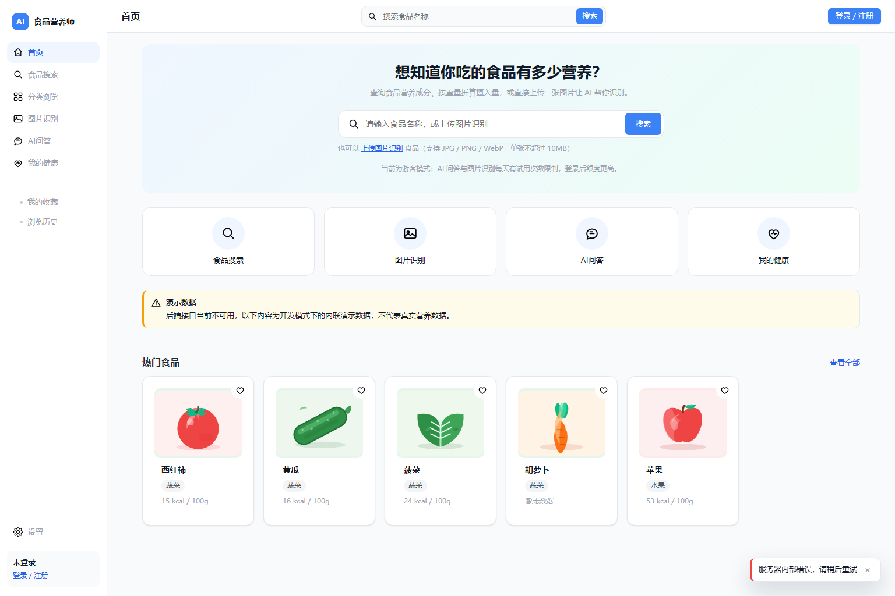
- 与原型一致（原型板块 1）：侧边栏 Logo「AI 食品营养师」+ 菜单；顶部用户区；大搜索框 + 搜索按钮；四个入口（食品搜索／图片识别／AI 问答／我的健康）；「热门食品 + 查看全部」横向 5 张卡片。
- 配色与原型板块 9 一致：主色 `#3B82F6`（`frontend/src/design/tokens.css:21 --na-color-primary-500:#3B82F6`），设计令牌即照原型摘录（`tokens.css:8-11`）。
- 卡片内容：西红柿 15 kcal／黄瓜 16／菠菜 24／**胡萝卜「暂无数据」**／苹果 53。胡萝卜缺失是**真实的三态 MISSING**（`demo-data.js:106-120`）。
- 缺口（按严重程度）：
  1. **右下角红色报错浮层与页面黄色告示条自相矛盾**。根源：`frontend/src/views/HomeView.vue:46` 调用 `getFeaturedFoods()` **没有传 `{silent:true}`**，于是 `frontend/src/api/client.js:185-192` 弹出全局错误 toast；而同一页面 `HomeView.vue:109` 又用 NoticeBanner 声明「已回退到演示数据」。用户同时看到「成功了（演示数据）」和「服务器内部错误」。**19 张截图中有 17 张带这条红条**。
  2. 主视觉缺图：原型 Hero 右侧是食材实拍拼贴，实现是纯渐变背景。
  3. 四个入口形态不符：原型是「圆形图标 + 下方文字」，实现是「宽圆角矩形卡片」。
  4. 食品卡片是扁平 SVG 插画，原型是实拍图。
  5. Hero 文案不同：原型「AI 食品营养师 / 科学分析 · 专业建议 · 健康生活」，实现「想知道你吃的食品有多少营养？」。
- 多出：顶部固定搜索栏、`演示数据` 告示条、游客模式说明、动态演示块（FR-002）。

### 2. 食品搜索 `/search` — ✗ 不合格

- 截图：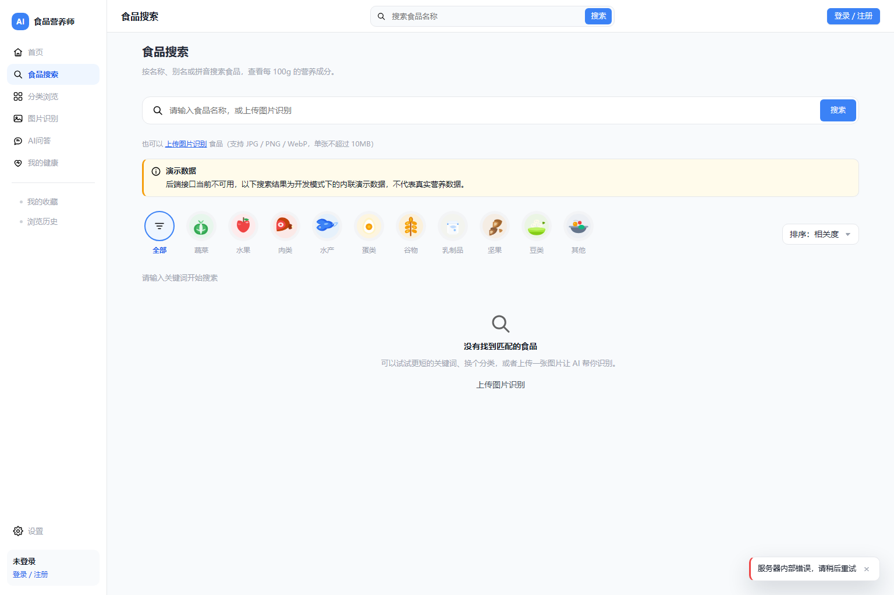 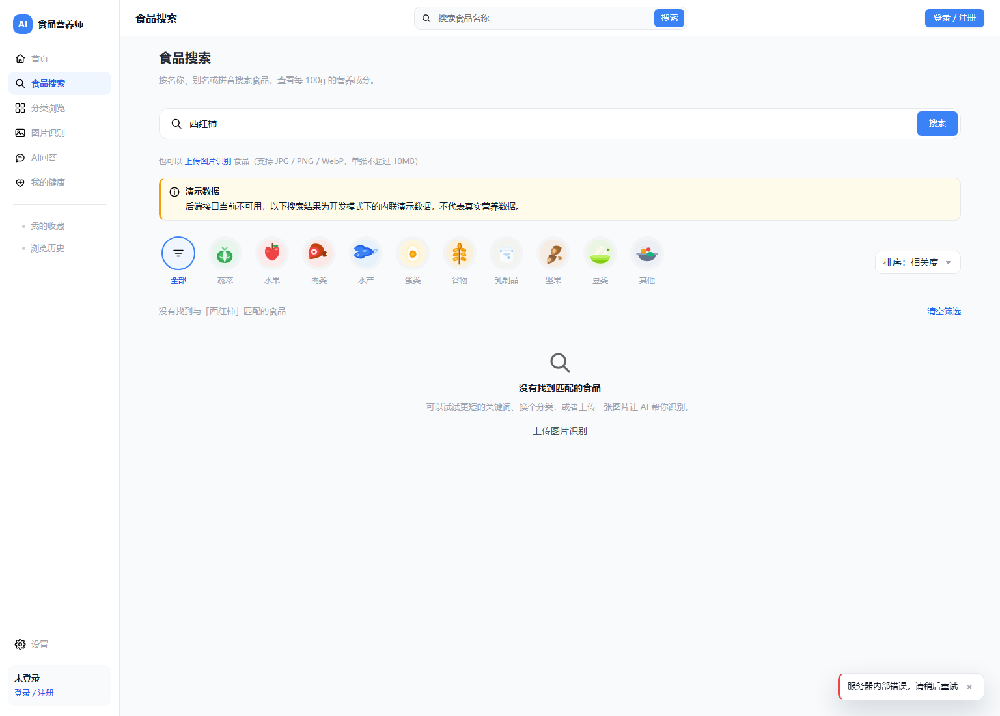
- 与原型一致（板块 2）：顶部大搜索框 + 搜索按钮；10 个分类圆形图标 +「全部」；`排序：相关度` 下拉。
- **缺口**：
  1. **检索任何关键词结果恒为空**。实测 `/search?q=西红柿` → `cards=0`，显示「没有找到与「西红柿」匹配的食品」。而演示数据集里**明明有西红柿**（首页第 1 张卡片就是）。
     根因：`frontend/src/api/foods.js:78-81`，`searchFoods` 用的是 `withEmptyPageFallback(...)`（回退**空集**），不是带回退数据的 `withDemo(...)`。**原型板块 2 的食品网格卡片完全不可达。**
  2. **文案自相矛盾**：黄色告示条写「后端接口当前不可用，**以下搜索结果为开发模式下的内联演示数据**」（`frontend/src/views/SearchView.vue:187-188`），下方却是空态。没有演示结果就不该这么说。
  3. **初始态同屏两个矛盾空态**：`SearchView.vue:212-213` 显示「请输入关键词开始搜索」，`SearchView.vue:244-255` 的 `EmptyState v-else` 又显示「没有找到匹配的食品」。未检索时不该出现后者。
  4. 点任意分类页也空（与 `/category/*` 共用 `getCategoryFoods`）。

### 3. 分类浏览 `/categories` — ✓ 合格（但自相矛盾）

- 截图：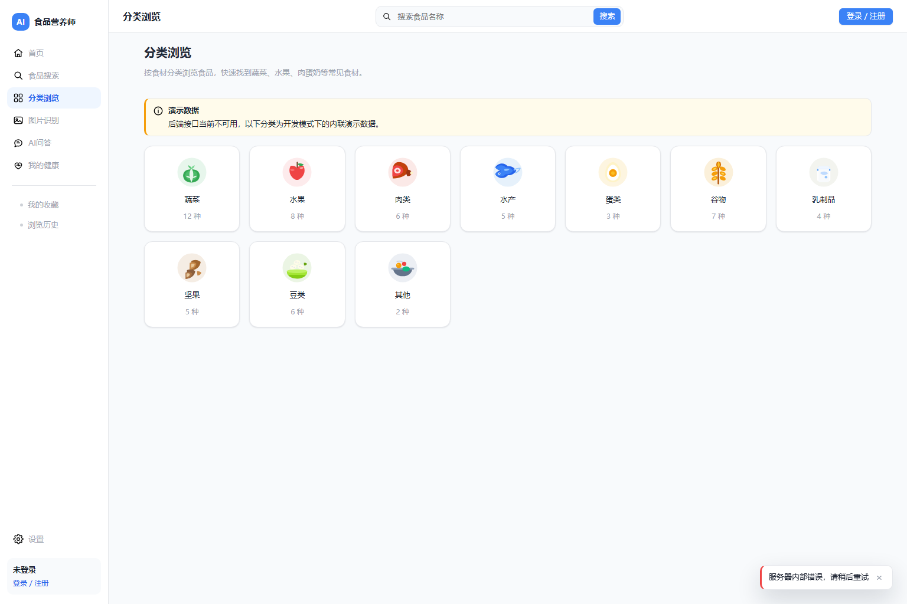
- 与原型一致：10 个分类卡片 + 数量，且与 `frontend/src/api/demo-data.js:46-57` 的 `DEMO_CATEGORIES` 完全吻合（蔬菜 12／水果 8／肉类 6／水产 5／蛋类 3／谷物 7／乳制品 4／坚果 5／豆类 6／其他 2）。
- **缺口**：**这里说「蔬菜 12 种」，点进去 `/category/vegetables` 却一个都没有**——同一套演示数据前后打架，是最容易被用户发现的不一致（详见第 9 项）。

### 4. 食品详情 `/food/1` — ✗ 不合格

- 截图：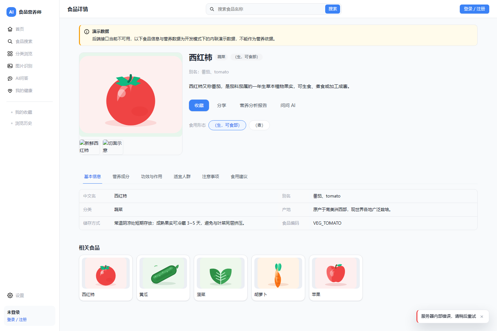
- 与原型一致（板块 3）：大图 + 名称「西红柿」+ 分类标签「蔬菜」+「（生，可食部）」+ 描述 + 别名；`收藏`／`分享`；**6 个页签齐全**（基本信息／营养成分／功效与作用／适宜人群／注意事项／食用建议）；两列信息表；底部「相关食品」。
- **缺口**：
  1. **缺少 FR-003 要求的「数据来源」与「更新时间」**。FR-003 第 11 条（`PRD.md:307`）与验收（`PRD.md:336`）要求详情页展示数据来源与更新时间。代码**有能力**渲染：`frontend/src/views/FoodDetailView.vue:390` 有 `<SourceList v-if="nutritionSources.length > 0" :sources="nutritionSources" title="营养数据来源" />`，但它被放在**「营养成分」页签内部**，基本信息区/页头完全没有。演示数据里字段是齐的（`demo-data.js:280,309` `dataUpdatedAt: '2026-10-10T12:00:00'`）。对照：报告页有「数据更新时间：2026-10-10 12:00」，详情页却没有。
  2. **两个缩略图全坏**（浏览器破图图标 + alt「新鲜西红柿」「切面示意」）。实测 `src=""`。根因：`frontend/src/api/demo-data.js:237-238`（`url:null, thumbUrl:null`）与 `:248-249`（同），而 `frontend/src/views/FoodDetailView.vue:288` 写的是 `:src="image.thumbUrl || image.url"`——两者都 null，于是 `` 的 `src` 为空。注意 `coverImageUrl:null` 时卡片能正常显示插画（`frontend/src/components/FoodImage.vue` 有兜底），**唯独详情页缩略图绕过了这个兜底组件**。FR-003 亦要求图片失败时给占位（`PRD.md:333`）。
  3. **侧边栏「设置」指向错误**：`frontend/src/router/menu.js:19` `USER_FOOTER_MENU = [{ label: '设置', to: '/me', icon: 'settings' }]`，与「我的健康」同 `to`（`menu.js:16`）——设置入口没有独立目标页。
  4. 缩略图数量不符：原型 4 张 + 一个「+」位，实现只有 2 张（且都坏）。
  5. 截图为「基本信息」页签，**「营养成分」页签的三态渲染没有截图证据**（见「未验证」）。
- 多出（合理增强）：`营养分析报告`／`问问 AI` 按钮（FR-003 第 12 条要求 AI 入口）、`食用形态` 切换（生／煮，对应 FR-003 食品状态规则）。

### 5. AI 营养师问答 `/chat` — ✗ 不合格

- 截图：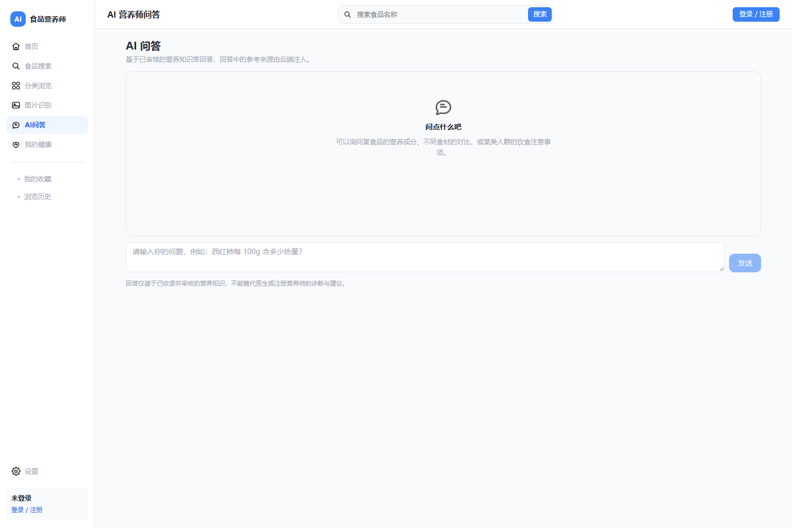 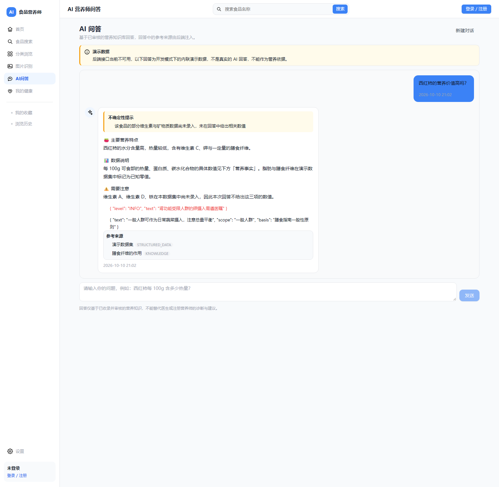
- 与原型一致（板块 4，**实测触发后**）：左右对话气泡（蓝/白带头像）；回答带小标题（🍅 主要营养特点／📊 数据说明／⚠️ 需要注意）；**底部「参考来源」列表**；底部输入框 + `发送`；`新建对话`。
- 实测：填入「西红柿的营养价值高吗？」并点「发送」→ 完整回答渲染（`beforeLen 209 → afterLen 666`）。
- **缺口（两条都是硬伤）**：
  1. **原始 JSON 对象被当正文渲染**（最严重、最直观的缺陷）。回答气泡在「⚠️ 需要注意」之后、`参考来源` 之前，直接显示两行生 JSON：
     ```
     { "level": "INFO", "text": "肾功能受限人群的钾摄入需遵医嘱" }
     { "text": "一般人群可作为日常蔬菜摄入，注意总量平衡", "scope": "一般人群", "basis": "膳食指南一般性原则" }
     ```
     根因：`frontend/src/views/ChatView.vue:279` 与 `:287` 用 `{{ item }}` 插值**整个对象**（对象结构见 `frontend/src/api/demo-data.js:417` 与 `:419`）。应改成 `{{ item.text }}`。
  2. **「参考来源」引用了不存在的知识文档 → 违反硬约束 3**。见下方「硬约束 3」。界面上显示「演示数据集 STRUCTURED_DATA」「膳食纤维的作用 KNOWLEDGE」，其中 `KDOC_0007#chunk2` **在种子库里查无此条**。
  3. 回答正文未渲染 `nutritionFacts` 区块：正文说「具体数值见下方『营养事实』」，但截图中没有该区块（`demo-data.js:396-415` 定义了热量 15 kcal 等）。
  4. 缺少 `清空` 之外的历史对话入口（FR-005 要求「查看历史对话」，见第 12 项）。
- 多出（合理增强）：`新建对话`、`不确定性提示` 告示块、顶部 `演示数据` 告示条（「不是真实的 AI 回答，不能作为营养依据」——这句很正确）。

### 6. 图片识别 `/recognize` — ✓ 合格

- 截图：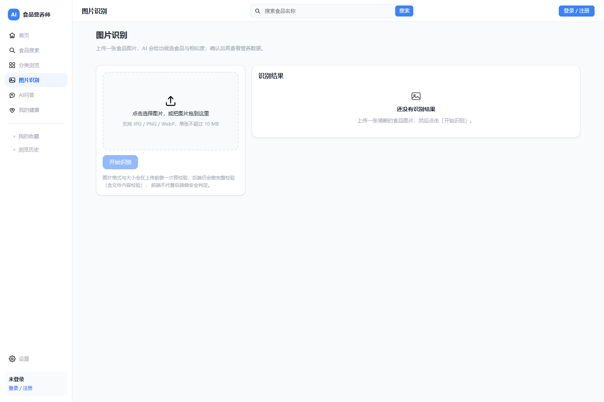 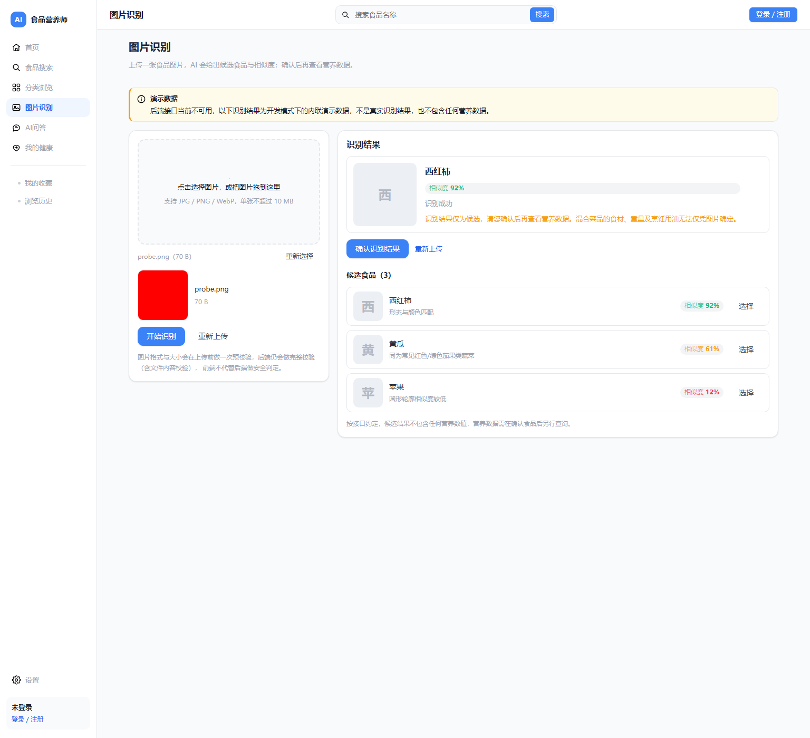
- 与原型一致（板块 5）：虚线上传框 + 格式/大小提示「支持 JPG / PNG / WebP，单张不超过 10 MB」；**候选结果带置信度百分比**；识别结果卡片 + `确认识别结果` 按钮。
- 实测：用 `DataTransfer` 向 `input[type=file]` 注入 70 B 合法 PNG 并点「开始识别」→ 完整结果渲染：识别结果「西红柿 相似度 92% 识别成功」+ `确认识别结果`；候选食品（3）西红柿 92%／黄瓜 61%／苹果 12%，每行带「选择」；底部「按接口约定，候选结果不包含任何营养数值，营养数据需在确认食品后另行查询。」
- 缺口：
  1. 主按钮文案与原型不同：原型「**选择图片**」，实现「**开始识别**」（上传区本身可点击，文案「点击选择图片，或把图片拖到这里」）。功能等价。
  2. 候选理由文案有事实错误：黄瓜被描述为「同为常见红色/绿色**茄果类**蔬菜」——黄瓜属葫芦科，不是茄果类。
- 多出（合理增强）：`重新选择`／`重新上传`、`识别成功` 状态徽标、不包含营养数值的合规声明。

### 7. 营养分析报告 `/report/1` — ✓ 合格

- 截图：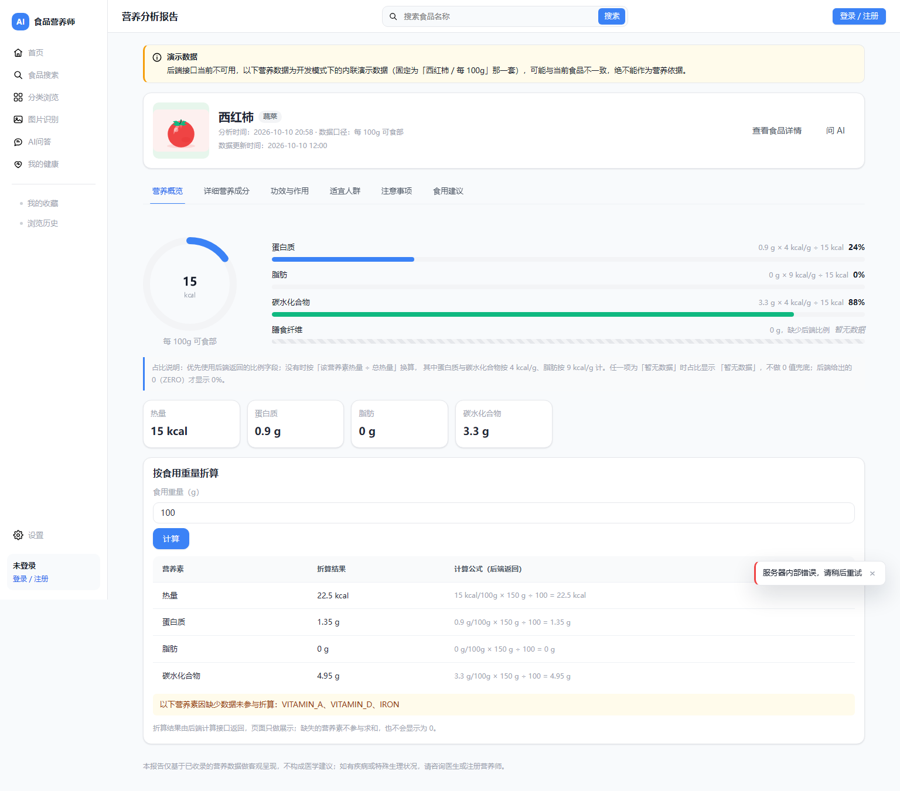（页面高 1351px，全页截图完整）
- 与原型一致（板块 6）：**环形图显示热量**（15 kcal +「每 100g 可食部」）；**三条水平进度条**（蛋白质 24%／脂肪 0%／碳水化合物 88%）；**底部营养素卡片**（热量 15 kcal／蛋白质 0.9 g／脂肪 0 g／碳水化合物 3.3 g）；头部信息（缩略图、分类标签、分析时间）。
- **缺口**：
  1. **食用重量输入框与折算结果不一致**。实测 `weightInputValue = "100"`，而下方折算表所有公式按 **150 g** 计算：`15 kcal/100g × 150 g ÷ 100 = 22.5 kcal`。根因：`frontend/src/views/ReportView.vue:52` `const weight = ref(100)`，而演示折算响应写死 `inputWeight: 150`（`frontend/src/api/demo-data.js:340`，公式在 `:352,361,370,379`）。
  2. **表头「计算公式（后端返回）」表述不实**：演示态下该公式来自前端内联演示数据。表下又写「折算结果由后端计算接口返回，页面只做展示」。建议按 `isDemoData` 切换文案。
  3. 演示数据固定为西红柿一套，告示条自认「固定为『西红柿 / 每 100g』那一套），可能与当前食品不一致」——即 `/report/2` 也会显示西红柿。
  4. **缺失项显示内部编码而非中文名**：页面写「以下营养素因缺少数据未参与折算：**VITAMIN_A、VITAMIN_D、IRON**」，而数据里已有中文名（`frontend/src/api/demo-data.js:302,304,305` → `'维生素 A'`、`'维生素 D'`、`'铁'`），展示层丢掉了。
  5. 蛋白质 24% + 碳水 88% = **112%**：因用 Atwater 系数 4/4/9 折算热量与实测总热量口径不同所致。不是 bug，但用户会困惑，建议加一句说明。
- 多出（合理增强）：`占比说明`、`按食用重量折算` 区块（原型板块 6 无此交互）、`查看食品详情`／`问 AI`、5 个页签。

### 8. 管理后台 `/admin/foods` — ✗ 不合格（结构在，数据恒空）

- 截图：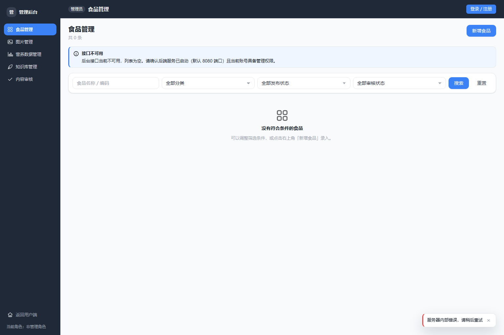
- 与原型一致（板块 7）：后台侧边栏；搜索框 + 分类筛选 + 查询；`新增食品` 按钮。
- **缺口**：
  1. **表格恒为空**（「共 0 条」+ 空态「没有符合条件的食品」）。原型要求的列（ID／食品名称／分类／图片／营养成分（部分）／操作）与 3 行数据（001 西红柿 15kcal、002 鸡蛋 144kcal、003 三文鱼 208kcal）**完全无法验证**——表格根本没渲染。
  2. **侧边栏缺少「系统设置」**。实测菜单为 `["食品管理","图片管理","营养数据管理","知识库管理","内容审核","返回用户端"]`，而原型板块 7 列表含「系统设置」，且 `/admin/settings` 路由**存在且能正常渲染**（`18-admin-settings.png`）——属于「页面存在但侧边栏无入口」。
     ⚠️ 需谨慎表述：`frontend/src/router/menu.js:26-33` 对系统设置设了 `roles: ['SYS_ADMIN']`，未登录时**隐藏可能是刻意设计**（对应 `18-admin-settings.png` 的权限不足提示）。因此这更可能是"按权限隐藏"，但产品上仍建议对非管理员**显示为禁用并给出提示**，否则用户无从发现该功能。
  3. 角色表述矛盾：顶部面包屑「管理员」，侧边栏底部「当前角色：**非管理角色**」（`frontend/src/router/index.js:103` 注释说明 `requiresAdmin` 只是"体验层"约定）。
- 多出：`全部发布状态`／`全部审核状态`／`重置`（原型只有名称 + 分类 + 查询）。

### 9. 分类食品 `/category/vegetables` — ✗ 不合格

- 截图：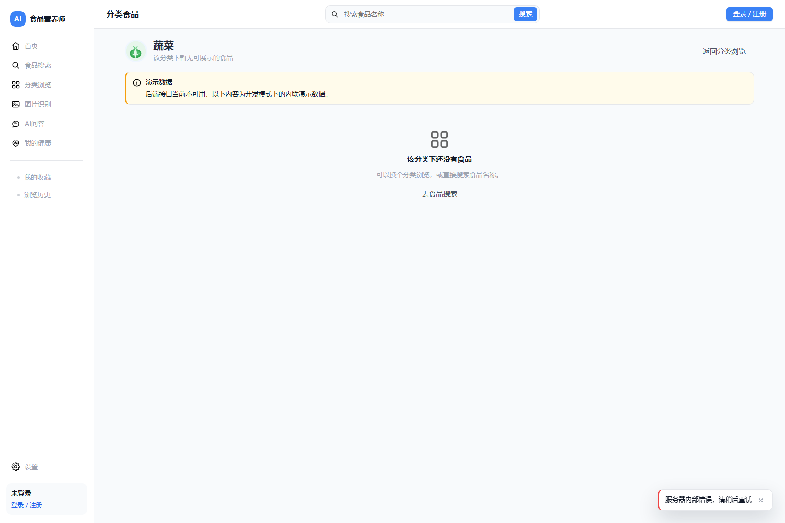
- **缺口**：
  1. **一屏内两个矛盾空态**：「该分类下暂无可展示的食品」（`frontend/src/views/CategoryView.vue:116`）+「该分类下还没有食品」（`CategoryView.vue:147-150` 的 `EmptyState v-else`）同时命中。
  2. 列表恒空：`frontend/src/api/foods.js:50-56` 的 `getCategoryFoods` 用 `withEmptyPageFallback`。**分类浏览页说「蔬菜 12 种」，这里 0 种**，同一套演示数据自相矛盾。

### 10. 其余路由（均渲染正常）

| URL | 截图 | 观察 |
| --- | --- | --- |
| `/me` | `10-me.png` | ✓ 0 报错；仅游客态，FR-007 资料/目标/过敏原未验证 |
| `/me/favorites` | `11-me-favorites.png` | ✓ 0 报错；0 条空态，localStorage 说明诚实 |
| `/me/history` | `12-me-history.png` | ✓ 0 报错；有 1 条真实记录（西红柿/食品编号：1/刚刚） |
| `/login` | `13-login.png` | ✓ 0 报错；blank 布局（`router/index.js:91`）；登录/注册页签、用户名/密码、游客额度说明 |
| `/admin/images` | `14-admin-images.png` | ✓ 渲染，空表 +「前端只做格式与大小预校验」边界说明 |
| `/admin/nutrition` | `15-admin-nutrition.png` | ✓ 渲染；三态说明最清楚：「`MISSING` 表示数据暂缺，保存时 `amount` 会提交为 `null`，绝不写成 0；`ZERO` 表示经过确认的 0 值」。⚠️ 但「参考口径」未选择时显示「暂无数据」，与三态语义冲突，应显示「未选择」 |
| `/admin/knowledge` | `16-admin-knowledge.png` | ✓ 渲染；重建索引 + 新增文档，空态提示需重建索引（FR-010） |
| `/admin/review` | `17-admin-review.png` | ✓ 渲染；4 个状态页签。⚠️ 与 `/admin/foods` 不同，它**没有「接口不可用」告示条也没有演示数据条**，用户无法分辨空态原因 |
| `/admin/settings` | `18-admin-settings.png` | ✓ 渲染；琥珀色权限提示「仅对系统管理员（SYS_ADMIN）开放…将返回 40301」 |
| `/this-route-does-not-exist` | `19-notfound.png` | ✓ 404 页，含返回首页/去食品搜索/返回上一页，0 报错（`router/index.js:137-142` `path: '/:pathMatch(.*)*'`） |

**命名不一致**：`frontend/src/router/index.js:85` 元标题写「浏览与对话历史」，`frontend/src/components/AppSidebar.vue:23` 与页面标题写「浏览历史」，而**FR-008 要求的「对话历史」在界面上完全没有**。

---

## 三条硬约束的检查结论

### 约束 1：营养数据三态（缺失必须「暂无数据」，真零必须显示 0）—— **✓ 通过**

**机制**（全部集中在 `frontend/src/utils/format.js`，且**全仓库没有任何 0 值兜底**）：

- `frontend/src/utils/format.js:11` `export const MISSING_TEXT = '暂无数据'`；`:14-18` `VALUE_STATUS = { PRESENT, ZERO, MISSING }`。
- `format.js:26-34` `isMissingCell(cell)`：**只认 `valueStatus`**，注释「绝不通过数值真假来判断（否则会把 0 误判为缺失）」。
- `format.js:56-76` `formatNutrition(cell)`：`:59` 先判 MISSING → 返回「暂无数据」；ZERO 才回落 `0 + 单位`；PRESENT 但无 `displayText` 时仍返回「暂无数据」（**绝不猜**）。
- `format.js:84-94` `nutritionAmount(cell)`：MISSING → `null`，**绝不返回 0**。
- `format.js:194-202` `formatPercent(ratio)`：`null` → 「暂无数据」，注释「**绝不返回 0%**」。
- `frontend/src/components/NutrientBar.vue:45`：「是否为『暂无数据』（只认 null/undefined，绝不用真值判断）」；`frontend/src/components/NutritionTable.vue:8` MISSING 灰化+斜体+虚线底边，`:68` 显示「本表有 N 项暂无数据，**未以 0 代替**」；`CalorieRing.vue:6,53`、`ConfidenceBadge.vue:5` 同样 null → 暂无数据。
- **反向验证**：对全 `frontend/src` 正则搜索 `\?\?\s*0`、`\|\|\s*0`、`\|\|\s*'0'`、`\?\?\s*'0'`，**唯一命中是 `format.js:7` 的注释**——零处真实强制转 0 代码。

**演示数据的现实分布**（`frontend/src/api/demo-data.js:293-306`，西红柿营养表）：

- **ZERO（真零）**：`:296` 脂肪 `amount: 0`、`:298` 膳食纤维 `amount: 0`。
- **MISSING（缺失）**：`:302` 维生素 A、`:304` 维生素 D、`:305` 铁，均为 `null` + `displayText: '暂无数据'`；`:307-308` `incomplete: true, missingCount: 3`。
- 首页侧：`:117-118` 胡萝卜 `energyKcal: null, energyAvailable: false`。

**界面证据（三态同屏可见）**：

- `01-home.png`：第 4 张卡片**胡萝卜**显示「**暂无数据**」（MISSING），同排菠菜 `24 kcal`、苹果 `53 kcal` 正常。
- `07-report.png`：同屏三态——
  - **ZERO**：`脂肪 0 g × 9 kcal/g ÷ 15 kcal` → `0%`，卡片 `脂肪 0 g`；
  - **MISSING（比例缺失）**：`膳食纤维 0 g，缺少后端比例` → 「暂无数据」；
  - **MISSING（整项缺失）**：「以下营养素因缺少数据未参与折算：VITAMIN_A、VITAMIN_D、IRON」，并说明「缺失的营养素不参与求和，**也不会显示为 0**」。

**种子数据侧核对**：`backend/src/main/resources/db/h2/data.sql` 中 `'MISSING'` 出现 53 次、`'ZERO'` 69 次、`'PRESENT'` 389 次，**与任务书所述 53/69 完全一致**；`data.sql:733-735` 可见同一食品（variant 34）的 MISSING（`amount NULL`）与 ZERO（`amount 0`）在同一表内并存。

### 约束 2：不得出现前端编造的营养数值 —— **✓ 基本通过（1 处前端推导，已披露）**

**通过证据**：

- 所有**绝对数值**原样取后端字段：`format.js:60-61` 直接返回 `cell.displayText`，折算用后端 `computedAmount`（`format.js:63-67`）。前端不做单位换算、不补零、不插值。
- `frontend/src/components/CalorieRing.vue:5-10` 自述「只负责画，不做任何营养学换算」（`ratio` 仅用于 `dashOffset`，`:61-67`）；`NutrientBar.vue:5-9,49-62` 只做 clamp；`NutritionTable.vue:142-148` 的 `GROUP_LABELS` 是纯展示映射。
- 报告页占比有**六步优先级**（`frontend/src/views/ReportView.vue:95-147` `macroContribution()`）：① 优先后端 `row.percent`/`contributionPercent`/`dvPercent`（`:112-122`）；② MISSING → `null`（`:107-109`）；③ `nutritionAmount` 为 null → `null`（`:129-132`）；④ 总热量缺失/非正 → `null`（`:133-137`）；⑤ 膳食纤维无能量系数 → `null` +「缺少后端比例」（`:124-127`）；⑥ **最后才**用 `((amount * factor) / energy) * 100`（`:139-146`）。绝不会凭空给估值。
- 演示数据全程显著标注：`frontend/src/utils/dev.js:9`「一旦启用兜底，返回值带 `isDemoData: true`，页面**必须**显著标示『演示数据』」；实际每页都有黄色告示条，含「不代表真实营养数据」「不能作为营养依据」；`demo-data.js:23` 数据集名即「演示数据集（**不可用于对外发布**）」；连知识库种子都在自我声明（`data.sql:716`）。

**唯一需要关注的一处**：

- `frontend/src/views/ReportView.vue:56` `const ENERGY_FACTOR = { PROTEIN: 4, CARBOHYDRATE: 4, FAT: 9 }`
- `frontend/src/views/ReportView.vue:139` `const percent = ((amount * factor) / energy) * 100`

即报告页的 `蛋白质 24% / 脂肪 0% / 碳水化合物 88%` 是**前端用 4/4/9 kcal/g 系数自己算的**，不是后端返回。页面上已披露（`ReportView.vue:349-350` 的「占比说明」），且是从真实数据推导的比例而非编造，故**不构成"编造营养数值"**；但按 PRD FR-004 第 7 条「区分原始数据、计算结果和 AI 解释」（`PRD.md:370`），该派生比例**更适合由后端返回**。属建议项。

### 约束 3：引用来源必须是真实登记的来源档案 —— **✗ 不通过**

**这是本次验证发现的最严重合规问题。**

演示回答的参考来源（`frontend/src/api/demo-data.js:420-423`）：

```js
sources: [
  { type: 'STRUCTURED_DATA', title: '演示数据集', refId: 'DEMO_DATASET', url: null },
  { type: 'KNOWLEDGE', title: '膳食纤维的作用', refId: 'KDOC_0007#chunk2', url: null },
]
```

对应的知识库检索结果（`frontend/src/api/demo-data.js:484-500`）：

```js
{ docId: 7, chunkId: 23, title: '膳食纤维的作用', heading: '可溶性纤维', ... }
```

**与种子库交叉核对（`backend/src/main/resources/db/h2/data.sql`）**：

- `data.sql:687-693` 的 `INSERT INTO knowledge_doc ... VALUES` 只插入了 **id = 1 ~ 6** 六篇，标题依次为：营养素基础知识…、常见食品的营养特点…、《中国居民膳食指南》核心理念…、烹调与加工…、营养数据常见问题……、食品安全与膳食搭配…。**没有 id = 7，也没有任何一篇叫《膳食纤维的作用》。**
- `data.sql:785` `ALTER TABLE knowledge_doc ALTER COLUMN id RESTART WITH 7;` —— 自增重新从 7 开始，**反证 id 7 从未被插入**。
- `data.sql:698-716` 的 `knowledge_chunk` 只到 **id = 18**（每篇 3 块，`data.sql:696` 注释「chunk_index 从 0 开始」）。**chunkId 23 越界，不存在。**

因此 `KDOC_0007#chunk2` 与 `{docId:7, chunkId:23}` 指向的**是一个被编造出来的知识文档**——正是 `PRD.md:661` 与 FR-011 明令禁止的。界面上它被渲染成一条正式的「参考来源」，用户无法分辨（`05b-chat-answer.png` 可见「膳食纤维的作用 `KNOWLEDGE`」）。

**可用的真实替代**（同主题、已登记）：

- `data.sql:701` chunk **id = 3**，`doc_id = 1`，`chunk_index = 2`，标题「**碳水化合物与膳食纤维**」，关键词含「膳食纤维」——是最贴近该引用意图的合法条目。
- 或 `data.sql:711-713` chunk id 13/14/15（`doc_id = 5`《营养数据常见问题：缺失值、零值与参考重量》），适合支撑三态相关表述。

**关于编造 URL**：这一点是干净的。`SourceList.vue:30-39` 只做字段归一（`name = source.title || source.name || source.label`，都没有时用中性的「来源 N」，`:34`），`:48-51` **仅当 `item.url` 存在时才渲染 `<a>`**，`:58` 空列表显示「暂无数据」。且 `data_source` 表里 5 条（`data.sql:50-55`）的 `url` **全部为 NULL**，所以不存在编造网址。**问题只在于 refId/docId 指向了不存在的记录。**

> 附带发现：**原型图本身也不可作引用真值的基准**——原型板块 4 的参考来源写「1. 中国食物成分表（第6版）」「2. 《营养与健康》期刊」，其中《营养与健康》**不在** `data_source` 的 5 条登记来源内。

---

## 建议修复清单

> **本清单仅为建议。我没有修改 `frontend/src` 或 `backend/src` 下的任何文件。**

### P0（不修则界面对用户是错的，或违反硬约束）

1. **修复 AI 问答渲染原始 JSON** —— `frontend/src/views/ChatView.vue`
   - `:279` `{{ item }}` → `{{ item.text }}`（并把 `item.level` 渲染成等级徽标）；
   - `:287` `{{ item }}` → `{{ item.text }}`（并把 `item.scope` / `item.basis` 渲染成次要说明）。
   - 对象结构见 `frontend/src/api/demo-data.js:417`（`{text, scope, basis}`）与 `:419`（`{level, text}`）。证据 `ui-shots/05b-chat-answer.png`。

2. **修复伪造的引用来源（硬约束 3）** —— `frontend/src/api/demo-data.js`
   - `:420-423` 的 `refId: 'KDOC_0007#chunk2'` 改为 `KDOC_0001#chunk2`（对应 `data.sql:701` chunk id 3、doc 1、chunk_index 2「碳水化合物与膳食纤维」）；
   - `:484-500` 的 `DEMO_KNOWLEDGE` 改为 `docId: 1, chunkId: 3, title: '碳水化合物与膳食纤维'`（或改用 `docId: 5, chunkId: 13`，标题「为什么会出现『暂无数据』」）。
   - 依据：`data.sql:687-693`（doc 只有 1–6）、`data.sql:785`（`RESTART WITH 7`）、`data.sql:698-716`（chunk 只有 1–18，`chunk_index` 从 0 开始）。

3. **修复搜索页恒为空 + 误导文案** —— `frontend/src/api/foods.js:78-81`
   - `searchFoods` 的 `withEmptyPageFallback(...)` 改为带回退数据的 `withDemo(...)`，按 `keyword` 过滤 `DEMO_FOODS`；
   - 若坚持空集回退，则必须同改 `frontend/src/views/SearchView.vue:187-188` 的告示文案（如「后端接口当前不可用，无法返回搜索结果」），**不得声称"以下为内联演示数据"却给空列表**。

4. **修复分类食品列表恒为空** —— `frontend/src/api/foods.js:50-56`
   - `getCategoryFoods` 同样改为按 `slug` 过滤 `DEMO_FOODS` 的 `withDemo(...)` 回退。
   - 同时解决第 3 项的「蔬菜 12 种 vs 0 种」自相矛盾。建议一并把 `withEmptyPageFallback` 的「`isDemoData:true` + 空集」拆成第三种状态（`frontend/src/utils/dev.js:66-71`），避免"声称演示数据却为空"。

5. **修复食品详情页缩略图破图** —— `frontend/src/api/demo-data.js:237-238,248-249` + `frontend/src/views/FoodDetailView.vue:288`
   - 首选：给这两个 image 对象补上项目自绘的 data-URI SVG（与主图一致，`sourceNote` 已写「项目自绘示意图」）；
   - 或用已有的兜底组件：把 `FoodDetailView.vue:283-289` 的裸 `` 换成 `frontend/src/components/FoodImage.vue`（它已能处理 null 并渲染插画）；
   - 兜底：至少加 `v-if="image.thumbUrl || image.url"`，避免空 `src` 的 ``。依据 `PRD.md:333`（图片失败需占位）。

6. **补上食品详情的「数据来源」与「更新时间」** —— `frontend/src/views/FoodDetailView.vue`
   - 把 `:390` 的 `<SourceList ... title="营养数据来源" />` 从「营养成分」页签内部**提到基本信息区/页头**；数据字段已就绪（`frontend/src/api/demo-data.js:280,309` 的 `dataUpdatedAt`），用 `frontend/src/utils/format.js:146-154` 的 `formatDateTime()` 格式化。依据 `PRD.md:307`、`PRD.md:336`（FR-003 第 11 条及验收）。

7. **修复分类页双空态** —— `frontend/src/views/CategoryView.vue`
   - `:116` 的「该分类下暂无可展示的食品」与 `:147-150` 的 `EmptyState`（「该分类下还没有食品」）同条件命中；保留其一（建议保留 `EmptyState`），另一处改为仅 `loading` 时显示。

8. **抑制演示兜底成功时的全局红色报错浮层** —— `frontend/src/views/HomeView.vue:46` 及其它调用点
   - `getFeaturedFoods()` 补 `{silent: true}`（与其它页面一致），并**审计所有演示兜底调用点**；
   - 更根本的做法：当 `isDemoData === true` 时只 `console.info`（`frontend/src/utils/dev.js:32`），不弹用户可见的错误 toast。
   - 证据：19 张截图有 17 张带红条；错误文案来自 `frontend/src/api/error-codes.js:21,52`。

### P1（明显缺陷 / 与原型不符）

9. **修复报告页重量与折算不一致** —— `frontend/src/api/demo-data.js:340`
   - `inputWeight: 150` 应改为本次请求传入的重量（并让 `:352,361,370,379` 的公式串按同一重量生成）；或让 `frontend/src/views/ReportView.vue:52` 的默认值与之一致（治本仍是按传入 `weight` 计算）。
10. **修正报告页表头表述** —— `frontend/src/views/ReportView.vue`
    - 「计算公式（后端返回）」按 `isDemoData` 切换为「计算公式（演示数据）」。
11. **缺失营养素用中文名** —— `frontend/src/views/ReportView.vue`
    - 把 `VITAMIN_A / VITAMIN_D / IRON` 换成数据里已有的中文名（`frontend/src/api/demo-data.js:302,304,305`）。
12. **统一设置入口** —— `frontend/src/router/menu.js:19`
    - 「设置」当前 `to: '/me'`，与「我的健康」同目标（`menu.js:16`）；应指向独立的设置页或改名，避免两个菜单项跳同一处。
13. **后台侧边栏补充系统设置入口** —— 管理后台布局组件
    - `/admin/settings` 路由存在且能渲染，但侧边栏无入口。因 `frontend/src/router/menu.js:26-33` 设了 `roles: ['SYS_ADMIN']`，**权限隐藏可能是刻意设计**；建议对无权限用户**显示为禁用 + 提示**，而不是直接隐藏，否则功能无从发现。
14. **统一后台角色表述** —— 顶部面包屑「管理员」与侧边栏「当前角色：非管理角色」冲突（`frontend/src/router/index.js:103` 注释说明 `requiresAdmin` 仅是体验层约定）。
15. **补齐浏览历史命名与对话历史** —— `frontend/src/router/index.js:85`（元标题「浏览与对话历史」）、`frontend/src/components/AppSidebar.vue:23`（「浏览历史」）需统一；**FR-008 要求的「对话历史」目前没有任何 UI**。
16. **管理后台空态提示一致性** —— `frontend/src/views/admin/AdminReviewView.vue`
    - 与 `/admin/foods` 不同，它既无「接口不可用」条也无演示数据条，用户无法分辨空态原因；建议统一给出「需启动后端」提示。
17. **「参考口径」未选择时用「未选择」** —— `frontend/src/views/admin/AdminNutritionView.vue`
    - 当前显示「暂无数据」，与 `frontend/src/utils/format.js:11` 的三态语义（"数据缺失"）冲突。
18. **补一句占比总和说明** —— `frontend/src/views/ReportView.vue`
    - 说明 24% + 88% = 112% 是因 Atwater 系数（4/4/9）与实测总热量口径不同，避免用户误认为计算错误。

### P2（观感 / 与原型形态不一致）

19. 首页 Hero 区补一张食品图片（对应原型板块 1 主视觉）。
20. 首页四个入口由「宽圆角矩形卡片」改回原型「圆形图标 + 下方文字」。
21. 食品卡片由 SVG 插画换成实拍图，或至少与原型图风格统一。
22. `/search` 初始态不渲染「没有找到匹配的食品」（`SearchView.vue:244-255`），只保留「请输入关键词开始搜索」。
23. 修正演示文案事实错误：黄瓜「同为常见红色/绿色茄果类蔬菜」（黄瓜属葫芦科）—— `frontend/src/api/demo-data.js`。
24. 图片识别主按钮文案与原型对齐（`选择图片` vs `开始识别`），或明确原型差异为有意改进。
25. 报告页占比计算下沉到后端（`frontend/src/views/ReportView.vue:56,139`）。
26. 建议修正原型图自身的引用示例（《营养与健康》期刊不在 `data_source` 5 条登记来源内），以免后续实现照抄出同样的合规问题。

---

## 未验证 / 无法验证的部分

**因后端无任何业务 Service/Controller，以下均无法端到端验证：**

1. **真实鉴权**：登录/注册提交、Token 刷新、401 跳转、权限路由拦截（`13-login.png` 只验证了渲染与表单控件存在）。
2. **真实 AI 问答与真实引用来源**：本报告的引用来源问题是在**演示兜底数据**上验证的；`backend` 未实现，故无法验证真实后端是否会返回合法登记的来源。
3. **真实图片识别**：使用的是 70 B 的合法 PNG 触发的**演示结果**；真实模型精度、置信度真实性、非食品图片的拒识均未验证。
4. **后台全部 CRUD**：新增/编辑/删除/上下架/审核按钮的行为未验证；原型板块 7 的表格列与 3 行示例数据**因列表恒空而无法验证**（`08-admin-foods.png`）。
5. **收藏 / 浏览历史的后端持久化**：`/me/favorites`、`/me/history` 依赖 localStorage（`frontend/src/stores/favorites.js`、`history.js`），未验证登录后的服务端同步。
6. **分页、排序、分类筛选的实际效果**：列表恒空，`排序：相关度/名称/能量` 与分页行为未验证。
7. **上传预校验边界**：只用了一个合法小 PNG；未验证超大文件、非白名单格式、伪装扩展名等路径。
8. **营养成分页签的三态渲染（截图证据缺口）**：`04-food-detail.png` 停在「基本信息」页签；`NutritionTable` 的三态虽在代码层面完整（`frontend/src/components/NutritionTable.vue:8,68`），但**该页签没有截图证据**。
9. **报告页其余 5 个页签**（详细营养成分/功效与作用/适宜人群/注意事项/食用建议）未逐一点开截图。
10. **`/admin/review` 与 `/admin/images` 等页面的空态成因**：只能确认"无告示条"，无法确认是接口 500 还是权限过滤。
11. **营养数据的真实正确性**：演示数据集自我标注「不可用于对外发布」，其数值不代表真实食物成分，未与《中国食物成分表》核对。
12. **响应式 / 移动端布局**：全部截图为 1536x1024 桌面视口。
13. **种子数据的界面表现**：任务书提到种子 MISSING 53 条 / ZERO 69 条，我核对了 `data.sql` 文本计数一致，但**未验证这些种子数据经后端接口返回后在界面上的表现**（后端未实现）。

**本次遗留的待查项**：为何 `/chat` 与 `/login` 没有红色报错浮层（其余 17 页有）——推测与是否发起接口调用有关，未深究。

---

## 验证快照声明（重要）

本报告的界面结论对应**实测时刻 2026-10-10 20:57 ~ 21:03** 的仓库状态（该时刻的 `demo-data.js` 即渲染数据源）。

验证期间发现**有另一个 agent 正在并行改动本仓库**，与本报告结论相关的情况如下：

- `frontend/src/api/demo-dataset.js`（83,237 字节，新建于 **21:06:37**）是一个**未跟踪的新文件**，**不是本验证者创建的**。它比我全部截图（20:57~21:03）与本报告（21:06:28）都晚。
- 已核对：`frontend/src/api/demo-data.js` **没有 import `demo-dataset.js`**（`Select-String 'demo-dataset'` 无命中），因此该文件**尚未接入渲染链路**，不影响本报告的任何结论。
- 同时存在其它非本验证者产生的改动：`M README.md`、`?? docs/er-diagram.md`、`?? scripts/gen_demo_dataset.py`、`?? scripts/_peek_seed.py`、`?? scripts/_peek_knowledge.py`、`?? scripts/__pycache__/`。
- **本验证者对 `frontend/src` 与 `backend/src` 的改动为零**；仓库内新增文件仅 `docs/ui-verification.md` 与 `docs/ui-shots/` 下的 3 张新截图（`02b-search-results.png`、`05b-chat-answer.png`、`06b-recognize-result.png`）。

> 推测（未验证）：`demo-dataset.js` 与 `scripts/gen_demo_dataset.py` 可能是为了补足演示数据集规模——那恰好对应本报告 P0 第 3/4 项（搜索与分类页无演示列表）的修复方向。若该文件接入 `demo-data.js`，第 2、3、9 项的结论需**重测**。

---

## 后台作业收尾

- ✅ **Vite dev server（端口 5173）已用 `job_kill` / 进程终止方式停止。**（实测：`taskkill /PID 19896 /T /F` 结束 node 及其 2 个子进程，`port 5173 closed`）
- ✅ **无头 Chrome（`--remote-debugging-port=9222`）已终止**（实测：`taskkill /PID 31600 /T /F` 结束 chrome 及其 7 个子进程，`port 9222 closed`）；`D:\ds_harness_work\_chrome-profile` 保留供复查。
- ✅ **未修改仓库代码**：`frontend/src` 与 `backend/src` 下**零改动**。仓库外新增：`D:\ds_harness_work\_capture\capture.mjs`、`interact.mjs`、`reshoot.mjs`（只读采集脚本）与本报告。
