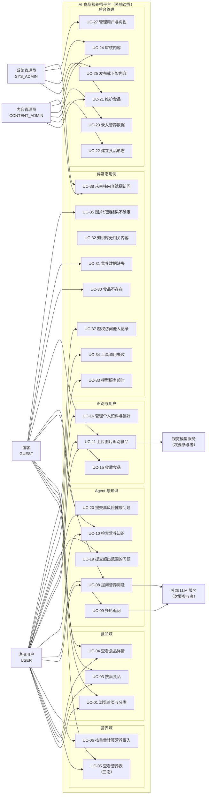
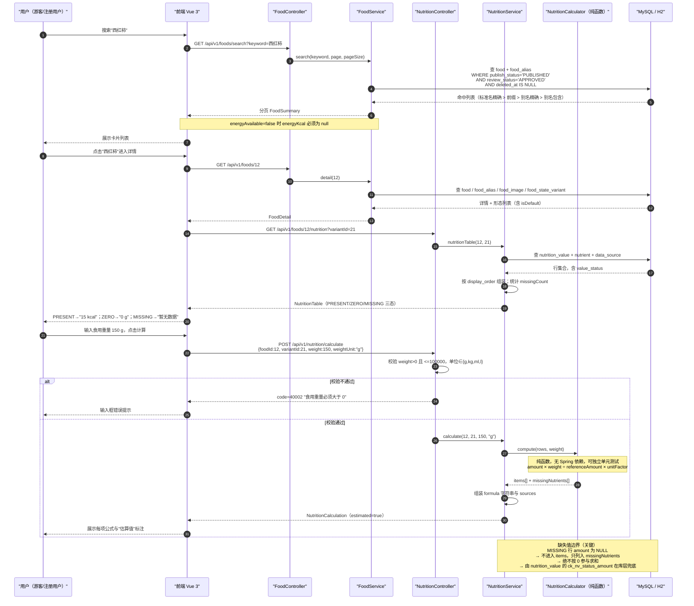
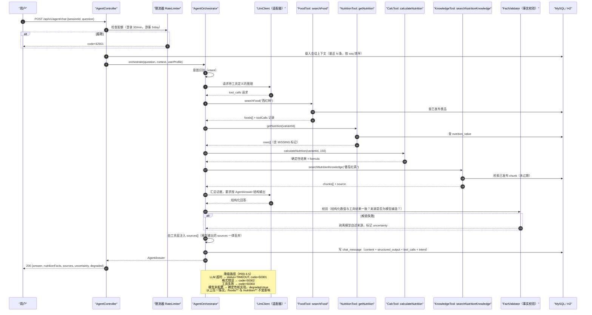
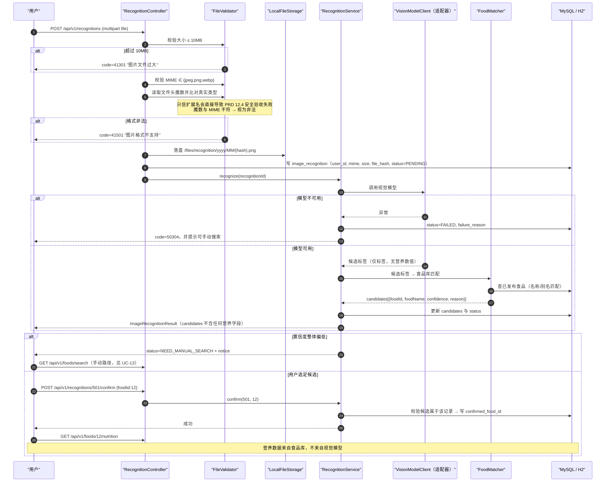

# 用户角色与用例说明 V1.0

> 交付物：对应 **PRD 第十四章第 2 项「用户角色与用例说明」**，里程碑标签 **`v0.1.0`**（阶段一：需求分析与设计）。
>
> 契约依据：`nutrition_agent/docs/PRD.md`（第三章角色与场景、第五章功能需求、第六章 Agent 需求）、
> `docs/db/schema.sql` V1.0、`docs/api-contract.md` V1.0。
> 本文件不引入任何 schema 与 API 契约之外的新表、新字段或新接口。

---

## 一、角色定义表

### 1.1 四类角色

| 角色 | 角色码 | 登录态 | 权限边界（可以做） | 明确禁止（不可做） |
| --- | --- | --- | --- | --- |
| **游客** | `GUEST` | 否 | 浏览首页与分类；搜索食品；查看已发布食品详情与营养表；关键词检索已发布知识；**有限次数** AI 问答与图片识别 | 查看他人记录；收藏；保存历史对话；访问任何 `/admin/**`；访问草稿/未审核内容 |
| **注册用户** | `USER` | 是 | 游客全部能力 + 无限次问答与识别；收藏/取消收藏；查看与删除**自己**的会话；管理个人资料与饮食偏好；删除个人数据 | 访问 `/admin/**`；访问其他用户会话/资料；发布或审核任何内容 |
| **内容管理员** | `CONTENT_ADMIN` | 是 | 食品、食品形态、图片、营养数据、知识内容的增删改；提交审核；**审核**；**发布/下架**；重建检索索引；查看审计日志 | 管理用户与角色；管理 AI 模型配置与系统参数 |
| **系统管理员** | `SYS_ADMIN` | 是 | 内容管理员全部能力 + 用户与角色管理；系统配置；运行日志、错误日志、调用统计；AI 模型配置与调用限制 | — |

> **PRD 3.1 原文约束**：内容管理员与系统管理员**可以由同一个人在初期担任，但系统权限应在设计上保持可区分**。
>
> **落地强制点**（`docs/db/schema.sql:76-96`）：角色在 `sys_role` 中以 `code` 独立建档，
> 用户与角色多对多存于 `sys_user_role`。即"同一人兼任"表现为该用户同时持有两条 `sys_user_role` 记录，
> 而不是合并成一个角色。后端鉴权按**具体权限点**判定（如 `FOOD_PUBLISH` vs `USER_MANAGE`），
> 而非按"是否管理员"的布尔值判定——这是"设计上可区分"的唯一可靠实现方式。

### 1.2 权限矩阵

| 权限点 | 游客 | 注册用户 | 内容管理员 | 系统管理员 | 契约强制点 |
| --- | :---: | :---: | :---: | :---: | --- |
| 浏览公开食品/分类/营养表 | ✅ | ✅ | ✅ | ✅ | `publish_status='PUBLISHED' AND review_status='APPROVED'`（`docs/api-contract.md:350`） |
| AI 问答 | ⚠️ 5 次/天 | ✅ 30 次/分钟 | ✅ | ✅ | `docs/api-contract.md:480` |
| 图片识别 | ⚠️ 3 次/天 | ✅ 20 次/小时 | ✅ | ✅ | `docs/api-contract.md:481` |
| 收藏 | ❌ | ✅ | ✅ | ✅ | `/users/me/favorites` 需登录（`docs/api-contract.md:433`） |
| 查看/删除会话 | ⚠️ 仅本机 `guest_key` | ✅ 仅本人 | ✅ 仅本人 | ✅ 仅本人 | 归属校验（`docs/api-contract.md:438`） |
| 增改食品/营养/知识 | ❌ | ❌ | ✅ | ✅ | `/admin/**` 否则 `40301`（`docs/api-contract.md:443`） |
| 审核 / 发布 / 下架 | ❌ | ❌ | ✅ | ✅ | 审核态与发布态分离（schema `[D6]`，`docs/db/schema.sql:39-41`） |
| 用户与角色管理、系统配置 | ❌ | ❌ | ❌ | ✅ | 角色 D 专属（`PRD.md:138-147`） |

---

## 二、用例图

> 图中把"外部 LLM 服务"和"视觉模型服务"画为**次要参与者**，因为 PRD 6.5 要求它们不可用时
> 非 AI 功能（UC-01/03/04/05/06）必须继续可用——即它们是**可降级的外部依赖**，不是系统核心链路的必经节点。

---

## 三、用例清单表

编号规则：`G`=游客主用例、`U`=登录用户、`C`=后台、`E`=异常态。所有「关联 API」均取自 `docs/api-contract.md`，路径前缀 `/api/v1`。

### 3.1 核心业务用例

| 编号 | 用例名 | 主角色 | 前置条件 | 主流程 | 异常流程 | 关联 FR 与 schema 表 | 关联 API |
| --- | --- | --- | --- | --- | --- | --- | --- |
| **UC-01** | 浏览首页与食品发现 | 游客/用户 | 无 | 1. 打开首页 2. 后端取分类列表与推荐食品 3. 展示分类入口、热门食品卡片、问答与识别入口 4. 点击卡片进入详情 | 空数据 → 展示空态提示，不报错；接口失败 → 展示重试入口 | FR-001；`food_category`、`food`（仅 `PUBLISHED`+`APPROVED`） | `GET /categories`、`GET /foods/featured` |
| **UC-02** | 按分类浏览 | 游客/用户 | 分类已启用 | 1. 选择分类 2. 后端分页查询该分类已发布食品 3. 展示卡片列表 4. 翻页 | 分类无食品 → 空态；`slug` 不存在 → 404 | FR-002；`food_category`、`food` | `GET /categories/{slug}/foods` |
| **UC-03** | 搜索食品 | 游客/用户 | 无 | 1. 输入关键词（标准名/英文名/别名） 2. 后端按优先级排序检索 3. 返回分页结果 4. 点击进入详情 | 无结果 → **明确提示"未找到"**并给手动建议，不伪造记录；关键词为空 → 返回推荐列表 | FR-002；`food`、`food_alias`（`alias_type`/`weight` 决定排序） | `GET /foods/search` |
| **UC-04** | 查看食品详情 | 游客/用户 | 食品已发布 | 1. 进入详情页 2. 返回基本信息、图片、别名、形态列表 3. 展示数据来源与更新时间 4. 提供问答与收藏入口 | 图片加载失败 → 占位图；字段缺失 → 显示"暂无数据"；食品未发布 → 404 | FR-003；`food`、`food_alias`、`food_image`、`food_state_variant` | `GET /foods/{id}` |
| **UC-05** | 查看营养表（三态） | 游客/用户 | 形态存在且有营养数据 | 1. 选择/默认形态 2. 查询 `nutrition_value` 3. 按 `display_order` 组装成表 4. `MISSING` 行渲染"暂无数据" 5. 展示 `incomplete` 与 `missingCount` | 该形态无任何数据 → `40402`；`MISSING` 行**不得**显示 0 | FR-004；`nutrition_value`（`ck_nv_status_amount`）、`nutrient`、`data_source` | `GET /foods/{id}/nutrition` |
| **UC-06** | 按重量计算营养摄入 | 游客/用户 | 形态有 `PRESENT`/`ZERO` 数据 | 1. 输入重量与单位 2. 参数校验 3. 调用确定性纯函数计算 4. 逐项返回公式与来源 5. `MISSING` 项目进 `missingNutrients` | 重量 ≤0 或 >100000 → `40002`；食品不存在 → `40401`；形态无数据 → `40402`；单位非法 → `40002` | FR-004；`nutrition_value`、`nutrient`（`unit_factor`/`base_unit` 归一）、`data_source` | `POST /nutrition/calculate` |
| **UC-07** | 查看营养素字典 | 游客/用户 | 无 | 1. 请求字典 2. 返回分组与单位 | 无 | FR-010；`nutrient` | `GET /nutrition/nutrients` |
| **UC-08** | 提问营养问题（单轮） | 游客⚠️/用户 | 模型服务可用 | 1. 提交问题 2. 校验与限流 3. 意图识别 4. 按需调用工具取结构化数据 5. 必要时检索知识库 6. 汇总证据生成回答 7. 工具层注入 `sources` 8. 结构校验与安全校验 9. 返回 `AgentAnswer` | 见 UC-30~UC-34、UC-19、UC-20；模型未配置 → 降级桩 + `degraded:true` | FR-005、FR-011；`chat_session`、`chat_message`、`food`、`nutrition_value`、`knowledge_chunk`、`operation_log` | `POST /agent/chat` |
| **UC-09** | 多轮追问 | 用户/游客 | 会话存在 | 1. 携带 `sessionId` 提问 2. 取最近上下文（含已提及食品与形态） 3. 解析指代（"它的热量呢"） 4. 复用上一轮 `variantId` 5. 返回回答 | 会话不存在 → `40404`；上下文超预算 → 截断并声明 | FR-005；`chat_session`、`chat_message`（`seq` 保序） | `POST /agent/chat`、`GET /agent/sessions/{id}/messages` |
| **UC-10** | 检索营养知识 | 游客/用户 | 知识已发布未过期 | 1. 输入关键词 2. 检索已发布 chunk 3. 返回片段 + 来源 + 适用范围 | 无命中 → `40403`；内容已过 `valid_until` → 不返回 | FR-010；`knowledge_chunk`、`knowledge_doc`、`data_source` | `GET /knowledge/search` |
| **UC-11** | 上传图片识别食品 | 游客⚠️/用户 | 无 | 1. 选择图片 2. **魔数 + MIME + 大小**校验 3. 落盘并记录 `image_recognition` 4. 调用视觉模型 5. 候选与食品库匹配 6. 返回候选（**无营养字段**） 7. 用户确认 8. 跳转食品详情 | 格式不支持 → `41501`；超 10MB → `41301`；服务不可用 → `50304`；无法识别 → `NEED_MANUAL_SEARCH` | FR-006；`image_recognition`（`candidates` JSON）、`food` | `POST /recognitions`、`POST /recognitions/{id}/confirm` |
| **UC-12** | 确认识别结果 | 游客/用户 | 识别记录存在 | 1. 选择候选食品 2. 写入 `confirmed_food_id` 3. 加载该食品营养数据 4. 提供继续提问入口 | 候选不属于该记录 → `40001`；食品已下架 → `40401` | FR-006；`image_recognition`、`food` | `POST /recognitions/{id}/confirm` |
| **UC-13** | 识别失败后手动搜索 | 游客/用户 | 识别状态为失败或不确定 | 1. 展示手动搜索入口 2. 用户搜索并自行选择食品 3. 正常进入详情 | 同 UC-03 | FR-006 验收；`food`、`food_alias` | `GET /foods/search` |
| **UC-14** | 新建 / 清空对话 | 游客/用户 | 无 | 1. 点击新建 2. 创建 `chat_session`（游客写 `guest_key`） 3. 返回空会话 | 游客配额耗尽 → `42901` | FR-005、FR-008；`chat_session` | `POST /agent/sessions` |
| **UC-15** | 收藏 / 取消收藏食品 | 用户 | 已登录、食品已发布 | 1. 点击收藏 2. 写入 `user_favorite` 3. 列表展示 | 重复收藏 → `40901`；取消后重新收藏 → 依赖 `uk_fav_user_food` 含 `deleted_at` | FR-008；`user_favorite` | `POST /users/me/favorites`、`DELETE /users/me/favorites/{foodId}` |
| **UC-16** | 管理个人资料与偏好 | 用户 | 已登录 | 1. 打开个人中心 2. 填写年龄区间/目标/偏好/过敏原 3. 保存并记录 `consent_at` 4. 可随时修改或删除 | 未授权字段不采集；非法枚举值 → `40001` | FR-007；`user_profile`（全字段可空）、`sys_user` | `GET /users/me`、`PUT /users/me/profile` |
| **UC-17** | 查看历史对话 | 用户 | 已登录 | 1. 请求列表 2. **按 `user_id` 过滤**并 `last_message_at` 倒序 3. 打开详情 | 他人会话 id → `40301` | FR-008；`chat_session`、`chat_message` | `GET /agent/sessions`、`GET /agent/sessions/{id}/messages` |
| **UC-18** | 删除对话 / 删除个人数据 | 用户 | 已登录 | 1. 发起删除 2. 校验归属 3. 逻辑删除（`deleted_at`） 4. 返回成功 | 非本人 → `40301`；不存在 → `40404` | FR-007 删除权、FR-008；`chat_session`、`sys_user`、`user_profile` | `DELETE /agent/sessions/{id}`、`DELETE /users/me/data` |
| **UC-19** | 提交超出范围的问题 | 用户/游客 | 无 | 1. 提交问题 2. 判断超范围 3. 返回明确能力边界说明与可做之事 | 返回 `50305` 并在 `uncertainty` 说明 | FR-005 交互要求；`chat_message.error_code`、`operation_log` | `POST /agent/chat`、`GET /agent/capabilities` |
| **UC-20** | 提交高风险健康问题 | 用户/游客 | 无 | 1. 提交疾病/用药/孕期等问题 2. 触发安全规则 3. **不给出个体化医疗判断** 4. 说明受疾病与用药影响 5. 建议咨询医生或注册营养师 | 返回 `50306`；高风险内容**不因免责声明而放行**（PRD 8.3） | PRD 8.3；`chat_message.error_code` | `POST /agent/chat` |

### 3.2 后台管理用例

| 编号 | 用例名 | 主角色 | 前置条件 | 主流程 | 异常流程 | 关联 FR 与 schema 表 | 关联 API |
| --- | --- | --- | --- | --- | --- | --- | --- |
| **UC-21** | 维护食品主数据 | 内容管理员 | 具备 `CONTENT_ADMIN` | 1. 新增/编辑食品基本信息 2. 设置分类与别名 3. 保存草稿 4. 写审计 | 别名冲突其他食品标准名 → `40901`；非管理员 → `40301` | FR-009、FR-002 业务规则；`food`、`food_alias`、`food_category`、`admin_audit_log` | `GET/POST /admin/foods`、`PUT/DELETE /admin/foods/{id}` |
| **UC-22** | 建立食品形态（生/熟/去皮/加工） | 内容管理员 | 食品存在 | 1. 新增形态，指定 `state` 与 `cooking_method` 2. 填写可食部比例 3. 设置默认形态 4. 提交审核 | `state=COOKED` 未填 `cooking_method` → `40001`；同一食品重复形态 → `40901` | FR-004、FR-003 `[D1]`；`food_state_variant` | `POST /admin/foods/{id}/variants` |
| **UC-23** | 录入营养数据 | 内容管理员 | 形态已建立 | 1. 选择形态与营养素 2. **必选数据来源** 3. 填写参考重量与口径 4. 选择 `PRESENT`/`ZERO`/`MISSING` 并填值 5. 保存草稿 | **缺 `sourceId` → `40001` 拒绝**；`value_status` 与 `amount` 不一致 → DB CHECK 报错 | FR-004、FR-009；`nutrition_value`、`nutrient`、`data_source` | `PUT /admin/variants/{id}/nutrition`、`GET /admin/variants/{id}/nutrition` |
| **UC-24** | 审核内容 | 内容管理员 | 内容处于 `PENDING` | 1. 查看待审内容 2. 通过或驳回 3. 写 `reviewed_by`/`reviewed_at` 4. 写审计 | 已审核内容不可重复审；驳回必填理由 | FR-009 `[D6]`；`food`、`nutrition_value`、`knowledge_doc`、`admin_audit_log` | `POST /admin/foods/{id}/review` |
| **UC-25** | 发布 / 下架内容 | 内容管理员 | 内容已 `APPROVED` | 1. 点击发布 2. 置 `publish_status='PUBLISHED'` 与 `published_at` 3. 前台立即可见 4. 下架则置 `OFFLINE` 并从前台消失 | **未审核直接发布 → 拒绝**（审核 ≠ 发布） | FR-009 `[D6]`；`food`、`food_state_variant`、`knowledge_doc` | `POST /admin/foods/{id}/publish`、`DELETE /admin/foods/{id}` |
| **UC-26** | 管理食品图片 | 内容管理员 | 食品存在 | 1. 上传图片 2. 填写类型/描述/来源/授权说明 3. 设置封面与排序 4. 提交审核 | 非法文件 → `41501`/`41301`；缺来源或授权说明 → 拒绝 | FR-003、PRD 11.2；`food_image` | `POST /admin/foods/{id}/images`、`DELETE /admin/images/{id}` |
| **UC-27** | 管理用户与角色 | 系统管理员 | 具备 `SYS_ADMIN` | 1. 查询用户 2. 分配或撤销角色 3. 启用/禁用账户 4. 写审计 | 内容管理员调用 → `40301`；不可删除自己最后一个管理角色 | 角色 D；`sys_user`、`sys_role`、`sys_user_role`、`admin_audit_log` | `GET /admin/users` |
| **UC-28** | 维护知识库与重建索引 | 内容管理员 | 知识文档存在 | 1. 新增/编辑文档与来源 2. 填写适用范围 3. 分段生成 `knowledge_chunk` 4. 审核后发布 5. 触发重建索引 | 未审核内容不得进入正式库；`valid_until` 过期不再被引用 | FR-009、FR-010；`knowledge_doc`、`knowledge_chunk`、`data_source` | `GET/POST/PUT /admin/knowledge`、`POST /admin/knowledge/reindex` |
| **UC-29** | 查看审计与运行日志 | 系统管理员 | 具备 `SYS_ADMIN` | 1. 按目标或操作人筛选 2. 查看变更前后快照 3. 查看错误与调用统计 | 日志中**不含**对话正文、个人资料、图片路径 | PRD 9.3、8.4；`admin_audit_log`、`operation_log` | `GET /admin/audit-logs` |

### 3.3 异常态用例

> 编号与错误码严格对应 `docs/api-contract.md:61-82`。异常态是**设计对象**，不是"以后再说"。

| 编号 | 异常场景 | 触发条件 | 系统行为（必须） | 绝不发生 | 错误码 | 关联 API |
| --- | --- | --- | --- | --- | --- | --- |
| **UC-30** | 食品不存在 | 用户提问或搜索一个库中不存在的食品 | 明确回复"未收录该食品"，并提供相近候选或手动检索入口 | 绝不生成该食品的营养数值；绝不把相似食品数据挪用 | `40401` | `POST /agent/chat`、`GET /foods/{id}` |
| **UC-31** | 营养数据缺失 | 形态下该营养素为 `MISSING` 或无任何记录 | 显示"暂无数据"；计算时进入 `missingNutrients`；置 `incomplete=true` | **绝不用 0 兜底**；绝不把缺失项参与求和 | `40402`（整体无数据） | `GET /foods/{id}/nutrition`、`POST /nutrition/calculate` |
| **UC-32** | 知识库无相关内容 | 检索无命中或仅有过期内容 | 返回 `40403`；Agent 据此在 `uncertainty` 声明"缺少知识依据" | 绝不编造指南、论文或来源 | `40403` | `GET /knowledge/search`、`POST /agent/chat` |
| **UC-33** | 模型服务超时 | LLM 调用超过 30s | 终止调用，记录 `latency_ms` 与 `status='TIMEOUT'`，返回明确超时提示 | 绝不无限重试；绝不返回残缺当成完整 | `50301` | `POST /agent/chat` |
| **UC-34** | 工具调用失败 | `searchFood`/`getNutrition` 等抛错 | 记录失败工具与参数到 `tool_calls`；以有限重试后降级为"仅知识回答"或明确失败 | 绝不用模型记忆替代工具结果 | `50303` | `POST /agent/chat` |
| **UC-35** | 图片识别结果不确定 | 置信度低或候选分散 | 返回多候选 + `confidence` + `notice`；`status` 可为 `NEED_MANUAL_SEARCH` | 绝不自动选定一个食品并直接给出营养分析 | — （非错误，是正常态） | `POST /recognitions` |
| **UC-36** | AI 返回格式错误 | 模型输出无法解析为约定 JSON | 丢弃该次输出，记录 `status='FAILED'`；返回格式错误提示 | 绝不把无法解析的输出透传给前端 | `50302` | `POST /agent/chat` |
| **UC-37** | 越权访问他人记录 | 请求他人 `sessionId`/收藏/资料 | 以令牌 `userId` 为准判定归属，拒绝并审计 | 绝不信任路径或请求体里的 `userId` | `40301` | `GET/DELETE /agent/sessions/{id}`、`/users/me/**` |
| **UC-38** | 未审核内容试探访问 | 非管理员直接请求草稿 id 或 `/admin/**` | 前台查询恒带 `PUBLISHED`+`APPROVED` 条件，草稿等同不存在；后台返回无权 | 绝不因"知道 id"而返回草稿 | `40301` / `40401` | 全部 `/foods/**` 与 `/admin/**` |

---

## 四、主流程时序图

### 4.1 食品查询与营养计算（含 `MISSING` 三态处理）

### 4.2 AI 问答（工具调用 + 知识检索 + sources 注入 + 事实校验）

### 4.3 图片识别（文件魔数校验 + 候选返回 + 用户确认）

---

## 五、业务规则汇总（含强制点）

> 本节的目的是证明规则**不是口号**：每条规则都必须指出它在 schema 或 API 契约中的**具体强制位置**。
> 若某条规则只有"约定"没有强制点，说明它可被绕过——那本身就是缺陷。

| # | 业务规则 | PRD 出处 | 强制点（schema / API 契约） | 强制方式 |
| --- | --- | --- | --- | --- |
| R01 | 营养数值只能来自结构化数据或确定性计算 | 6.4 输出规范、README 约束 1 | `POST /nutrition/calculate`（`docs/api-contract.md:358`）；`docs/api-contract.md:299-301` 三条硬规则 | 计算走独立接口；Agent 输出中的数值需与工具结果一致（`FactValidator`） |
| R02 | 缺失 ≠ 零：必须区分"未录入"与"已知为 0" | 5.4 第 8 条、12.1 | `nutrition_value.value_status` + `ck_nv_status_amount` CHECK（`docs/db/schema.sql:314-337`） | **数据库 CHECK 约束**，应用层漏改会被库直接拒绝 |
| R03 | 不得用 0 兜底缺失值 | 5.4 验收、README 约束 3 | API 用 `null` + `energyAvailable=false`（`docs/api-contract.md:107-108`）；`MISSING` 行不进 `items` 只进 `missingNutrients`（`docs/api-contract.md:253`） | 契约字段语义 + 前端渲染约定 |
| R04 | 营养数据来源可追溯率 100% | 2.2、8.1 | `nutrition_value.source_id` **NOT NULL** + 外键（`docs/db/schema.sql:316`）；`PUT /admin/variants/{id}/nutrition` 缺 `sourceId` 必须 `40001`（`docs/api-contract.md:465-466`） | **NOT NULL 外键 + 接口层拒绝** |
| R05 | 营养数据必须带食品状态与参考重量 | 5.3 业务规则、8.1 | `nutrition_value.variant_id` NOT NULL（`[D1]`）、`reference_amount`/`reference_unit` NOT NULL（`docs/db/schema.sql:308-312`） | 表结构强制：**营养数据无法脱离形态存在** |
| R06 | 生/熟/去皮/加工必须分别建档 | 5.3 业务规则 | `food_state_variant` 独立表 + `uk_variant_food_state`（`docs/db/schema.sql:234-254`） | 唯一约束防止同食品同形态重复；营养表只挂 variant |
| R07 | 单位换算统一处理 | 5.4 第 6 条 | `nutrient.unit` / `base_unit` / `unit_factor`（`docs/db/schema.sql:266-274`） | 单位集中在字典，数据行不写死单位 |
| R08 | 别名不能劫持其他食品的标准名 | 5.2 业务规则 | `food_alias` + `uk_alias_food`（`docs/db/schema.sql:202`）；**跨食品同名在服务层冲突校验**（`docs/db/schema.sql:201`）；冲突返回 `40901` | 表内唯一 + 服务层校验（见「⚠️ 待确认」T-04） |
| R09 | 下架 / 未审核食品不出现在公开搜索与详情 | 5.2 业务规则、5.9 | 查询恒带 `publish_status='PUBLISHED' AND review_status='APPROVED' AND deleted_at IS NULL`（`docs/api-contract.md:350`）；`idx_food_publish` 支撑（`docs/db/schema.sql:185`） | 查询条件 + 专用索引；草稿对前台等同不存在 |
| R10 | 审核 ≠ 发布，两态可分别控制 | 7.4、5.9、`[D6]` | `review_status` 与 `publish_status` 两列独立（`docs/db/schema.sql:39-41`）；`/review` 与 `/publish` 是两个接口（`docs/api-contract.md:451-452`） | **列分离 + 接口分离**，不存在"审核即上线" |
| R11 | 搜索结果排序：标准名精确 > 前缀 > 别名精确 > 别名包含 > 关键词包含 | 5.2 业务规则 | `food_alias.weight` 与 `alias_type`（`docs/db/schema.sql:194-197`）；排序规则写入契约（`docs/api-contract.md:352`） | 可配置权重；同分按 `id` 稳定排序 |
| R12 | 游客仅有限次数试用 AI 与识别 | 3.1 角色 A | `chat_session.guest_key`（`docs/db/schema.sql:403`）；限流表（`docs/api-contract.md:480-481`）：问答 5 次/天、识别 3 次/天 | 会话按 `guest_key` 归集 + 限流器；超限 `42901` |
| R13 | 越权防护：一律以令牌 userId 为准 | 12.4 | `docs/api-contract.md:438-439` 明确禁止从路径/请求体接收 `userId`；`DELETE /agent/sessions/{id}` 必须校验归属 | 接口层强制 + `40301` |
| R14 | 来源不得虚构 | FR-011 验收、README 约束 5 | `sources` **由工具层注入**，模型输出的来源一律丢弃（`docs/api-contract.md:300`） | 架构强制：模型无法写入来源字段 |
| R15 | 未审核内容不得进入正式知识库 | 5.9 业务规则 | `knowledge_doc.review_status` + `publish_status`（`docs/db/schema.sql:360-361`）；检索只取 `PUBLISHED`+`APPROVED` 且未过 `valid_until`（`docs/api-contract.md:411`） | 检索条件强制 |
| R16 | 知识内容过期后不得再被引用 | 风险表（知识库过期） | `knowledge_doc.valid_until`（`docs/db/schema.sql:363`） | 检索条件过滤 |
| R17 | 后台内容修改必须有审计记录 | 9.3 | `admin_audit_log.before_json`/`after_json`（`docs/db/schema.sql:503-504`）；内容表带 `created_by`/`updated_by`/`reviewed_by`（`[D7]`） | 表结构强制留痕 |
| R18 | 日志禁止写入敏感信息 | 8.4 | `operation_log.message` 注释明确禁止对话正文/个人资料/图片路径（`docs/db/schema.sql:527`） | 写入前过滤（见 DESIGN 横切关注点） |
| R19 | 上传文件必须校验内容而非扩展名 | 12.4 | `docs/api-contract.md:421-422`：必须校验 MIME 与文件头魔数 | 接口层强制；`image_recognition.mime_type` 非空 |
| R20 | 视觉模型只识别候选，不产出营养数值 | 5.6 业务规则 | `image_recognition.candidates` 仅 `{foodId,foodName,confidence,reason}`（`docs/db/schema.sql:456`）；`ImageRecognitionResult.candidates` 无营养字段（`docs/api-contract.md:321`） | **结构层面不可能携带营养数值** |
| R21 | 计算类结果必须标注为估算值 | 8.2 | `NutritionCalculation.estimated` 恒为 `true` + `estimatedReason`（`docs/api-contract.md:242-252`） | 契约字段恒定 |
| R22 | 个人资料必须由用户主动提供或授权 | 5.7 业务规则 | `user_profile` 全部业务字段可空 + `consent_at`（`docs/db/schema.sql:116-124`） | 结构允许"不填"，且记录授权时间 |

---

## ⚠️ 待确认

> 以下为撰写本文档时发现的 **PRD ↔ schema ↔ API 契约 ↔ ROADMAP** 之间的一致性问题。
> **本文档不擅自修改上述任何文件**，仅列出供决策。

| 编号 | 问题 | 位置 | 影响 | 建议 |
| --- | --- | --- | --- | --- |
| **T-01** | 知识库缺少发布、下架、删除接口。契约只有 `GET/POST/PUT /admin/knowledge` 与 `reindex`。 | `docs/api-contract.md:458-461` | UC-25「发布/下架」与 UC-28「审核后发布」对知识文档无接口可落；`knowledge_doc.publish_status` 无法被驱动 | 补 `POST /admin/knowledge/{id}/review`、`POST /admin/knowledge/{id}/publish`、`DELETE /admin/knowledge/{id}`，或明确知识复用食品的审核发布接口 |
| **T-02** | 营养数据缺少审核与发布接口。`nutrition_value` 有 `review_status`、`reviewed_by`、`reviewed_at`，但契约中只有 `PUT /admin/variants/{id}/nutrition`。 | `docs/db/schema.sql:318-322`；`docs/api-contract.md:454-455` | `nutrition_value` 的审核字段永远写不进去，`[D6]`「审核≠发布」在营养域失效 | 明确营养数据的审核是否随形态（variant）一并审核；若是，需在 `POST /admin/foods/{id}/variants` 与审核流程中说明 |
| **T-03** | 图片审核流程缺接口。`food_image.review_status` 默认 `PENDING`，但契约无图片审核接口。 | `docs/db/schema.sql:222`；`docs/api-contract.md:456-457` | 新上传图片将永久停留在 `PENDING`，前台可见性规则不明 | 补图片审核接口，或明确图片随食品审核一并完成 |
| **T-04** | 「别名跨食品冲突校验」只在 schema 注释中声明在服务层实现，无数据库约束。 | `docs/db/schema.sql:201` | R08（别名不劫持标准名）是 PRD 5.2 明文业务规则，当前仅靠服务层自觉 | 服务层实现时必须返回 `40901`，并补单元测试；长期可加触发器或应用启动期校验 |
| **T-05** | 游客配额无持久化载体。契约给了配额数值（5 次/天、3 次/天），schema 只有 `chat_session.guest_key`，没有配额的日维度记录表。 | `docs/api-contract.md:480-481`；`docs/db/schema.sql:403` | 游客配额若只放内存，重启即清零，PRD 3.1「有限次数」可被重启绕过 | 明确配额存储策略（内存 + 定期落库，或直接落 `operation_log`）并在契约中注明 |
| **T-06** | 角色码 `GUEST` 与 `sys_role` 的关系不明。schema 注释列出 `GUEST`，但游客不登录，无 `sys_user` 记录。 | `docs/db/schema.sql:79` | 「四类角色权限必须在设计上可区分」的表述与实现之间存在概念落差 | 建议明确：`GUEST` 仅作为**未鉴权上下文**的权限档位，不落 `sys_role`；或保留该行但注明游客不占用 `sys_user_role` |
| **T-07** | `image_recognition.session_id` 在 schema 中存在但无外键约束。 | `docs/db/schema.sql:449` | 会话删除后可能留下悬空引用；数据一致性弱于其他表 | 补 `FOREIGN KEY (session_id) REFERENCES chat_session(id)`，或注明有意不约束 |
| **T-08** | 对象存储表述不一致。ROADMAP 已知债务写"第一版图片落本地磁盘"，README 目录结构与 PRD FR-003 也提到对象存储，但契约的 `/files/**` 未说明存储后端。 | `docs/ROADMAP.md:52`；`docs/api-contract.md:472` | 存储实现层的替换边界未定义 | 在 DESIGN 中明确：`FileStorage` 接口 + `LocalFileStorage` 实现，对象存储作为第二实现，`/files/**` 路径形态不变（本文档已按此设计） |
| **T-09** | `sys_auth_token` 表存在，但 README 描述为「HMAC-SHA256 签名令牌」。签名令牌通常无需落库（无状态），而该表支持可撤销。 | `docs/db/schema.sql:98-110`；`README.md:39` | 两种令牌方案（有状态可撤销 vs 无状态签名）实现路线不同，影响登出与吊销语义 | 明确：若采用签名令牌 + 撤销白名单，`sys_auth_token` 语义需重新定义；建议在 DESIGN 中给出确定选择 |
| **T-10** | 收藏接口 `POST /users/me/favorites` 在 PRD 中属第二阶段（4.2），契约与 schema 已实现，但 ROADMAP 阶段划分未单列。 | `PRD.md:193-203`；`docs/ROADMAP.md:11` | 阶段五「用户功能与完善」包含收藏，与 PRD「二阶段增强」表述存在口径差异 | 在 ROADMAP 中注明收藏按 `v0.5.0` 交付，功能定义以 PRD FR-008 为准 |

---

## 附：用例 → 交付物追溯

| 用例组 | 主要交付物 | 里程碑 |
| --- | --- | --- |
| UC-01 ~ UC-07（食品与营养浏览） | `backend/src/main/java/com/nutritionagent/food/`、`.../nutrition/` | `v0.2.0` |
| UC-08 ~ UC-10、UC-19、UC-20（Agent 与知识） | `backend/src/main/java/com/nutritionagent/agent/`、`.../knowledge/` | `v0.3.0` |
| UC-11 ~ UC-13（图片识别） | `backend/src/main/java/com/nutritionagent/agent/`（识别工具）、前端 `/recognize` | `v0.4.0` |
| UC-14 ~ UC-18（用户功能） | `backend/src/main/java/com/nutritionagent/user/`、前端 `/chat`、`/me` | `v0.5.0` |
| UC-21 ~ UC-29（后台） | `backend/src/main/java/com/nutritionagent/admin/`、前端 `/admin/**` | `v0.5.0` |
| UC-30 ~ UC-38（异常态） | 贯穿各模块，验收记录落 `docs/acceptance/` | `v1.0.0` |
